# KNDbgX

[English](README.md) · 한국어

KNDbgX는 x64 WinDbg에 시각적인 분석 작업 화면을 제공한다. 커널 콜백과 미니필터 등록 정보, 프로세스 목록 교차 조회, 커널 스냅샷 비교, 드라이버 파일 분석 결과를 탭으로 보관한다. 결과 옆이나 별도 창에서 메모리·디스어셈블리·레지스터를 확인한다. 확장 자체는 커널 드라이버를 설치하지 않는다.

## 작업 화면 열기

x64 WinDbg, Microsoft VC++ x64 런타임, WebView2 Evergreen Runtime이 필요하다. [배포 ZIP](https://github.com/kernullist/kndbgx/releases)을 내려받아 전체를 풀고, `kndbgx.dll`이 있는 폴더를 기준으로 `runtime\dia\msdia140.dll`의 상대 경로를 유지한다.

WinDbg를 대상에 연결하고 메모리를 조사하기 전에 대상을 중단한다. 아래 DLL 경로를 압축을 푼 파일의 실제 위치로 바꾼 뒤, **WinDbg 명령 입력란**에서 실행해 확장을 로드하고 창을 연다.

```text
.load C:\path\to\kndbgx.dll
!kndbgx
```

이후에는 **KNDbgX 창**에서 작업한다. **Library**에서 명령을 찾고, **Results**에서 수집 결과를 확인하며, **Inspect**에서 Processes·Memory·Disassembly·Registers를 연다. **Windows**에서 배치와 분리된 창을 관리한다. 창을 닫아도 로드된 확장에 작업 화면이 남으며 `!kndbgx`로 다시 연다.

[커널 수집기](#kndbgx-수집기로-조사하기), [메모리 권한](#메모리-권한-조사하기), [CPU와 플랫폼 상태](#cpu와-플랫폼-상태-확인하기), [스냅샷 비교](#스냅샷-저장과-비교), [파일 분석과 진단](#파일-근거와-진단-결과-가져오기)을 살펴본 뒤 [주소 기반 작업](#주소를-따라-메모리와-코드-확인하기)으로 이어간다. [전체 명령 색인](#전체-명령-색인)에서는 미지원 항목을 포함한 등록 명령을 확인할 수 있다.

## 할 일을 찾고 실행하기

**Library**를 열거나 **Ctrl+K**를 누른다. `callback`처럼 목적에 맞는 단어를 검색하고 `!callbacks`를 선택한 뒤 Enter로 초안을 넣는다. 필요한 인자를 채우고 **Run**을 누르면 수집 결과가 **Results**의 새 탭에 열린다. **Tab**은 문법과 로드된 심볼을 완성한다. 선택이나 자동 완성만으로 명령이 실행되지는 않는다.

아래 이미지는 2026-11-15에 **0.2.0-preview.7**을 WinDbg에 로드하고 Windows 11 x64 VMware 게스트에 연결한 실제 작업 화면에서 촬영했다. 호스트 전용 관찰과 인위적으로 만든 파일·디코더 예제는 별도로 표시했다. 수와 주소는 해당 캡처의 값이므로 자신의 대상에서 관찰한 값으로 바꿔 사용한다. 커널 수집기와 Data Model 연동은 실험적 기능이다. [지원 환경과 제약](docs/SUPPORT.md)을 참고한다.


**Pin left**로 Library를 Results 옆에 고정한다. 즐겨찾기·필터·그룹 접기로 자주 쓰는 명령을 정리하고, **Investigation starting points > Kernel investigation**을 펼쳐 크래시·I/O·드라이버 분석의 시작점을 선택한다. [명령 찾기](docs/UX.md#find-and-run-commands)

## KNDbgX 수집기로 조사하기

### 커널 콜백: `!callbacks`

지원되는 커널 대상을 중단하고 **Library / Ctrl+K**에서 `!callbacks`를 찾아 실행한다. notify·object·registry 콜백의 등록 정보, 함수 주소와 소유 모듈을 확인한다. **Columns**로 표시할 필드를 고르고, **Row details**로 전체 레코드를 열거나 Routine·Pre·Post 주소를 따라 **Memory**와 **Disassembly**로 이동한다. [콜백 조사 절차](docs/UX.md#inspect-kernel-callbacks)


*등록된 콜백은 조사 자료다. 콜백의 존재나 소유 모듈만으로 후킹 또는 악성 코드라고 판정하지 않는다.*

### 미니필터 콜백: `!minifilter`

`!minifilter`(별칭 `!fltmgr`)로 필터 식별 정보·altitude와 개별 PreOperation/PostOperation 콜백을 확인한다. 연산 종류, 함수 주소, 소유 모듈을 비교하고 **Row details**나 **Export**로 전체 레코드를 확인·보관한다. [미니필터 조사 절차](docs/UX.md#follow-minifilter-registrations)


*캡처의 469행은 필터 레코드와 연산별 콜백을 합친 결과이며, 필터 469개를 뜻하지 않는다.*

### 프로세스 교차 비교: `!hiddenproc`

지원되는 커널 대상을 중단하고 **Library / Ctrl+K**에서 `!hiddenproc`를 찾아 실행한다. 원격 KD에서는 활성 프로세스 목록과 대상의 CID 테이블을 비교한다. 양쪽에서 관측한 식별 정보와 비교 결과를 한 표에서 확인하고, **Row details**로 원본 필드를 열거나 **Export**로 비교 결과를 저장한다.


*이 캡처의 집계는 전체 88·일치 88·불일치 후보 0·판정 불가 0이다. 전체는 일치 행을 포함한 비교 건수이며, 88개 프로세스 모두 양쪽에서 같은 식별 정보로 관측됐다.*

불일치 후보는 재관찰이 필요하다. 프로세스 생성·종료·PID 재사용으로도 차이가 생긴다. 입력이 불완전하면 판정 불가로 남기며, 두 목록 모두에서 빠진 프로세스는 이 비교로 찾지 못한다. [비교의 한계](docs/UX.md#compare-two-process-inventories)

### 프로세스 핸들의 접근 권한

`!handles /owner-pid 4`로 System이 가진 Process 핸들 중 VM 접근 권한이 있는 항목을 조사한다. 관찰한 PID를 `/target-pid`에 넣어 목적지를 좁힐 수도 있다. 소유자·대상·부여된 접근 권한·프로세스 간 접근 여부를 비교하고, 행을 선택해 원본 식별 정보와 마스크를 확인한다. 원격 KD에서는 게스트의 핸들 테이블을 읽는다.


*이 캡처는 System이 소유한 Process 핸들 437행을 수집하고 완료됐다. 접근 권한이 있다는 사실만으로 실제 읽기·쓰기·인젝션이 발생했다고 판단하지 않는다.*

<details>
<summary>선택한 핸들의 원본 필드 확인</summary>


[핸들 조사 절차](docs/UX.md#inspect-process-handle-access)

</details>

### 드라이버 객체·디스패치·디바이스 스택

`!driver`로 관찰한 드라이버를 고른 뒤 `!drvobj \Driver\fvevol` 또는 객체 주소로 조사한다. MajorFunction 슬롯, 핸들러 심볼과 소유 모듈을 비교한다. 디바이스 주소는 `!devstack <device-address>`로 이어서 확인한다. 꺾쇠 인자는 실제 관찰한 값으로 바꾼다.


*예제의 34행에는 드라이버·디스패치·디바이스 레코드가 포함된다. 다른 모듈을 가리키는 핸들러도 정상적인 공유 코드일 수 있으며, 소유 모듈만으로 무결성을 판정하지 않는다.*

<details>
<summary>로드된 모듈과 PE 섹션 확인</summary>

`!module fvevol`로 대상 메모리의 PE와 섹션 정보를 읽는다. `/disk`는 로컬 대상과 파일의 관계를 검증할 수 있을 때만 사용하며, 식별 정보가 일치하는 제한된 표본을 비교한다. 재배치까지 반영한 전체 이미지 무결성 검사는 아니다.

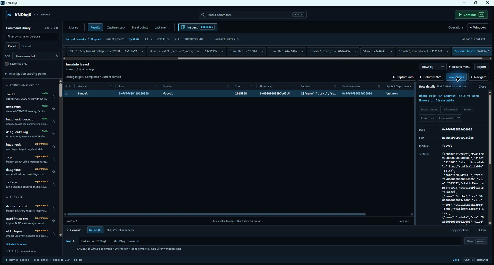

[드라이버와 모듈 조사](docs/UX.md#inspect-driver-dispatch-and-loaded-image-metadata)

</details>

### 드라이버 로드 이력

`!mapper`는 `!unloaded`·`!piddb`·`!cihash`의 결과를 함께 보관한다. 하위 레코드를 선택해 상태와 수집 범위를 보거나, 개별 명령을 실행해 별도 표로 연다. 화면의 페이지 크기 제한을 넘는 중첩 레코드는 **Export**로 보관한다.


*세 행은 하위 수집 결과이며 의심 드라이버 세 개가 아니다. 이 게스트에서는 unloaded-driver·CI 메타데이터 일부를 검증하지 못했고, 중첩 PiDDB 레코드는 화면 표시 한도를 넘었다. 기록이 없다는 사실만으로 이력 삭제나 수동 매핑을 확정하지 않는다.* [이력 조사 절차](docs/UX.md#inspect-driver-history)

### 레지스트리 하이브와 ALPC 소유자

`!hive`는 관찰한 하이브의 `GetCellRoutine`을 심볼·모듈과 연결한다. **Routine**이나 **Symbol**로 정렬해 등록 정보를 비교하고, 현재 컨텍스트의 주소를 Disassembly로 연다.


`!alpc`는 객체 네임스페이스를 순회해 ALPC 포트를 찾는다. **Row details**에서 소유 프로세스 식별 정보, 연결 포트와 네임스페이스 깊이를 함께 확인한다.


*하이브 캡처는 15행으로 완료됐다. ALPC는 순회 제한에 도달하기 전 포트 9개를 보관한 Partial 결과이며, 모든 통신 엔드포인트의 목록은 아니다.* [하이브와 ALPC 조사](docs/UX.md#inspect-hives-and-alpc-ports)

### 다른 콜백과 서비스 테이블

`!nmi`는 NMI 콜백 체인, `!hal`은 HAL 디스패치 함수 포인터, `!fwtable`은 펌웨어 테이블 공급자 등록을 조사한다. 확인할 수 있는 함수·모듈 정보와 레이아웃 공백을 결과에 남기며 등록을 변경하지 않는다.

`!ssdt`는 레이아웃과 범위를 검증할 수 있을 때 native/shadow 서비스 테이블을 수집한다. 표가 비어 있으면 **View output**에서 이유를 확인한다.

<details>
<summary>빈 SSDT 결과가 Partial로 남는 이유</summary>

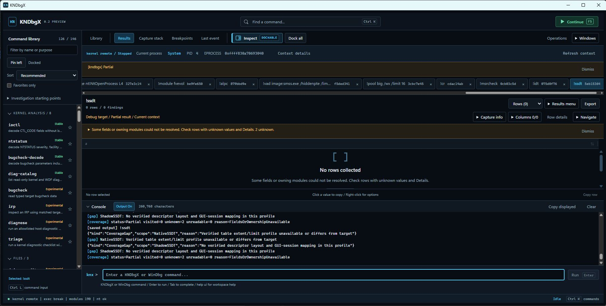

이 게스트에서는 native 테이블의 범위와 shadow descriptor·session 관계를 확인하지 못했다. 0행은 정상 판정이 아니다. [수집 한계 확인](docs/UX.md#read-a-collectors-coverage-limits)

</details>

## 메모리 권한 조사하기

### VAD와 페이지 테이블 표본

`!vad image:smss.exe /hiddenpte /limit 32`를 실행하거나 **Processes > Memory (VADs)**를 선택한다. **Row details**에서 VAD의 보호 속성과 첫·마지막 페이지 표본을 비교한다. `/exec`로 조사 범위를 좁힐 수 있고, `/limit`는 보관 행이 아닌 콘솔 표시 수를 제한한다.


*이 캡처는 24행과 판정 불가 23건을 포함한다. 전역 256페이지 한도 안의 양 끝 표본은 모든 페이지를 조사하거나 모든 은닉 매핑을 찾지 못한다.* [VAD 조사](docs/UX.md#compare-vad-protection-with-page-samples)

### 주소 변환과 실제 페이지 권한

`!kpage nt!NtOpenProcess L4`로 페이지 경계에 맞춘 네 페이지의 변환 결과를 읽는다. 물리 주소와 유효 쓰기·실행 권한을 비교한다. `!address <address>`는 변환·권한·소유 정보를 함께 보고, `vtop <address>`는 VA를 변환하며, `query <address> [length]`는 읽기 가능 여부를 확인한다. `procctx`는 디버거 연결 컨텍스트와 별개인 변환용 DTB를 선택한다.

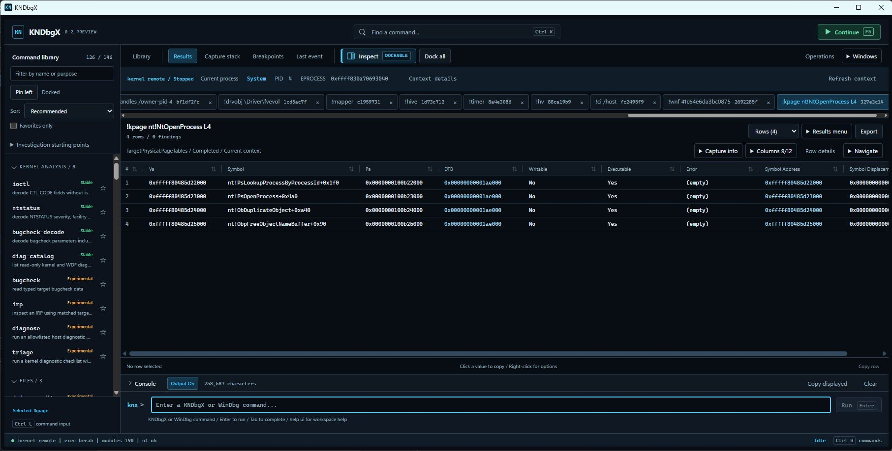

*이 네 페이지는 실행 가능·쓰기 불가로 관찰됐다. 변환 실패만으로 미매핑을 확정하지 않는다. PE 섹션 플래그나 할당 소유권은 별도로 확인해야 한다.* [페이지 조사](docs/UX.md#inspect-page-permissions-for-a-chosen-range)

### Big pool 할당과 W+X 관찰

`!pool big /wx /limit 16`을 실행한다. 대소문자를 구분하는 네 글자 `/tag`, 16진수 바이트 크기 `/min`·`/max`, `/addr`로 범위를 좁힌다. **wxObserved**, **inspectedPages**, **skippedPages**, **rangeClassified**를 함께 읽는다. `/wx`는 첫 페이지를 표본으로 조사하고 `/full`은 전역 예산 안에서 전체 페이지를 요청한다. `/wx`가 W+X 행만 필터링하는 것은 아니다.


*73행의 Partial 캡처다. 선택한 할당에서는 한 페이지를 읽고 두 페이지를 건너뛰었다. `!payload`도 같은 big pool 표본 수집을 사용하며, true·false 어느 쪽도 전체 할당의 악성 여부를 판정하지 않는다. Small pool은 이 목록의 범위 밖이다.* [Pool 조사](docs/UX.md#inspect-big-pool-allocations-and-wx-samples)

## CPU와 플랫폼 상태 확인하기

### IDT·제어 레지스터·시스템 호출 MSR

`!idt`를 실행하고 **Vector**로 정렬해 CPU별 핸들러를 비교한다. `!cr`은 저장된 CR0·CR4·CR8과 WP·SMEP·SMAP·LA57 비트를 보여준다. 두 명령 모두 저장된 프로세서 상태를 사용하며 디버거 CPU를 전환하지 않는다.


<details>
<summary>저장된 제어 레지스터와 보호 비트 확인</summary>


IDT 예제는 451개 게이트를 보관한 Partial 결과이고, 제어 레지스터 예제는 6행으로 완료됐다. 저장된 상태는 같은 순간의 실제 읽기와 다를 수 있다. [CPU 상태 조사](docs/UX.md#review-per-cpu-idt-and-control-state)

</details>

`!msrcheck`는 검증된 현재 이벤트 CPU에서 LSTAR·CSTAR·STAR·FMASK·EFER를 읽는다. 값을 비교하기 전에 **Read from**과 **Why unavailable**을 확인한다.


*이 캡처는 CPU 0만 읽었다. CPU 1은 Unknown이므로 모든 CPU의 후킹 여부를 확인한 결과가 아니다.*

### DPC 큐와 타이머

`!dpc`는 CPU별 DPC 큐를, `!timer`는 타이머 테이블을 순회한다. **CPU**·**Queue**·**Routine**·**Decode**를 함께 보고, 완료한 큐 수와 전체 예상 큐 수를 비교한다.


*타이머 캡처는 189행, 판정 불가 189건이다. 1,024개 큐를 모두 읽었지만 루틴 해석이 불가해 Partial로 남았다. 인코딩된 DPC 포인터를 확인 없이 함수 주소로 해석하지 않는다. 큐 밖에서 실행 중이거나 이미 완료된 작업은 포함하지 않는다.* [큐 조사](docs/UX.md#inspect-dpc-queues-and-timers)

### 호스트와 대상의 보안 상태

`!hv`는 **HostCpuidObservation**과 **TargetControlRegister**를 별도 레코드로 보여준다. 호스트 CPU·하이퍼바이저 CPUID와 디버깅 대상의 CR4는 출처가 다르며, 이 값만으로 게스트의 VBS나 보호 상태를 확정하지 않는다.

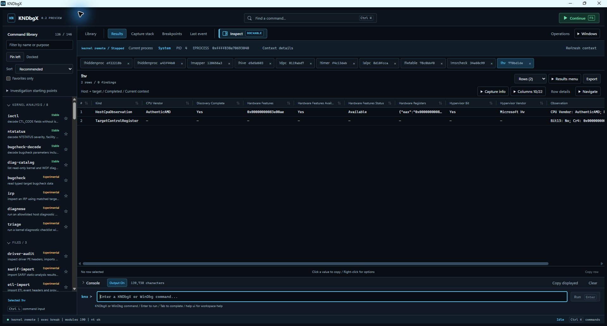

<details>
<summary>명시적인 호스트 CI/HVCI 조회와 로컬 KD 전용 기능</summary>

`!ci /host`는 디버거 호스트의 공개 CI/HVCI 플래그를 명시적으로 조회한다. `/host`가 없는 `!ci`는 검증된 로컬 KD가 필요하다. 아래 화면은 원격 VMware 게스트 정책이 아닌 **호스트 정보**다.

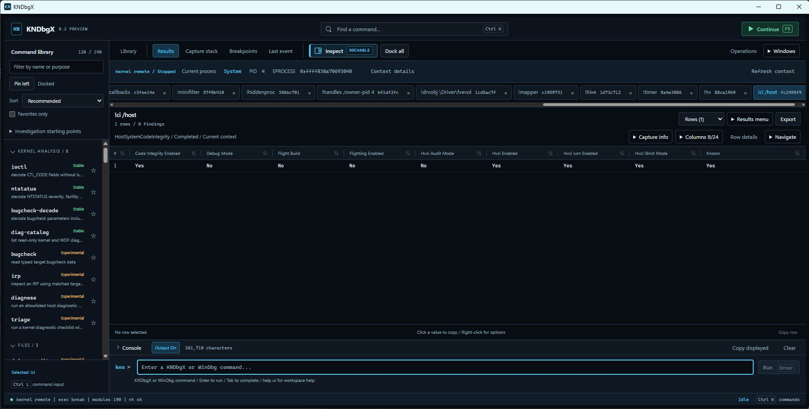

`!wfp`는 BFE filter·callout·provider·sublayer·layer를 열거하고, `!dma`는 DMAR/IVRS 펌웨어 테이블을 관찰한다. `!byovd`는 로컬 드라이버 파일의 SHA-256을 사용자가 제공한 카탈로그와 비교한다. 세 명령 모두 검증된 로컬 KD가 필요하므로 이 원격 게스트에는 사용할 수 없다. 테이블 존재는 DMA 보호 활성화의 증명이 아니며, 해시 일치는 악용 가능성이나 로드된 이미지의 무결성을 확정하지 않는다. [플랫폼 범위와 카탈로그 설정](docs/UX.md#distinguish-host-and-target-security-state)

</details>

### ETW 로거 메타데이터

`!etw`로 대상 host silo의 로거 ID와 clock 표현 등 메타데이터를 조사한다. **Capture info / View output**에서 레이아웃 공백과 실제 빈 목록을 구분한다.

<details>
<summary>이 게스트에서 확인하지 못한 ETW 메타데이터</summary>


저장소·형식 관계를 확인하지 못해 0행, 판정 불가 1건으로 남았다. ETW가 비활성화됐다는 뜻이 아니다. 이 명령은 추적을 시작하지 않으며 호스트 로거를 게스트 정보로 대신하지 않는다. [ETW 조사](docs/UX.md#inspect-etw-logger-metadata)

</details>

## 스냅샷 저장과 비교

기준 상태를 저장하고 비교할 조사 단계를 수행한 뒤, 대상을 다시 중단하고 다른 **새 디렉터리**에 저장한다.

```text
!snapshot "C:\captures\before"
!snapshot "C:\captures\after"
!diff "C:\captures\before" "C:\captures\after"
```

**Artifact Committed**는 번들 저장 여부, **Collection Complete**는 수집 완전성을 각각 나타낸다. Snapshot v2는 프로세스·모듈·콜백·SSDT·IDT·제어 레지스터·HAL·드라이버 언로드 이벤트와 manifest 체크섬을 담는다. 수집은 순차적이며 원자적이지 않고, 원시 메모리는 포함하지 않는다.


비교 표에서 **State**를 정렬하고 **Row details**로 전후 레코드를 읽는다. 식별 정보나 입력이 불완전하면 근거 없는 Added/Removed 대신 Unknown으로 남긴다.


*비교 화면은 위에서 새로 저장한 번들과 별개인 기존 번들 쌍을 다시 열었다. 이 예제는 디버거 세션 재초기화를 사이에 둔 비교다. 1,551행 중 Unknown 1,534개와 Unchanged 17개이며, 모든 차이가 중간의 한 동작 때문에 발생했다는 뜻은 아니다.*

<details>
<summary>세션 검사·전후 원본·레거시 가져오기</summary>

세션 식별 정보가 다르면 `!diff "C:\captures\before" "C:\captures\after" /cross-session`을 명시해야 한다. 세션 간 프로세스 식별 정보와 언로드 이벤트는 여전히 비교 불가다.

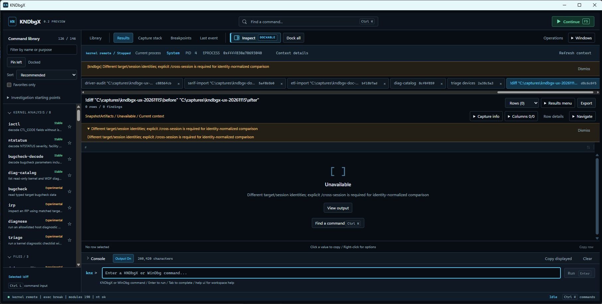


`!snapshot-import <text-file> <new-directory>`는 지원되는 레거시 텍스트를 Unknown 수집 범위의 번들로 가져온다. 오프라인 행의 저장된 주소는 현재 대상 주소로 연결되지 않는다. [스냅샷 절차](docs/UX.md#save-and-compare-kernel-snapshots)

</details>

## 파일 근거와 진단 결과 가져오기

### 드라이버 파일 분석

호스트 파일에 `driver-audit "C:\evidence\driver.sys"`를 실행한다. PE 식별 정보·완화 기능 선언·섹션·import·내장 서명 정책을 행으로 읽는다. 로드된 모듈과 연결하기 전에 **FileEvidence**의 경로·해시가 대상과 맞는지 확인한다.


*예제는 호스트 `disk.sys` 사본을 읽은 121행이며 게스트 드라이버와의 관계는 검증하지 않았다. 선언된 완화 비트가 실행 중 강제를 증명하지 않는다.*

<details>
<summary>내장 서명 정책과 검사하지 않은 범위</summary>


호스트 신뢰 정책을 사용하며 카탈로그 서명·폐기 여부·대상의 서명/HVCI 정책은 평가하지 않는다. NoEmbeddedSignature는 서명되지 않은 드라이버라는 판정이 아니다. [드라이버 파일 분석](docs/UX.md#audit-a-driver-file)

</details>

### SARIF와 ETL 가져오기

`sarif-import "C:\evidence\analysis.sarif"`를 실행하고 **StaticFinding**을 선택한다. **Row details**에서 규칙·수준·메시지·소스 위치를 확인하고 run·파일 근거 행에서 출처를 읽는다.


*문서용 예제임을 명시한 파일을 사용한 화면이다. 가져온 항목은 분석기의 출력이며, 독립적으로 확인된 결함이나 디버깅 대상과 자동 연결된 결과가 아니다.*

`etl-import "C:\evidence\trace.etl" 2048`로 기록된 이벤트 헤더·공급자 메타데이터·제한된 payload 미리보기를 읽는다. 10진수 이벤트 한도의 기본값은 2,048이며 최대 16,384다.


*기존에 만든 시험용 trace의 이벤트 5행과 요약 1행이다. 메타데이터 공백 3건으로 Partial이며 게스트 trace가 아니다. 가져오기는 추적을 시작하거나 임의 WPP payload를 해석하거나 DPC 지연을 추론하지 않는다.* [파일 가져오기 절차](docs/UX.md#import-sarif-and-etl-files)

### 진단 체크리스트·크래시·IRP

`diag-catalog`로 53개 레시피를 찾아본다. `diagnose <recipe> [operand]`는 한 항목, `triage devices`는 storage·USB·PnP 체크리스트를 실행한다. crash·hang·I/O·power·memory·network·WDF 프로필도 있으며 WDF에는 모듈 인자가 필요하다.


KNDbgX는 기존 WinDbg 확장 호출을 단계별 레코드·저장된 출력·컨텍스트 복구 관찰로 감싼다. **attempted**·**engineAccepted**·**contextRestored**와 건너뛴 이유를 확인한다. 엔진이 명령을 수락했다는 사실이 데이터의 완전성을 증명하지 않는다.


<details>
<summary>저장된 네이티브 출력과 크래시·I/O 객체 확인</summary>


셀 미리보기가 짧게 표시되면 **View output**이나 **Raw record**로 읽는다. 이 실행은 storage·USB를 시도하고 기한이 지나 PnP를 건너뛰었다. 진행 중인 네이티브 호출은 기한보다 오래 걸릴 수 있다.

`bugcheck`는 대상의 형식화된 버그체크 정보를, `irp <address>`는 일치하는 PDB 레이아웃으로 관찰한 IRP를 읽는다. `bugcheck-decode <hex-code> <p1> <p2> <p3> <p4>`는 크래시를 발생시키지 않고 입력값을 해석하며 지원하는 KASAN 사례도 포함한다. [진단 절차](docs/UX.md#run-a-diagnostic-checklist)

</details>

### 숫자 값 디코더

`ioctl 222004`로 CTL_CODE 필드, `ntstatus c0000005`로 상태의 severity·facility·code, `!wnf 41c64e6da3bc0875`로 WNF 상태 이름 필드를 해석한다. 입력된 숫자를 해석하는 기능이며 `ioctl`은 실제 요청을 보내지 않는다.

<details>
<summary>문서용 WNF 디코딩 예제</summary>

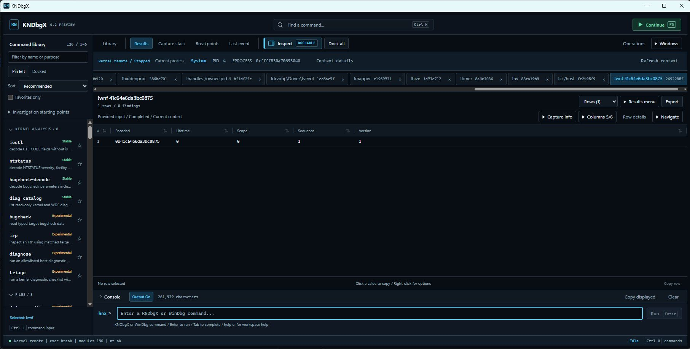

이 숫자는 문서용으로 구성했다. 게스트의 구독·상태 payload·WNF 보안 속성을 수집한 결과가 아니다. [디코더 사용법](docs/UX.md#decode-values-without-reading-the-target)

</details>

## 주소를 따라 메모리와 코드 확인하기

결과 행을 선택하고 **Row details**에서 **Open Memory** 또는 **Disassemble**을 누른다. 콜백 행에서는 Routine·Pre·Post를 구분해서 선택한다. 인식 가능한 주소 셀을 오른쪽 클릭해도 **Open Memory / Open Disassembly**를 사용할 수 있다. 읽기 전에 원본 결과와 프로세스 컨텍스트를 확인한다.

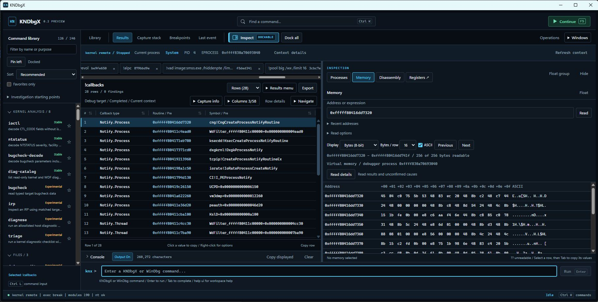

**Memory > Read options**에서 Virtual/Physical과 바이트 수를 고른다. 저장된 바이트로 byte/word/dword/qword·ASCII 표시를 바꿀 수 있으며 `??`는 읽지 못한 바이트다. **Read details**에는 컨텍스트·범위·실제 읽은 수·네이티브 오류가 남는다. `s <address> L<bytes> <byte...>`로 제한된 범위를 검색할 수도 있다.

<details>
<summary>주소 작업과 저장된 메모리 읽기 상세</summary>

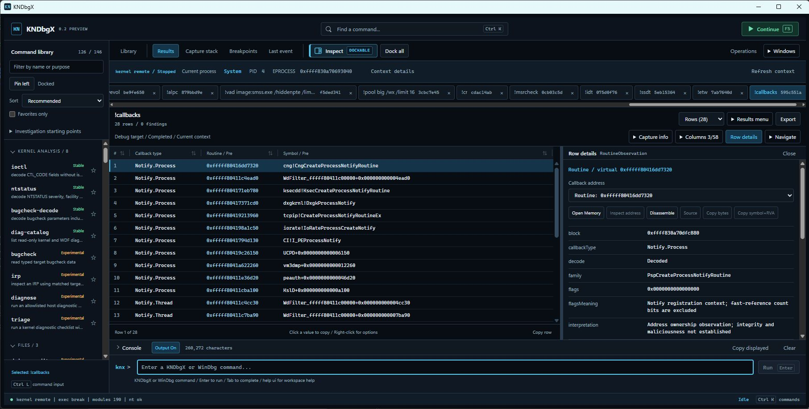


Previous/Next는 성공적으로 읽은 범위를 기준으로 이동한다. 주소를 수정하거나 컨텍스트가 바뀌면 새 읽기가 필요하다. 과거 또는 불일치 결과는 현재 대상 읽기의 근거로 사용하지 않는다. [Memory 사용법](docs/UX.md#memory-tab)

</details>

### 디스어셈블리·레지스터·부동 창

**Disassembly**는 Current IP·Next instructions·Follow IP·브레이크포인트 표시를 제공한다. 명령어를 선택해 주소 작업을 수행하며 `u`·`uf`로도 결과를 보관한다. **Registers**는 필터·고정·변경 표시·벡터 원시 바이트와 캡처 당시 CPU·스레드 식별 정보를 제공한다.

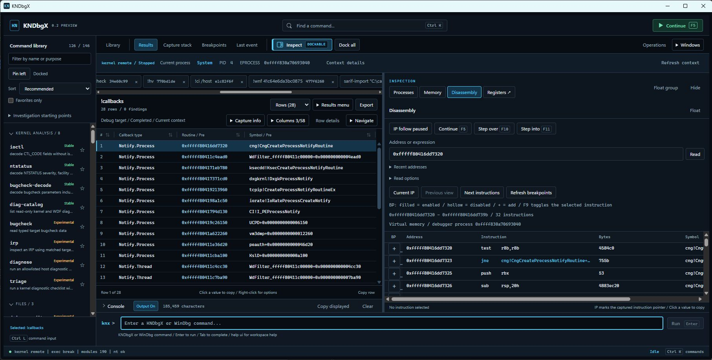

<details>
<summary>레지스터와 독립된 검사 창</summary>


각 뷰는 **Float**로, Inspect 전체는 **Float group**으로 분리한다. 제목 표시줄의 도킹 가이드나 **Windows > Dock all views**로 돌아온다. **Bring windows into view**는 화면 밖 창을 되찾는다. 모든 창은 하나의 디버거 컨텍스트와 실행 슬롯을 공유한다.


[부동 창 사용법](docs/UX.md#floating-inspection-windows)

</details>

`navigate va <address>`·`navigate pa <address>`는 주소 공간을 구분한 관찰을 보관한다. `history`·`back`·`forward`·`bookmark "note"`·`bookmarks`로 저장된 결과를 다시 찾는다. 이력 이동은 예전 주소를 다시 읽지 않는다. 검사 뷰의 **Recent** 목록은 선택한 식을 현재 컨텍스트에서 읽는 별도 기능이다. `source [address]`는 가능한 경우 호스트의 소스 조회를 사용한다.

## 프로세스에서 조사 시작하기

**Inspect > Processes**에서 프로세스를 선택하고 **Open details**, **Threads**, **Memory (VADs)** 또는 **Token**을 누른다. 프로세스 목록을 유지하면서 별도 결과 탭이 열린다. 결과 탭을 더블클릭하면 알아보기 쉬운 이름을 붙일 수 있다.


이미지·PID로 검색하고 EPROCESS·DTB·생성 시각을 확인한다. `!dml_proc`·`!process 0`은 프로세스를 열거하고, `!process pid:4`·`!threads pid:4`·`!token pid:4`는 대상을 명시한다. 선택자 없는 `!threads`는 현재 스레드를, `!token`은 활성 impersonation 토큰이 있으면 그것을, 없으면 현재 프로세스의 primary 토큰을 읽는다.

행 선택만으로 디버거의 주소 공간이 바뀌지는 않는다. **Attach address space**는 별도로 검증하는 동작이며, 레지스터의 스레드/CPU 컨텍스트도 구분한다. 목록이 불완전하면 이미지 이름으로 선택하지 못할 수 있으므로 관찰한 PID나 EPROCESS를 사용한다. [프로세스 조사](docs/UX.md#processes-tab)

## 컨텍스트와 심볼 확인하기

**Context details**에서 선택한 프로세스·암시적 주소 공간·디버거 스레드/CPU·scope·마지막 이벤트를 구분한다. **Refresh context**로 관찰을 갱신한다.


**Symbols**에서 **Read modules**를 누르고 모듈을 고른 뒤 **Inspect selected module**을 실행한다. Type/Field에 `_EPROCESS`·`UniqueProcessId` 같은 이름을 넣어 메타데이터 가용성을 확인할 수 있다. 이미지/PDB 일치와 비공개 필드 가용성은 별개다. **Insert reload draft**는 명령 초안만 넣는다.


<details>
<summary>Results에서 형식 레이아웃과 값 살펴보기</summary>

`dt nt!_EPROCESS`로 필드 offset·size·비트 범위·출처를 읽는다. 실제 필드 값이 필요하면 관찰한 인스턴스 주소를 뒤에 넣는다. **Offset**으로 정렬하거나 개별 레코드를 확인한다.


이 캡처는 인스턴스 없이 레이아웃만 요청했다. 없는 형식 이름이나 선택적 메타데이터는 확인 불가로 남는다. `lm`·`x`·`ln`·`.sympath`·`.reload`로 모듈과 심볼을 다룰 수 있지만, 같은 PDB를 반복 로드한다고 없는 비공개 형식이 생기지는 않는다. [심볼 조사](docs/UX.md#context-symbols-and-waits)

</details>

## 결과 보관·실행 제어·작업 복구

### 결과 탭과 내보내기

다시 수집하지 않고 탭을 전환한다. 더블클릭/F2로 이름을 바꾸고 끌어서 순서를 조정한다. **Columns**·정렬·전체 셀 값 복사·**Row details**로 필요한 필드를 살펴본다. 숨긴 열도 저장된 결과에 남는다. **Capture info**는 출처와 범위를 설명하며, **Export**는 화면 밖 행과 저장된 출력을 포함한 전체 결과를 내보낸다.

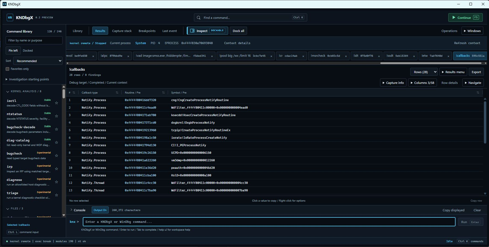

기본 저장 위치는 `%LOCALAPPDATA%\kndbgx\logs`이며 **Copy saved path**로 확인된 경로를 가져온다. 다른 위치는 `results`에서 ID를 찾은 뒤 `result-export <id> "C:\captures\result.json"`으로 지정한다. `result-read <id> [row-offset] [finding-offset]`는 저장된 데이터를 나눠 읽는다. 최근 비고정 결과 16개와 열린 탭의 보호된 결과 128개가 64 MiB를 공유하므로 퇴출이나 DLL unload 전에 내보낸다. [저장과 복구](docs/UX.md#export-and-recovery)

### Operations·취소·백그라운드 작업

**Operations**는 단계·경과 시간·취소 상태·보관된 결과를 보여준다. **Cancel operation**은 협력적 취소를 요청하므로 진행 중인 네이티브 심볼·메모리 호출이 먼저 반환해야 한다. **Refresh outcomes**는 재실행 없이 기존 결과를 조회한다. 수동 갱신만 원하면 자동 inspection 읽기를 일시 중지한다.


<details>
<summary>제한 시간 뒤 남은 결과의 수집 범위 확인</summary>

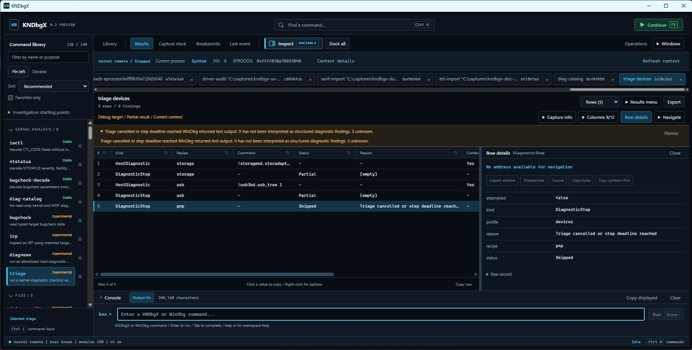

이 실행은 취소 요청 없이 단계 제한 시간에 도달했다. PnP는 **attempted: false**와 Skipped로 남고, 앞선 단계의 출력은 보관된다. 보관된 행이 완전한 목록을 의미하지는 않는다. `submit <command>`·`jobs`·`job <id>`·`cancel <id>`로도 백그라운드 작업을 관리한다. 엔진 작업은 한 번에 하나만 실행된다. [Operations 사용법](docs/UX.md#context-symbols-and-waits)

</details>

### 실행 제어와 승인된 변경

지원되는 live 대상에서 **Continue / Break**, F5와 Disassembly의 F10/F11을 사용한다. **Breakpoints**는 설정, **Last event**는 이벤트 정보를 별도로 보여준다. Disassembly의 명령어 표에 포커스가 있고 선택한 명령어에 브레이크포인트가 없을 때 F9는 추가 미리보기를 연다. 명령어 옆 **+**도 같은 동작이다. 기존 브레이크포인트가 하나 있으면 F9나 채워진/빈 표시는 추가 미리보기 없이 바로 비활성/활성으로 전환한다. 여러 개가 겹치면 브레이크포인트 목록을 연다. Add/Delete는 미리보기 승인이 필요하며 Enable/Disable은 클릭 시 컨텍스트에 연결된 동작을 적용한다.


*이 캡처의 미리보기는 취소했다. 브레이크포인트 적용·스텝·대상 메모리 쓰기를 검증한 화면은 아니다.*

등록된 `eb`·`ew`·`ed`·`eq`·`f`·`setfield` 변경은 `plan <mutation-command>`와 일회용 승인을 사용한다. `approve <plan-id> <approval-token>` 전에 원본·변경 바이트, 형식·필드와 대상 컨텍스트를 확인한다. 계획은 60초 후 만료되며 컨텍스트·원본 바이트를 다시 검사한다. 부분 쓰기는 자동 재시도나 롤백을 하지 않는다. `debug-plan`·`debug-approve`는 별도의 브레이크포인트·실행 계획 흐름이다. [변경 절차](docs/UX.md#execution-and-changes)

<details>
<summary>대상 실행 중에도 남는 과거 결과</summary>


과거 캡처는 읽을 수 있지만 새 대상 작업을 허가하지 않는다. 다시 읽으려면 대상을 중단하고 갱신한다.

</details>

### 덤프·메모리 내보내기·Data Model

`dump-raw <address> <length> "C:\captures\range.bin"`은 제한된 VA 범위를, `/phys`는 PA 범위를 저장한다. `dump-pe <module|address> "C:\captures\mapped.bin"`은 매핑된 이미지를 저장한다. 출력 한도는 64 MiB이며 요청한 바이트를 읽지 못하면 출력 파일을 게시하지 않는다. 매핑된 PE는 가상 섹션 offset을 사용하며 원래 디스크 파일을 재구성하지 않는다. `.dump <path>`는 호스트 엔진으로 덤프를 만들고 `dump-analyze <path>`는 기존 덤프 헤더를 조사한다.

`IHostDataModelAccess`가 있는 호스트에서는 `model publish <result-id>`로 최대 128행과 128개 finding을 `Debugger.Models.KNDbgX`에 복사해 `dx`로 읽을 수 있다. 복사된 값은 확장 unload 후에도 읽을 수 있으며 대상을 다시 읽지 않는다. 미지원 호스트에서도 일반 CLI/UI 결과는 유지된다. [명령과 제약](docs/COMMANDS.md#limits)

[사용법 문서](docs/UX.md)에서 상세 절차와 [단축키](docs/UX.md#shortcuts)를 확인한다. UI 초기화에 실패해도 WinDbg에서 `!kndbgx !callbacks`처럼 작업 명령 앞에 `!kndbgx`를 붙여 CLI로 실행할 수 있다.

## 전체 명령 색인

**등록 명령 126개 전체**를 아래에 기록했다. **Stable·Experimental 항목 121개**, **Unsupported 항목 5개**와 **별칭 20개**를 포함하며 조사 작업별로 묶었다. 등록 정보에서 생성한 [명령 참조](docs/COMMANDS.md)는 등록 문법·대상 모드 메타데이터의 기준이고, 아래 표는 각 항목의 기능과 사용 예제를 설명한다.

예제는 **KNDbgX 명령 입력란**에 입력한다. WinDbg에서 실행할 때는 `!kndbgx`를 앞에 붙인다. UI의 `!callbacks`는 `!kndbgx !callbacks`, `db <va> L20`은 `!kndbgx db <va> L20`이 된다. 같은 이름의 네이티브 WinDbg 명령과 구분해서 사용한다.

**표기:** `<...>`는 바꿔 넣을 값, `[...]`는 선택 인자, `|`는 대안이다. 표기 기호 자체를 입력하지 않는다. 자리표시자가 있는 예제는 그대로 붙여 넣는 명령이 아닌 템플릿이다. 주소·객체 식별 정보·ID는 현재 대상과 결과에서 얻고, 따옴표로 묶은 파일 경로는 디버거 호스트 기준으로 지정한다. 각 명령은 한 줄씩 따로 실행한다.

**사용 조건:** Stable·Experimental 표시는 [지원 환경](docs/SUPPORT.md) 안에서의 구분이며 모든 Windows 빌드에서 완전한 수집을 보장하지 않는다. 라이브 대상 메모리를 조사하기 전에 중단한다. 라이브 커널 전용·검증된 로컬 KD 조건은 각 항목에 표시했다. `submit` 같은 래퍼에도 하위 명령의 조건이 적용된다. 레이아웃·페이지 누락은 Partial 또는 Unavailable로 남는다.

**숫자:** `pid:` 선택자·PID 필터·스택 제한·결과 오프셋·ETL 제한·VAD와 풀의 `/limit`는 10진수다. 메모리 표시·디스어셈블리의 `L` 개수, 바이트 패턴과 변경 값은 16진수이며 `L20`은 요소 32개다. 풀의 `/min`·`/max`는 16진수 바이트 크기다. 변경이나 내보내기 전에 `help <command>`로 항목을 확인한다.

- [커널 콜백·필터·드라이버 조사](#커널-콜백필터드라이버-조사)
- [프로세스·스레드·토큰·주소 공간](#프로세스스레드토큰주소-공간)
- [페이지 변환·권한·풀](#페이지-변환권한풀)
- [CPU·커널 테이블·플랫폼 상태](#cpu커널-테이블플랫폼-상태)
- [스냅샷 수집·비교·가져오기](#스냅샷-수집비교가져오기)
- [커널 진단·값 디코더](#커널-진단값-디코더)
- [호스트 파일 증거·덤프 내보내기](#호스트-파일-증거덤프-내보내기)
- [가상·물리 메모리 읽기](#가상물리-메모리-읽기)
- [심볼·형식·디스어셈블리](#심볼형식디스어셈블리)
- [디버거 컨텍스트·저장된 탐색](#디버거-컨텍스트저장된-탐색)
- [보관 결과·Data Model·작업](#보관-결과data-model작업)
- [메모리 변경 계획·실행 제어](#메모리-변경-계획실행-제어)
- [세션·도움말·네이티브 명령 전달](#세션도움말네이티브-명령-전달)
- [등록되어 있지만 미지원인 명령](#등록되어-있지만-미지원인-명령)

### 커널 콜백·필터·드라이버 조사

이 수집기들은 Experimental이며, 사용할 수 있는 심볼·레이아웃이 있는 x64 커널 대상이 필요하다. 등록 정보와 소유 모듈은 관찰 자료이며 무결성·악성 판정이 아니다. 빈 결과를 해석하기 전에 Partial·Unknown 범위를 확인한다.

<details>
<summary>16개 명령 — 기능·문법·예제 보기</summary>

| 명령·별칭 | 기능·사용 조건 | 문법·예제 |
|---|---|---|
| `!callbacks` | notify·object·registry 콜백 함수와 소유 모듈을 나열한다.<br>Experimental · x64 커널·덤프 | `!callbacks`<br>예제: `!callbacks` |
| `!minifilter`<br>별칭: `!fltmgr` | 미니필터·altitude·PreOperation/PostOperation 콜백을 나열한다.<br>Experimental · x64 커널·덤프 | `!minifilter`<br>예제: `!minifilter` |
| `!driver` | \Driver 네임스페이스의 드라이버 객체를 열거한다.<br>Experimental · x64 커널·덤프 | `!driver`<br>예제: `!driver` |
| `!drvobj` | DRIVER_OBJECT, IRP 디스패치 슬롯과 연결된 디바이스를 확인한다.<br>Experimental · x64 커널·덤프 | `!drvobj <name\|address>`<br>예제: `!drvobj \Driver\fvevol`<br>`!drvobj <driver-object>` |
| `!devstack` | 관찰한 디바이스 객체의 연결된 디바이스 스택을 순회한다.<br>Experimental · x64 커널·덤프 | `!devstack <device-address>`<br>예제: `!devstack <device-address>` |
| `!module` | 로드된 PE의 식별 정보와 섹션 메타데이터를 읽는다. /disk 파일 비교는 검증된 로컬 KD에서만 가능하다.<br>Experimental · x64 커널·덤프 | `!module [module] [/disk]`<br>예제: `!module fvevol`<br>`!module fvevol /disk` |
| `!unloaded` | 남아 있는 MmUnloadedDrivers 항목을 확인한다. 기록 부재가 이력 삭제의 증거는 아니다.<br>Experimental · x64 커널·덤프 | `!unloaded`<br>예제: `!unloaded` |
| `!piddb` | 레이아웃과 항목을 검증할 수 있을 때 PiDDBCacheTable을 순회한다.<br>Experimental · x64 커널·덤프 | `!piddb`<br>예제: `!piddb` |
| `!cihash` | 필요한 레이아웃이 있을 때 커널 CI 해시 버킷 메타데이터를 확인한다.<br>Experimental · x64 커널·덤프 | `!cihash`<br>예제: `!cihash` |
| `!mapper` | !unloaded·!piddb·!cihash를 함께 수집하고 각 하위 결과와 수집 범위를 보존한다.<br>Experimental · x64 커널·덤프 | `!mapper`<br>예제: `!mapper` |
| `!nmi` | 등록된 NMI 콜백을 순회하고 가능한 함수 정보를 해석한다.<br>Experimental · x64 커널·덤프 | `!nmi`<br>예제: `!nmi` |
| `!hal` | 검증된 HAL 디스패치 포인터와 소유 모듈을 확인한다.<br>Experimental · x64 커널·덤프 | `!hal`<br>예제: `!hal` |
| `!hive` | 레지스트리 하이브의 GetCellRoutine 주소와 소유 모듈을 나열한다.<br>Experimental · x64 커널·덤프 | `!hive`<br>예제: `!hive` |
| `!alpc` | 제한된 객체 네임스페이스 순회로 ALPC 포트를 찾고 소유자·연결 정보를 확인한다.<br>Experimental · x64 커널·덤프 | `!alpc`<br>예제: `!alpc` |
| `!fwtable` | 대상 레이아웃을 알 수 있을 때 등록된 펌웨어 테이블 공급자를 확인한다.<br>Experimental · x64 커널·덤프 | `!fwtable`<br>예제: `!fwtable` |
| `!etw` | 대상의 ETW 로거 메타데이터를 확인한다. 추적을 시작하거나 InfinityHook 여부를 판정하지 않는다.<br>Experimental · x64 커널·덤프 | `!etw`<br>예제: `!etw` |

</details>

### 프로세스·스레드·토큰·주소 공간

프로세스 선택자는 `pid:<10진수-pid>`, `image:<이름>`, `eprocess:<16진수-주소>`를 사용한다. 이름으로 선택하려면 완전한 목록이 필요하다. `!hiddenproc`·`!handles`는 라이브 커널이 필요하고, 이 분류의 다른 수집 명령은 커널 덤프도 지원한다. `/owner`·`/target`은 PID 필터의 짧은 이름이다. `/json`은 호스트 경로에 저장한다.

<details>
<summary>8개 명령 — 기능·문법·예제 보기</summary>

| 명령·별칭 | 기능·사용 조건 | 문법·예제 |
|---|---|---|
| `!dml_proc`<br>별칭: `!processes` | PID·이미지·EPROCESS·DTB를 나열한다. 특정 프로세스 선택과 JSON 저장도 지원한다.<br>Experimental · x64 커널·덤프 | `!dml_proc [pid:PID\|image:NAME\|eprocess:ADDRESS] [/json path]`<br>예제: `!dml_proc`<br>`!dml_proc pid:4 /json "C:\captures\process.json"` |
| `!process` | 현재 프로세스 또는 지정한 프로세스를 읽는다. 0을 지정하면 전체 프로세스를 나열한다.<br>Experimental · x64 커널·덤프 | `!process [process\|0]`<br>예제: `!process`<br>`!process 0`<br>`!process pid:4` |
| `!threads` | 선택자를 생략하면 현재 ETHREAD를 읽고, 프로세스를 지정하면 해당 프로세스의 스레드를 나열한다.<br>Experimental · x64 커널·덤프 | `!threads [process\|ethread:ADDRESS]`<br>예제: `!threads`<br>`!threads pid:4`<br>`!threads ethread:<thread-address>` |
| `!hiddenproc` | 원격 KD에서는 활성 목록과 CID를, 검증된 로컬 KD에서는 Toolhelp와 비교한다. 불일치는 은닉 확정이 아닌 재확인 후보다.<br>Experimental · 라이브 x64 커널 | `!hiddenproc`<br>예제: `!hiddenproc` |
| `!handles` | VM 접근 권한이 있는 Process 핸들을 소유자·대상 PID로 좁혀 확인한다. 권한 보유가 실제 사용을 뜻하지는 않는다.<br>Experimental · 라이브 x64 커널 | `!handles [/owner-pid PID] [/target-pid PID] [/json path]`<br>예제: `!handles /owner-pid 4`<br>`!handles /owner-pid 4 /target-pid <pid> /json "C:\captures\handles.json"` |
| `!token` | 현재 스레드의 유효 토큰 또는 지정한 프로세스의 주 토큰을 읽는다.<br>Experimental · x64 커널·덤프 | `!token [process]`<br>예제: `!token`<br>`!token pid:4` |
| `!vad` | 현재 또는 지정한 프로세스의 VAD를 순회한다. /exec는 실행 가능 VAD 선택, /hiddenpte는 페이지 표본 추가, /limit는 콘솔 표시 제한이다.<br>Experimental · x64 커널·덤프 | `!vad [process] [/exec] [/hiddenpte] [/limit count] [/json path]`<br>예제: `!vad`<br>`!vad image:smss.exe /exec /hiddenpte /limit 32 /json "C:\captures\vad.json"` |
| `procctx` | 수동 주소 변환용 DTB를 조회·설정·해제한다. 디버거의 프로세스·스레드·레지스터 컨텍스트는 바꾸지 않는다.<br>Stable · 연결된 대상·덤프 | `procctx [show\|reset\|pid:<id>\|eprocess:<address>]`<br>예제: `procctx show`<br>`procctx pid:4`<br>`procctx reset` |

</details>

### 페이지 변환·권한·풀

페이지 명령에는 x64 커널 대상이 필요하다. Big pool 명령은 라이브 커널이 필요하며 small pool은 열거하지 않는다. `/tag`(`/t`)는 대소문자를 구분하는 ASCII 4글자, `/min`·`/max`는 16진수 바이트 크기다. `/limit`는 10진수 콘솔 표시 제한이며 완전한 순회를 보장하지 않는다. `/wx`는 W+X 행만 필터링하는 대신 권한 표본 조사를 요청한다. `/json <path>`로 보관한 풀 행을 저장한다.

<details>
<summary>6개 명령 — 기능·문법·예제 보기</summary>

| 명령·별칭 | 기능·사용 조건 | 문법·예제 |
|---|---|---|
| `vtop` | 명시한 DTB, procctx 설정 또는 현재 CR3로 가상 주소의 PML4/PML5 엔트리를 순회한다.<br>Experimental · x64 커널·덤프 | `vtop <virtual-address> [dtb]`<br>예제: `vtop nt!NtOpenProcess`<br>`vtop <va> <dtb>` |
| `query` | 가상 주소 범위에서 읽을 수 있는 바이트를 확인한다. 기본 길이는 1바이트이며 최대 64 KiB다.<br>Experimental · x64 커널·덤프 | `query <address> [length]`<br>예제: `query nt!NtOpenProcess 0x20` |
| `!address` | 주소 변환·유효 페이지 권한·확인 가능한 소유 정보를 함께 표시한다.<br>Experimental · x64 커널·덤프 | `!address <address>`<br>예제: `!address nt!NtOpenProcess` |
| `!kpage` | 시작 주소가 속한 페이지부터 VA 범위의 페이지 변환과 권한을 확인한다.<br>Experimental · x64 커널·덤프 | `!kpage <address> [L<count>]`<br>예제: `!kpage nt!NtOpenProcess L4` |
| `!pool` | Big pool 할당을 요약하거나 나열한다. 태그·크기·주소로 필터링하며 /wx는 권한 표본, /full은 수집 예산 안에서 전체 페이지 조사를 요청한다.<br>Experimental · 라이브 x64 커널 | `!pool [big\|find\|summary] [/tag TAG] [/min hex] [/max hex] [/addr VA] [/wx] [/full] [/limit count] [/json path]`<br>예제: `!pool summary`<br>`!pool find /tag Cont /min 1000 /max 10000 /limit 32`<br>`!pool big /addr <va> /wx /full` |
| `!payload` | Big pool 수집기를 권한 표본 조사와 함께 실행한다. W+X 관찰은 악성 판정이나 전체 할당 분류가 아니다.<br>Experimental · 라이브 x64 커널 | `!payload`<br>예제: `!payload` |

</details>

### CPU·커널 테이블·플랫폼 상태

`!byovd`·`!wfp`·`!dma`는 검증된 로컬 KD가 필요하며 호스트 정보를 원격 게스트 정보로 대신하지 않는다. `!ci /host`와 `!hv`의 CPUID 부분은 디버거 호스트를 명시적으로 설명한다. `!byovd`는 [플랫폼 조사 절차](docs/UX.md#distinguish-host-and-target-security-state)의 카탈로그를 먼저 준비한다. 해시 일치가 악용 가능성을 확정하지는 않는다.

<details>
<summary>11개 명령 — 기능·문법·예제 보기</summary>

| 명령·별칭 | 기능·사용 조건 | 문법·예제 |
|---|---|---|
| `!idt` | CPU별 IDT 게이트·핸들러 주소·모듈을 확인하고 같은 벡터끼리 비교한다.<br>Experimental · x64 커널·덤프 | `!idt`<br>예제: `!idt` |
| `!ssdt` | 검증된 레이아웃으로 native SSDT 핸들러를 읽고 검증하지 못한 shadow 테이블 범위를 별도로 표시한다.<br>Experimental · x64 커널·덤프 | `!ssdt`<br>예제: `!ssdt` |
| `!msrcheck` | 검증된 선택 CPU의 LSTAR·CSTAR·STAR·FMASK·EFER를 읽는다. 다른 CPU는 Unknown으로 남긴다.<br>Experimental · x64 커널·덤프 | `!msrcheck`<br>예제: `!msrcheck` |
| `!cr` | CPU별로 저장된 CR0·CR4·CR8 값과 해석한 플래그를 읽는다.<br>Experimental · x64 커널·덤프 | `!cr`<br>예제: `!cr` |
| `!dpc` | 선언된 CPU별 DPC 큐를 순회한다. 지연 시간을 측정하거나 완료된 작업을 나열하지는 않는다.<br>Experimental · x64 커널·덤프 | `!dpc`<br>예제: `!dpc` |
| `!timer` | 타이머 큐를 순회하고 큐 집계와 해석하지 못한 범위를 보존한다. 인코딩된 DPC 값은 Unknown으로 남을 수 있다.<br>Experimental · x64 커널·덤프 | `!timer`<br>예제: `!timer` |
| `!hv` | 호스트 CPUID·하이퍼바이저 관찰과 확인 가능한 디버기 CR4 상태를 구분해 표시한다.<br>Experimental · 호스트 CPUID·가용한 대상 CR4 | `!hv`<br>예제: `!hv` |
| `!ci` | 검증된 로컬 KD의 공개 CI/HVCI 플래그를 읽는다. /host는 디버거 호스트를 명시적으로 조회한다.<br>Experimental · 로컬 KD 또는 명시적 /host | `!ci [/host]`<br>예제: `!ci`<br>`!ci /host` |
| `!byovd` | 로컬 드라이버 파일의 SHA-256을 사용자가 제공한 카탈로그와 비교한다. /status는 카탈로그 메타데이터만 읽는다.<br>Experimental · 검증된 로컬 KD x64 | `!byovd [/status]`<br>예제: `!byovd /status`<br>`!byovd` |
| `!wfp` | 검증된 로컬 KD에서 호스트 BFE의 filter·callout·provider·sublayer·layer를 열거한다.<br>Experimental · 검증된 로컬 KD x64 | `!wfp`<br>예제: `!wfp` |
| `!dma` | 검증된 로컬 KD에서 호스트 DMAR/IVRS 펌웨어 테이블을 관찰한다. 테이블 존재만으로 DMA 보호 활성화를 확정하지 않는다.<br>Experimental · 검증된 로컬 KD x64 | `!dma`<br>예제: `!dma` |

</details>

### 스냅샷 수집·비교·가져오기

저장·가져오기마다 새로운 출력 디렉터리를 사용한다. 스냅샷은 순차 수집하며 원자적이지 않다. Artifact Committed와 Collection Complete는 별개다. 오프라인 비교는 저장된 주소를 현재 대상에 연결하지 않는다. `/cross-session`을 지정해도 세션 간 프로세스·언로드 이벤트 식별 정보는 비교 불가로 남는다.

<details>
<summary>3개 명령 — 기능·문법·예제 보기</summary>

| 명령·별칭 | 기능·사용 조건 | 문법·예제 |
|---|---|---|
| `!snapshot` | 새 디렉터리에 커널 수집 번들·manifest·체크섬을 저장한다. 원시 메모리는 포함하지 않는다.<br>Experimental · x64 커널·덤프 | `!snapshot <new-directory>`<br>예제: `!snapshot "C:\captures\before"` |
| `!diff` | 저장된 번들을 오프라인 비교하고 불완전한 입력은 Unknown으로 보존한다. 다른 세션끼리는 /cross-session이 필요하다.<br>Experimental · 대상 연결 불필요 | `!diff <before-directory> <after-directory> [/cross-session]`<br>예제: `!diff "C:\captures\before" "C:\captures\after"`<br>`!diff "C:\captures\before" "C:\captures\after" /cross-session` |
| `!snapshot-import` | 지원하는 레거시 텍스트를 새 스냅샷 번들로 가져온다. 수집 범위는 Unknown으로 남는다.<br>Experimental · 대상 연결 불필요 | `!snapshot-import <text-file> <new-directory>`<br>예제: `!snapshot-import "C:\captures\legacy.txt" "C:\captures\imported"` |

</details>

진행 순서: `before` 저장 → 조사하려는 동작 수행 → 다른 `after` 디렉터리에 저장 → 두 번들 비교. 저장에 성공했어도 Partial 수집 결과가 포함될 수 있다.

### 커널 진단·값 디코더

`ioctl`·`ntstatus`·`bugcheck-decode`·`!wnf`·`diag-catalog`는 대상 연결 없이 사용할 수 있다. 수치 디코딩 예제는 합성 값이다. 진단 레시피는 호스트 확장을 감싸고 텍스트를 보존하며, 명령 수락이 완전한 구조화 finding을 보장하지는 않는다. attempted·컨텍스트 복원·제한 시간·건너뛴 단계 기록을 확인한다. `triage` 프로필은 `crash`·`hang`·`io`·`power`·`memory`·`wdf`·`network`·`devices`다.

<details>
<summary>9개 명령 — 기능·문법·예제 보기</summary>

| 명령·별칭 | 기능·사용 조건 | 문법·예제 |
|---|---|---|
| `ioctl` | IOCTL을 전송하지 않고 CTL_CODE의 device·access·function·method를 해석한다.<br>Stable · 대상 연결 불필요 | `ioctl <hex-code>`<br>예제: `ioctl 222004` |
| `ntstatus` | NTSTATUS의 severity·facility·status code를 해석한다.<br>Stable · 대상 연결 불필요 | `ntstatus <hex-code>`<br>예제: `ntstatus c0000005` |
| `bugcheck-decode` | 입력한 버그체크 매개변수와 지원하는 KASAN 사례를 해석한다. 대상에 크래시를 발생시키지 않는다.<br>Stable · 대상 연결 불필요 | `bugcheck-decode <hex-code> <p1> <p2> <p3> <p4>`<br>예제: `bugcheck-decode a 0 2 0 0` |
| `diag-catalog` | 진단 레시피 ID·필수 인자·네이티브 명령을 나열해 실행할 항목을 고를 수 있게 한다.<br>Stable · 대상 연결 불필요 | `diag-catalog`<br>예제: `diag-catalog` |
| `bugcheck` | 검증된 형식 필드를 통해 대상의 버그체크 기록을 읽는다.<br>Experimental · x64 커널·덤프 | `bugcheck`<br>예제: `bugcheck` |
| `irp` | 일치하는 대상 PDB 레이아웃으로 관찰한 IRP를 확인한다.<br>Experimental · x64 커널·덤프 | `irp <hex-address>`<br>예제: `irp <irp-address>` |
| `diagnose` | 허용 목록의 네이티브 진단 하나를 실행하고 출력·컨텍스트 복원 관찰을 보존한다.<br>Experimental · x64 커널·덤프 | `diagnose <recipe> [hex-address\|module]`<br>예제: `diagnose storage`<br>`diagnose irp <irp-address>` |
| `triage` | 선택한 프로필의 진단 체크리스트를 수집 한도 안에서 실행한다. WDF에는 모듈 인자가 필요하다.<br>Experimental · x64 커널·덤프 | `triage crash\|hang\|io\|power\|memory\|wdf\|network\|devices [module]`<br>예제: `triage devices`<br>`triage wdf <module>` |
| `!wnf` | 입력한 WNF 상태 이름을 해석한다. 구독을 열거하거나 상태 페이로드를 읽지는 않는다.<br>Experimental · 대상 연결 불필요 | `!wnf <state-name>`<br>예제: `!wnf 41c64e6da3bc0875` |

</details>

### 호스트 파일 증거·덤프 내보내기

경로는 디버기가 VM이어도 디버거 호스트 기준이다. 가져오기와 `dump-analyze`는 대상 연결이 필요 없고, 내보내기는 필요하다. `etl-import`의 이벤트 제한은 10진수이며 기본 2,048개, 최대 16,384개다. 원시·매핑 이미지 내보내기는 64 MiB로 제한한다. 드라이버 감사는 카탈로그·폐기 확인 없이 호스트 내장 서명 정책을 사용하며 대상 HVCI 허용 여부를 확정하지 않는다.

<details>
<summary>7개 명령 — 기능·문법·예제 보기</summary>

| 명령·별칭 | 기능·사용 조건 | 문법·예제 |
|---|---|---|
| `driver-audit` | 호스트 PE 파일의 헤더·완화 설정 선언·섹션·임포트·제한된 내장 서명 정책 결과를 보존한다.<br>Experimental · 대상 연결 불필요 | `driver-audit <path>`<br>예제: `driver-audit "C:\evidence\driver.sys"` |
| `sarif-import` | SARIF 실행·finding·위치 레코드를 크기 한도 안에서 파일 출처와 함께 가져온다. finding은 분석기 출력이다.<br>Experimental · 대상 연결 불필요 | `sarif-import <path>`<br>예제: `sarif-import "C:\evidence\analysis.sarif"` |
| `etl-import` | ETL 이벤트 헤더·확인 가능한 공급자 메타데이터·제한된 페이로드 미리보기를 읽는다. 추적을 시작하지 않는다.<br>Experimental · 대상 연결 불필요 | `etl-import <path> [decimal-limit]`<br>예제: `etl-import "C:\evidence\trace.etl" 2048` |
| `.dump` | 호스트 디버거에 현재 대상의 덤프를 호스트 경로로 저장하도록 요청한다.<br>Stable · 연결된 대상·덤프 | `.dump <path>`<br>예제: `.dump "C:\captures\target.dmp"` |
| `dump-analyze` | 호스트 덤프 파일의 헤더와 식별 정보를 오프라인으로 읽는다. 전체 크래시 진단을 실행하지 않는다.<br>Stable · 대상 연결 불필요 | `dump-analyze <path>`<br>예제: `dump-analyze "C:\captures\target.dmp"` |
| `dump-raw` | 제한된 가상 주소 범위 또는 /phys 물리 주소 범위를 내보낸다. 읽기가 불완전하면 파일을 게시하지 않는다.<br>Stable · 연결된 대상·덤프 | `dump-raw <address> <length> <path> [/phys]`<br>예제: `dump-raw <va> 0x1000 "C:\captures\range.bin"`<br>`dump-raw <pa> 0x1000 "C:\captures\physical.bin" /phys` |
| `dump-pe` | 가상 섹션 오프셋을 사용하는 매핑된 모듈 이미지를 내보낸다. 원래 디스크 파일 레이아웃과는 다르다.<br>Stable · 연결된 대상·덤프 | `dump-pe <module\|address> <path>`<br>예제: `dump-pe fvevol "C:\captures\fvevol-mapped.bin"` |

</details>

### 가상·물리 메모리 읽기

`L` 뒤의 개수는 16진수다. `L20`은 요소 32개이며 항상 32바이트를 뜻하지는 않는다. 단위 크기는 아래 설명을 따른다. `da`는 바이트, `du`는 UTF-16 코드 유닛 수다. 주소를 생략하면 직전의 성공한 표시 다음부터 계속하며, 최초 기본값은 가상 메모리는 현재 명령어, 물리 메모리는 0이다. `L<count>`만 지정해도 기본 주소를 사용한다. 가상·물리·디스어셈블리 커서는 별개이고 컨텍스트 변경 시 무효화된다. `??`는 읽지 못한 바이트다.

<details>
<summary>14개 명령 — 기능·문법·예제 보기</summary>

| 명령·별칭 | 기능·사용 조건 | 문법·예제 |
|---|---|---|
| `db`<br>별칭: `d` | 가상 메모리를 1바이트 값으로 표시한다. d는 별칭이다.<br>Stable · 연결된 대상·덤프 | `db [address] [L<elements>\|end-address]`<br>예제: `db nt!NtOpenProcess L20` |
| `dw` | 가상 메모리를 2바이트 word로 표시한다.<br>Stable · 연결된 대상·덤프 | `dw [address] [L<elements>\|end-address]`<br>예제: `dw <va> L10` |
| `dd` | 가상 메모리를 4바이트 dword로 표시한다.<br>Stable · 연결된 대상·덤프 | `dd [address] [L<elements>\|end-address]`<br>예제: `dd <va> L10` |
| `dq`<br>별칭: `dp` | 가상 메모리를 8바이트 qword로 표시한다. dp는 별칭이다.<br>Stable · 연결된 대상·덤프 | `dq [address] [L<elements>\|end-address]`<br>예제: `dq <va> L10` |
| `dc` | dword 값과 ASCII 문자를 함께 표시한다.<br>Stable · 연결된 대상·덤프 | `dc [address] [L<elements>\|end-address]`<br>예제: `dc <va> L10` |
| `dds` | dword 값에 확인 가능한 심볼 정보를 함께 표시한다.<br>Stable · 연결된 대상·덤프 | `dds [address] [L<elements>\|end-address]`<br>예제: `dds <va> L10` |
| `dqs`<br>별칭: `dps` | qword 값과 심볼 정보를 함께 표시한다. dps는 별칭이다.<br>Stable · 연결된 대상·덤프 | `dqs [address] [L<elements>\|end-address]`<br>예제: `dqs <va> L10` |
| `da` | 바이트 제한 또는 종료 문자까지 ASCII 문자열을 읽는다.<br>Stable · 연결된 대상·덤프 | `da [address] [L<count>]`<br>예제: `da <string-address> L40` |
| `du` | 코드 유닛 제한 또는 종료 문자까지 UTF-16 문자열을 읽는다.<br>Stable · 연결된 대상·덤프 | `du [address] [L<count>]`<br>예제: `du <string-address> L40` |
| `!db`<br>별칭: `phys`, `pdb` | 물리 메모리를 1바이트 값으로 표시한다. phys·pdb는 별칭이며 PDB 파일 명령이 아니다.<br>Stable · 연결된 대상·덤프 | `!db [physical-address] [L<elements>\|end-address]`<br>예제: `!db <pa> L20` |
| `!dw`<br>별칭: `pdw` | 물리 메모리를 2바이트 word로 표시한다.<br>Stable · 연결된 대상·덤프 | `!dw [physical-address] [L<elements>\|end-address]`<br>예제: `!dw <pa> L10` |
| `!dd`<br>별칭: `pdd` | 물리 메모리를 4바이트 dword로 표시한다.<br>Stable · 연결된 대상·덤프 | `!dd [physical-address] [L<elements>\|end-address]`<br>예제: `!dd <pa> L10` |
| `!dq`<br>별칭: `pdq` | 물리 메모리를 8바이트 qword로 표시한다.<br>Stable · 연결된 대상·덤프 | `!dq [physical-address] [L<elements>\|end-address]`<br>예제: `!dq <pa> L10` |
| `s` | 제한된 가상 주소 범위에서 16진수 바이트 시퀀스를 검색한다.<br>Stable · 연결된 대상·덤프 | `s <address> L<bytes> <byte...>`<br>예제: `s <va> L1000 4d 5a` |

</details>

### 심볼·형식·디스어셈블리

동명 WinDbg 네이티브 명령의 전체 문법이 아니라 KNDbgX 문법이다. 주소 없는 `dt`는 레이아웃만 읽는다. 주소를 생략한 `ln`·`uf`는 `u` 커서와 별개로 현재 명령어를 사용한다. 없는 비공개 레이아웃이나 소스 메타데이터가 다시 로드만으로 생기지는 않는다.

<details>
<summary>8개 명령 — 기능·문법·예제 보기</summary>

| 명령·별칭 | 기능·사용 조건 | 문법·예제 |
|---|---|---|
| `lm` | 로드된 모듈과 확인 가능한 식별·심볼 정보를 나열한다.<br>Stable · 연결된 대상·덤프 | `lm`<br>예제: `lm` |
| `x` | 패턴에 일치하는 심볼을 찾아 주소를 보존한다.<br>Stable · 연결된 대상·덤프 | `x <symbol-pattern>`<br>예제: `x nt!*CreateProcess*` |
| `ln` | 주소에 가장 가까운 심볼을 찾는다. 생략하면 현재 명령어 주소를 사용한다.<br>Stable · 연결된 대상·덤프 | `ln [address]`<br>예제: `ln nt!NtOpenProcess`<br>`ln` |
| `.reload` | 지정한 모듈 또는 현재 대상의 모듈·심볼 다시 읽기를 요청한다.<br>Stable · 연결된 대상·덤프 | `.reload [module]`<br>예제: `.reload nt` |
| `.sympath` | 디버거의 심볼 경로를 표시하거나 바꾼다.<br>Stable · 디버거 엔진 | `.sympath [path]`<br>예제: `.sympath`<br>`.sympath "C:\symbols"` |
| `dt` | 형식 레이아웃을 표시한다. 인스턴스 주소를 추가하면 형식에 따른 값을 요청한다.<br>Stable · 연결된 대상·덤프 | `dt <type> [address]`<br>예제: `dt nt!_EPROCESS`<br>`dt nt!_EPROCESS <eprocess>` |
| `u` | 지정한 주소에서 명령어를 디코딩하거나 직전의 성공한 디스어셈블리 다음부터 계속한다.<br>Stable · 연결된 대상·덤프 | `u [address] [L<count>]`<br>예제: `u nt!NtOpenProcess L20`<br>`u` |
| `uf` | 네이티브 함수 디스어셈블리를 요청한다. 생략하면 현재 명령어를 사용하며 수집 범위는 Partial로 보존한다.<br>Stable · 연결된 대상·덤프 | `uf [address]`<br>예제: `uf nt!NtOpenProcess` |

</details>

### 디버거 컨텍스트·저장된 탐색

`stack`·`registers`는 중단된 대상이 필요하며 스택 깊이는 10진수 1–256이다. 레지스터는 선택한 프로세스 행이 아닌 현재 디버거 스레드·CPU를 사용한다. 북마크를 추가하기 전에 `navigate`로 관찰을 만든다. 이력과 북마크는 기존 관찰을 보존하며 `back`·`forward`는 메모리를 다시 읽지 않는다. 소스 조회에는 심볼과 파일이 필요하다.

<details>
<summary>11개 명령 — 기능·문법·예제 보기</summary>

| 명령·별칭 | 기능·사용 조건 | 문법·예제 |
|---|---|---|
| `stack`<br>별칭: `k` | 컨텍스트·심볼·소스 관찰이 포함된 형식화된 스택 프레임을 읽는다. 프레임 제한은 10진수다.<br>Stable · 중단된 대상·덤프 | `stack [decimal-frame-count]`<br>예제: `stack 32` |
| `registers`<br>별칭: `r` | 디버거의 현재 스레드·CPU 컨텍스트에서 전체 또는 이름으로 지정한 레지스터를 읽는다.<br>Stable · 중단된 대상·덤프 | `registers [name]`<br>예제: `registers`<br>`registers rax` |
| `breakpoints`<br>별칭: `bl` | 현재 디버거 브레이크포인트와 관찰한 설정을 나열한다.<br>Stable · 연결된 대상·덤프 | `breakpoints`<br>예제: `breakpoints` |
| `event` | 마지막 디버거 이벤트·예외 상세·관련 브레이크포인트 관찰을 읽는다.<br>Stable · 연결된 대상·덤프 | `event`<br>예제: `event` |
| `navigate` | 범위를 명시한 가상·물리 주소 관찰을 읽고 탐색 이력에 추가한다.<br>Stable · 연결된 대상·덤프 | `navigate va\|pa <address>`<br>예제: `navigate va nt!NtOpenProcess`<br>`navigate pa <pa>` |
| `source` | 주소 또는 현재 명령어의 소스를 찾는다. 소스 파일과 줄 메타데이터가 필요하다.<br>Stable · 연결된 대상·덤프 | `source [address]`<br>예제: `source <code-address>`<br>`source` |
| `history` | 원래 세션·중단 컨텍스트를 포함한 저장된 주소 관찰 이력을 나열한다.<br>Stable · 대상 연결 불필요 | `history`<br>예제: `history` |
| `back` | 대상을 다시 읽지 않고 이전에 저장한 주소 관찰을 표시한다.<br>Stable · 대상 연결 불필요 | `back`<br>예제: `back` |
| `forward` | 대상을 다시 읽지 않고 다음에 저장한 주소 관찰을 표시한다.<br>Stable · 대상 연결 불필요 | `forward`<br>예제: `forward` |
| `bookmark` | 현재 탐색 관찰에 북마크를 남긴다. 따옴표로 묶은 메모를 덧붙일 수 있다.<br>Stable · 대상 연결 불필요 | `bookmark [quoted-note]`<br>예제: `bookmark "callback entry"` |
| `bookmarks` | 저장한 북마크를 내보낼 수 있는 결과로 나열한다.<br>Stable · 대상 연결 불필요 | `bookmarks`<br>예제: `bookmarks` |

</details>

### 보관 결과·Data Model·작업

`<result-id>`는 `results`, `<job-id>`는 `submit`·`jobs`에서 얻으며 서로 다른 식별자다. 결과 오프셋은 10진수이고 페이지는 최대 128행·finding 128개다. 퇴출이나 확장 언로드 전에 내보낸다. `model publish`는 네이티브 `dx -r4 Debugger.Models.KNDbgX`에서 읽을 값을 복사한다. 엔진 작업은 한 번에 하나만 실행되며 협력적 취소는 실행 중인 네이티브 호출을 중단시키지 않는다.

<details>
<summary>8개 명령 — 기능·문법·예제 보기</summary>

| 명령·별칭 | 기능·사용 조건 | 문법·예제 |
|---|---|---|
| `results` | CLI·UI가 공유하는 보관 결과의 ID·상태·행 수·수집 컨텍스트를 나열한다.<br>Stable · 대상 연결 불필요 | `results`<br>예제: `results` |
| `result-export` | 보관된 전체 결과와 체크섬을 호스트 JSON 파일로 저장한다.<br>Stable · 대상 연결 불필요 | `result-export <id> <path>`<br>예제: `result-export <result-id> "C:\captures\result.json"` |
| `result-read` | 10진수 행·finding 오프셋으로 보관된 결과의 한 페이지를 읽는다. 대상을 다시 읽지 않는다.<br>Stable · 대상 연결 불필요 | `result-read <id> [row-offset] [finding-offset]`<br>예제: `result-read <result-id> 0 0` |
| `model` | Data Model 가용성을 표시하거나 결과 한 페이지를 Debugger.Models.KNDbgX에 복사한다. 호스트 API 지원이 필요하다.<br>Experimental · 디버거 엔진 | `model [publish <result-id> [row-offset] [finding-offset]]`<br>예제: `model`<br>`model publish <result-id> 0 0` |
| `submit` | 명령을 백그라운드에 제출하고 작업 ID를 받는다. 하위 명령의 대상·효과 조건은 그대로 적용된다.<br>Stable · 대상 연결 불필요 | `submit <command>`<br>예제: `submit !callbacks` |
| `jobs` | 제한된 작업 이력에 남아 있는 작업을 나열한다.<br>Stable · 대상 연결 불필요 | `jobs`<br>예제: `jobs` |
| `job`<br>별칭: `result` | 작업 하나의 상태와 보관 결과를 읽는다. result는 별칭이며 결과 저장소의 ID 조회 명령이 아니다.<br>Stable · 대상 연결 불필요 | `job <id>`<br>예제: `job <job-id>` |
| `cancel` | 작업 하나에 협력적 취소를 요청한다. 실행 중인 네이티브 호출은 먼저 반환해야 한다.<br>Stable · 대상 연결 불필요 | `cancel <id>`<br>예제: `cancel <job-id>` |

</details>

### 메모리 변경 계획·실행 제어

중단된 라이브 사용자 모드 또는 원격 커널 대상을 사용한다. 덤프와 로컬 KD는 이 동작들을 거부한다. 예제는 사용자가 명시적으로 고른 테스트 버퍼·객체를 전제로 한다. 메모리 명령은 `plan` → 검토 → `approve`를 거치며 쓰기 동사를 직접 입력해도 승인을 대신하지 않는다. 메모리 계획은 최대 64 KiB, 유효 시간 60초이며 컨텍스트·원본 바이트를 다시 검증한다. 부분 쓰기는 자동 롤백하지 않는다. 브레이크포인트·실행 계획은 별도 ID·토큰과 `debug-approve`를 사용한다.

<details>
<summary>10개 명령 — 기능·문법·예제 보기</summary>

| 명령·별칭 | 기능·사용 조건 | 문법·예제 |
|---|---|---|
| `plan` | 가상 메모리 변경의 원본·제안 바이트를 준비한다. 이 단계에서는 적용하지 않는다.<br>Stable · 중단된 라이브 사용자 모드·원격 커널 | `plan <mutation-command>`<br>예제: `plan eb <test-buffer> 41 42` |
| `approve` | 컨텍스트와 원본 바이트를 다시 검증한 뒤 일치하는 메모리 계획 ID·토큰을 한 번 사용해 적용한다.<br>Stable · 중단된 라이브 사용자 모드·원격 커널 | `approve <plan-id> <approval-token>`<br>예제: `approve <plan-id> <approval-token>` |
| `eb`<br>별칭: `e` | plan을 통해 바이트 쓰기를 준비한다. e는 별칭이며 값은 16진수다.<br>Stable · 중단된 라이브 사용자 모드·원격 커널 | `eb <address> <value...>`<br>예제: `plan eb <test-buffer> 41 42` |
| `ew` | plan을 통해 2바이트 word 쓰기를 준비한다.<br>Stable · 중단된 라이브 사용자 모드·원격 커널 | `ew <address> <value...>`<br>예제: `plan ew <test-buffer> 1234` |
| `ed` | plan을 통해 4바이트 dword 쓰기를 준비한다.<br>Stable · 중단된 라이브 사용자 모드·원격 커널 | `ed <address> <value...>`<br>예제: `plan ed <test-buffer> 12345678` |
| `eq` | plan을 통해 8바이트 qword 쓰기를 준비한다.<br>Stable · 중단된 라이브 사용자 모드·원격 커널 | `eq <address> <value...>`<br>예제: `plan eq <test-buffer> 1122334455667788` |
| `f` | plan을 통해 제한된 범위를 반복 바이트 시퀀스 또는 따옴표로 묶은 ASCII로 채울 준비를 한다.<br>Stable · 중단된 라이브 사용자 모드·원격 커널 | `f <address> L<bytes> <byte...\|quoted-ascii>`<br>예제: `plan f <test-buffer> L10 00`<br>`plan f <test-buffer> L10 "AB"` |
| `setfield` | plan을 통해 검증된 형식 필드의 쓰기를 준비한다. 메타데이터가 없거나 맞지 않으면 거부한다.<br>Experimental · 중단된 라이브 사용자 모드·원격 커널 | `setfield <address> <type> <field> <value>`<br>예제: `plan setfield <test-object> <module!type> <field> 1` |
| `debug-plan` | 현재 중단된 라이브 컨텍스트에 귀속된 브레이크포인트·실행 동작을 준비한다.<br>Experimental · 중단된 라이브 사용자 모드·원격 커널 | `debug-plan <operation> [operand]`<br>예제: `debug-plan breakpoint-add <code-address>`<br>`debug-plan step-over` |
| `debug-approve` | 디버거 동작 계획의 ID·토큰을 한 번 사용해 브레이크포인트 또는 실행 동작을 적용한다.<br>Experimental · 중단된 라이브 사용자 모드·원격 커널 | `debug-approve <plan-id> <approval-token>`<br>예제: `debug-approve <plan-id> <approval-token>` |

</details>

`debug-plan` 동작: `breakpoint-add <address>`, `breakpoint-remove <10진수-id>`, `breakpoint-enable <10진수-id>`, `breakpoint-disable <10진수-id>`, `go`, `step-into`, `step-over`. 기존 브레이크포인트 ID는 `breakpoints`에서 얻는다. 계획은 일치하는 승인 전에는 실행되지 않는다. 다른 계획의 값을 복사하지 말고 반환된 ID·토큰을 사용한다. [상세 절차](docs/UX.md#execution-and-changes)

### 세션·도움말·네이티브 명령 전달

KNDbgX UI에 직접 입력한 미등록 명령은 WinDbg에 전달된다. CLI와 작업에서 불투명한 호스트 문법을 쓰려면 `raw --ack-effects`가 필요하며 등록된 이름에는 KNDbgX 문법이 적용된다. `:help`는 작업 화면 도움말의 UI 단축 명령이다. `policy`·`gate`로 전역 쓰기 모드를 켤 수 없다. 물리·MMIO 쓰기, 콜백 변경, TTD·Replay SDK 어댑터는 비활성 상태다.

<details>
<summary>10개 명령 — 기능·문법·예제 보기</summary>

| 명령·별칭 | 기능·사용 조건 | 문법·예제 |
|---|---|---|
| `help` | 등록 명령 도움말, 특정 명령의 문법·옵션 또는 작업 화면 도움말을 표시한다.<br>Stable · 대상 연결 불필요 | `help [command\|ui]`<br>예제: `help`<br>`help !pool`<br>`help ui` |
| `status` | 현재 KNDbgX 세션 요약과 가용성을 표시한다.<br>Stable · 대상 연결 불필요 | `status`<br>예제: `status` |
| `cls` | KNDbgX 출력 콘솔을 비운다. 보관된 결과 탭은 유지된다.<br>Stable · 대상 연결 불필요 | `cls`<br>예제: `cls` |
| `?` | 전체 디버거 표현식을 평가하고 수치 값을 표시한다.<br>Stable · 연결된 대상·덤프 | `? <expression>`<br>예제: `? nt!NtOpenProcess + 10` |
| `raw` | 불투명한 문법을 WinDbg에 명시적으로 전달한다. 확인 플래그를 넣어도 읽기 전용 효과가 보장되지는 않는다.<br>Stable · 디버거 엔진 | `raw --ack-effects <command>`<br>예제: `raw --ack-effects .echo KNDbgX` |
| `reconnect` | 오류 이후 KNDbgX 클라이언트를 다시 구성해 후속 작업에서 새 클라이언트를 사용할 수 있게 한다.<br>Stable · 대상 연결 불필요 | `reconnect`<br>예제: `reconnect` |
| `version` | 확장 버전을 표시한다.<br>Stable · 대상 연결 불필요 | `version`<br>예제: `version` |
| `features` | 선택적 어댑터 가용성을 표시한다. 사용할 수 없는 어댑터는 비활성 상태로 남는다.<br>Stable · 대상 연결 불필요 | `features`<br>예제: `features` |
| `command-schema` | 등록된 명령 정의·별칭·옵션·지원 메타데이터를 JSON으로 출력한다.<br>Stable · 대상 연결 불필요 | `command-schema`<br>예제: `command-schema` |
| `policy`<br>별칭: `gate` | 제거된 전역 정책의 호환용 항목이다. readonly·planned로 쓰기를 켜거나 작업별 승인을 우회할 수 없다.<br>Stable · 대상 연결 불필요 | `policy [readonly\|planned]`<br>예제: `policy` |

</details>

### 등록되어 있지만 미지원인 명령

명시적 거부와 검색을 위해 이름·별칭이 등록된 항목이다. 이번 릴리즈에서 실행 가능한 예제는 없으며, 아래 문법은 항목을 식별하기 위한 것이다.

<details>
<summary>미지원 명령 5개 — 문법·상태 보기</summary>

| 명령·별칭 | 기능·사용 조건 | 문법·예제 |
|---|---|---|
| `!eb`<br>별칭: `peb` | 물리 메모리 바이트 쓰기는 비활성화되어 있다.<br>Unsupported | `!eb <address> <value...>`<br>미지원 — 실행 예제 없음. |
| `!ew`<br>별칭: `pew` | 물리 메모리 word 쓰기는 비활성화되어 있다.<br>Unsupported | `!ew <address> <value...>`<br>미지원 — 실행 예제 없음. |
| `!ed`<br>별칭: `ped` | 물리 메모리 dword 쓰기는 비활성화되어 있다.<br>Unsupported | `!ed <address> <value...>`<br>미지원 — 실행 예제 없음. |
| `!eq`<br>별칭: `peq` | 물리 메모리 qword 쓰기는 비활성화되어 있다.<br>Unsupported | `!eq <address> <value...>`<br>미지원 — 실행 예제 없음. |
| `dump-live` | 권한이 필요한 라이브 덤프 수집은 비활성화되어 있다. 해당 작업은 지원되는 호스트 도구를 사용한다.<br>Unsupported | `dump-live [path]`<br>미지원 — 실행 예제 없음. |

</details>

## 결과 해석과 명령 전달

심볼·페이지 누락이나 수집 한도는 **Partial** 또는 **Unavailable**로 표시한다. 행이 없다는 사실만으로 객체 부재를 단정하지 않는다. 결과는 수집 당시 컨텍스트를 유지하며, 과거 결과로 현재 대상을 변경할 수 없다. 중요한 결과는 보관 한도 도달이나 DLL 언로드 전에 내보낸다.

UI에서 직접 입력한 미등록 명령은 WinDbg로 전달되며 대상이나 호스트를 변경할 수 있다. 등록된 이름에는 KNDbgX의 검증과 승인 규칙이 적용된다. CLI와 작업에서 미등록 명령을 실행하려면 `raw --ack-effects <명령>`이 필요하다. 덤프와 로컬 KD는 대상 쓰기와 실행 제어를 지원하지 않는다. [지원 범위와 제약](docs/SUPPORT.md)

## 소스 빌드

Visual Studio 2022 C++ 도구(v143)와 Windows 10/11 SDK를 설치하고 저장소 루트의 PowerShell에서 실행한다.

```powershell
.\tools\build.ps1 -Configuration Release -RunTests
```

스크립트가 `vswhere`로 Visual Studio를 찾아 `x64\Release`에 확장을 생성한다. `-RunTests`의 프런트엔드 검사에는 Node.js가 필요하며 빌드만 하려면 이 옵션을 생략한다. 배포 도구에는 Python 3.11 이상, `samples/snapshot-demo`에는 별도로 WDK가 필요하다. [빌드 검증과 배포 패키징](docs/VALIDATION.md)을 참고한다.

## 라이선스

KNDbgX는 [MIT 라이선스](LICENSE)로 배포한다. Copyright (c) 2026 kernullist.
서드파티 구성요소에는 각각의 라이선스가 적용된다. [THIRD_PARTY_NOTICES.md](THIRD_PARTY_NOTICES.md)를 참고한다.
