# KNDbgX

[English](README.md) · 한국어

KNDbgX는 x64 WinDbg에 시각적인 분석 작업 화면을 제공한다. 커널 콜백과 미니필터 등록 정보, 프로세스 목록 교차 조회, 커널 스냅샷 비교, 드라이버 파일 분석 결과를 탭으로 보관한다. 결과 옆이나 별도 창에서 메모리·디스어셈블리·레지스터를 확인한다. 확장 자체는 커널 드라이버를 설치하지 않는다.

## 작업 화면 열기

x64 WinDbg, Microsoft VC++ x64 런타임, WebView2 Evergreen Runtime이 필요하다. [배포 ZIP](https://github.com/kernullist/kndbgx/releases)을 내려받아 전체를 풀고, `kndbgx.dll`이 있는 폴더를 기준으로 `runtime\dia\msdia140.dll`의 상대 경로를 유지한다.

WinDbg를 대상에 연결하고 메모리를 조사하기 전에 대상을 중단한다. 아래 DLL 경로를 압축을 푼 파일의 실제 위치로 바꾼 뒤, **WinDbg 명령 입력란**에서 실행해 확장을 로드하고 창을 연다.

```text
.load C:\path\to\kndbgx.dll
!kndbgx
```

이후에는 **KNDbgX 창**에서 작업한다. **Library**에서 명령을 찾고, **Results**에서 수집 결과를 확인하며, **Inspect**에서 Processes·Memory·Disassembly·Registers를 연다. **Windows**에서 배치와 분리된 창을 관리한다. 창을 닫아도 로드된 확장에 작업 화면이 남으며 `!kndbgx`로 다시 연다.

[커널 수집기](#kndbgx-수집기로-조사하기), [메모리 권한](#메모리-권한-조사하기), [CPU와 플랫폼 상태](#cpu와-플랫폼-상태-확인하기), [스냅샷 비교](#스냅샷-저장과-비교), [파일 분석과 진단](#파일-근거와-진단-결과-가져오기)을 살펴본 뒤 [주소 기반 작업](#주소를-따라-메모리와-코드-확인하기)으로 이어간다. [전체 명령 색인](#전체-명령-색인)에서는 미지원 항목을 포함한 등록 명령을 확인할 수 있다.

## 할 일을 찾고 실행하기

**Library**를 열거나 **Ctrl+K**를 누른다. `callback`처럼 목적에 맞는 단어를 검색하고 `!callbacks`를 선택한 뒤 Enter로 초안을 넣는다. 필요한 인자를 채우고 **Run**을 누르면 수집 결과가 **Results**의 새 탭에 열린다. **Tab**은 문법과 로드된 심볼을 완성한다. 선택이나 자동 완성만으로 명령이 실행되지는 않는다.

아래 이미지는 2026-11-15에 **0.2.0-preview.7**을 WinDbg에 로드하고 Windows 11 x64 VMware 게스트에 연결한 실제 작업 화면에서 촬영했다. 호스트 전용 관찰과 인위적으로 만든 파일·디코더 예제는 별도로 표시했다. 수와 주소는 해당 캡처의 값이므로 자신의 대상에서 관찰한 값으로 바꿔 사용한다. 커널 수집기와 Data Model 연동은 실험적 기능이다. [지원 환경과 제약](docs/SUPPORT.md)을 참고한다.

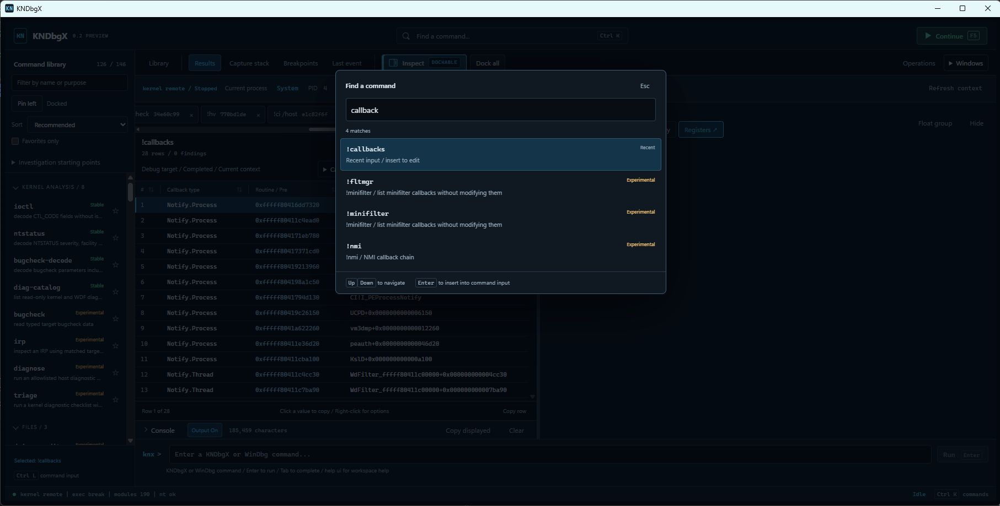

**Pin left**로 Library를 Results 옆에 고정한다. 즐겨찾기·필터·그룹 접기로 자주 쓰는 명령을 정리하고, **Investigation starting points > Kernel investigation**을 펼쳐 크래시·I/O·드라이버 분석의 시작점을 선택한다. [명령 찾기](docs/UX.md#find-and-run-commands)

## KNDbgX 수집기로 조사하기

### 커널 콜백: `!callbacks`

지원되는 커널 대상을 중단하고 **Library / Ctrl+K**에서 `!callbacks`를 찾아 실행한다. notify·object·registry 콜백의 등록 정보, 함수 주소와 소유 모듈을 확인한다. **Columns**로 표시할 필드를 고르고, **Row details**로 전체 레코드를 열거나 Routine·Pre·Post 주소를 따라 **Memory**와 **Disassembly**로 이동한다. [콜백 조사 절차](docs/UX.md#inspect-kernel-callbacks)


*등록된 콜백은 조사 자료다. 콜백의 존재나 소유 모듈만으로 후킹 또는 악성 코드라고 판정하지 않는다.*

### 미니필터 콜백: `!minifilter`

`!minifilter`(별칭 `!fltmgr`)로 필터 식별 정보·altitude와 개별 PreOperation/PostOperation 콜백을 확인한다. 연산 종류, 함수 주소, 소유 모듈을 비교하고 **Row details**나 **Export**로 전체 레코드를 확인·보관한다. [미니필터 조사 절차](docs/UX.md#follow-minifilter-registrations)

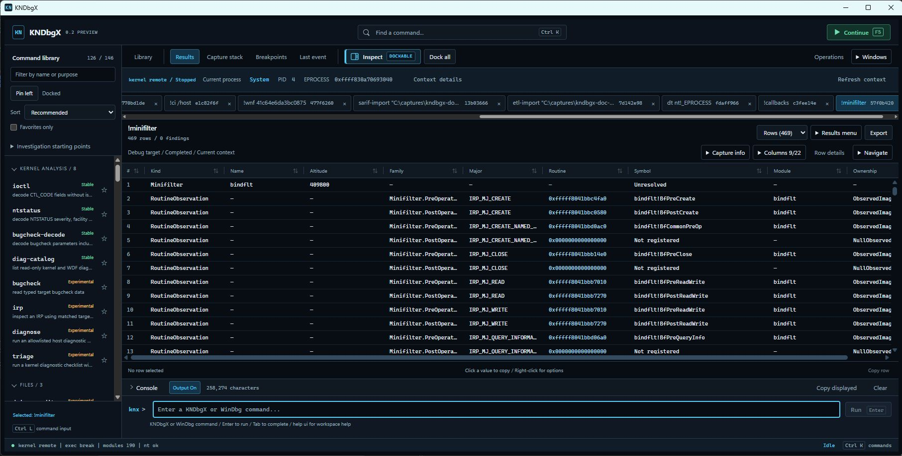

*캡처의 469행은 필터 레코드와 연산별 콜백을 합친 결과이며, 필터 469개를 뜻하지 않는다.*

### 프로세스 교차 비교: `!hiddenproc`

지원되는 커널 대상을 중단하고 **Library / Ctrl+K**에서 `!hiddenproc`를 찾아 실행한다. 원격 KD에서는 활성 프로세스 목록과 대상의 CID 테이블을 비교한다. 양쪽에서 관측한 식별 정보와 비교 결과를 한 표에서 확인하고, **Row details**로 원본 필드를 열거나 **Export**로 비교 결과를 저장한다.

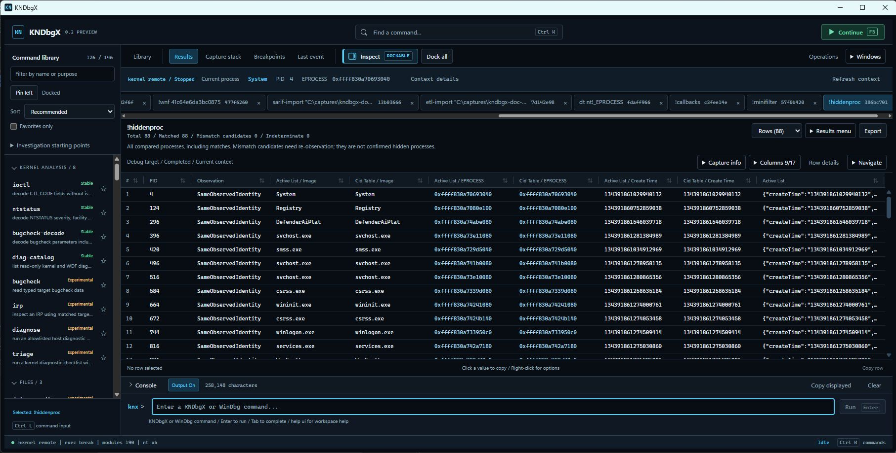

*이 캡처의 집계는 전체 88·일치 88·불일치 후보 0·판정 불가 0이다. 전체는 일치 행을 포함한 비교 건수이며, 88개 프로세스 모두 양쪽에서 같은 식별 정보로 관측됐다.*

불일치 후보는 재관찰이 필요하다. 프로세스 생성·종료·PID 재사용으로도 차이가 생긴다. 입력이 불완전하면 판정 불가로 남기며, 두 목록 모두에서 빠진 프로세스는 이 비교로 찾지 못한다. [비교의 한계](docs/UX.md#compare-two-process-inventories)

### 프로세스 핸들의 접근 권한

`!handles /owner-pid 4`로 System이 가진 Process 핸들 중 VM 접근 권한이 있는 항목을 조사한다. 관찰한 PID를 `/target-pid`에 넣어 목적지를 좁힐 수도 있다. 소유자·대상·부여된 접근 권한·프로세스 간 접근 여부를 비교하고, 행을 선택해 원본 식별 정보와 마스크를 확인한다. 원격 KD에서는 게스트의 핸들 테이블을 읽는다.

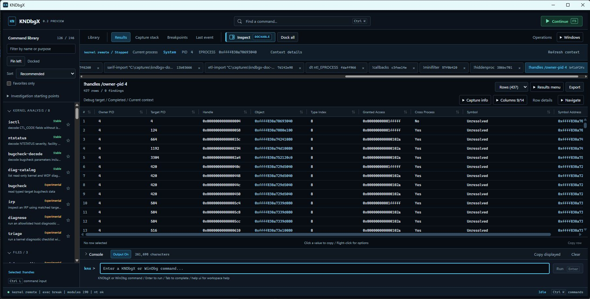

*이 캡처는 System이 소유한 Process 핸들 437행을 수집하고 완료됐다. 접근 권한이 있다는 사실만으로 실제 읽기·쓰기·인젝션이 발생했다고 판단하지 않는다.*

<details>
<summary>선택한 핸들의 원본 필드 확인</summary>

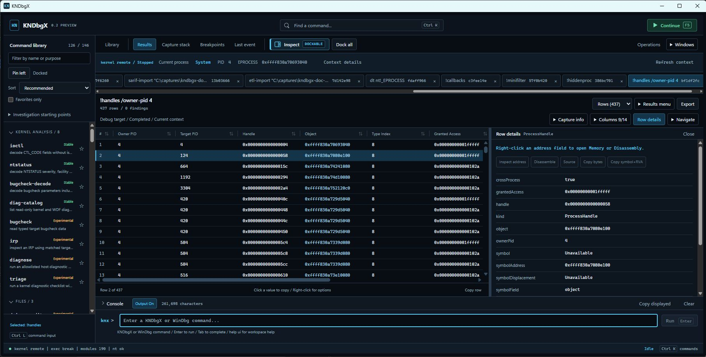

[핸들 조사 절차](docs/UX.md#inspect-process-handle-access)

</details>

### 드라이버 객체·디스패치·디바이스 스택

`!driver`로 관찰한 드라이버를 고른 뒤 `!drvobj \Driver\fvevol` 또는 객체 주소로 조사한다. MajorFunction 슬롯, 핸들러 심볼과 소유 모듈을 비교한다. 디바이스 주소는 `!devstack <device-address>`로 이어서 확인한다. 꺾쇠 인자는 실제 관찰한 값으로 바꾼다.

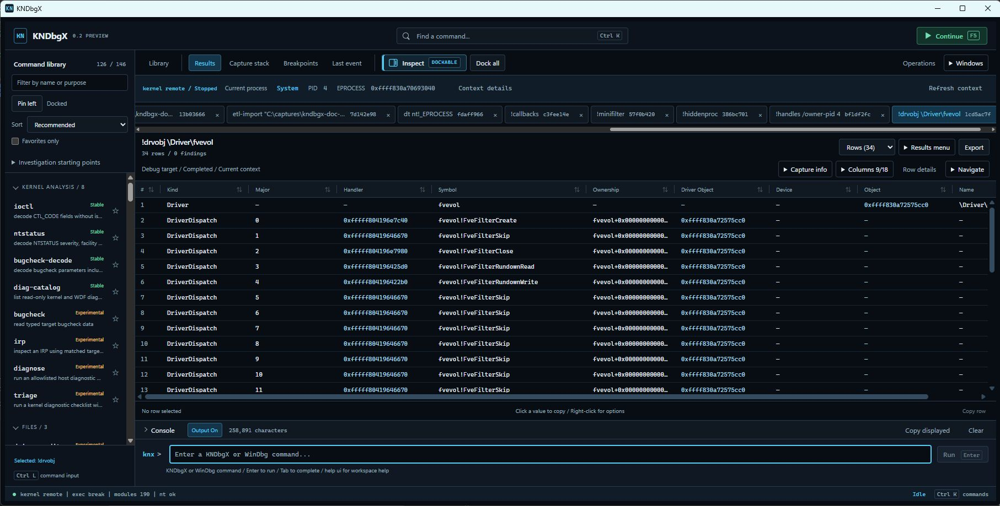

*예제의 34행에는 드라이버·디스패치·디바이스 레코드가 포함된다. 다른 모듈을 가리키는 핸들러도 정상적인 공유 코드일 수 있으며, 소유 모듈만으로 무결성을 판정하지 않는다.*

<details>
<summary>로드된 모듈과 PE 섹션 확인</summary>

`!module fvevol`로 대상 메모리의 PE와 섹션 정보를 읽는다. `/disk`는 로컬 대상과 파일의 관계를 검증할 수 있을 때만 사용하며, 식별 정보가 일치하는 제한된 표본을 비교한다. 재배치까지 반영한 전체 이미지 무결성 검사는 아니다.


[드라이버와 모듈 조사](docs/UX.md#inspect-driver-dispatch-and-loaded-image-metadata)

</details>

### 드라이버 로드 이력

`!mapper`는 `!unloaded`·`!piddb`·`!cihash`의 결과를 함께 보관한다. 하위 레코드를 선택해 상태와 수집 범위를 보거나, 개별 명령을 실행해 별도 표로 연다. 화면의 페이지 크기 제한을 넘는 중첩 레코드는 **Export**로 보관한다.

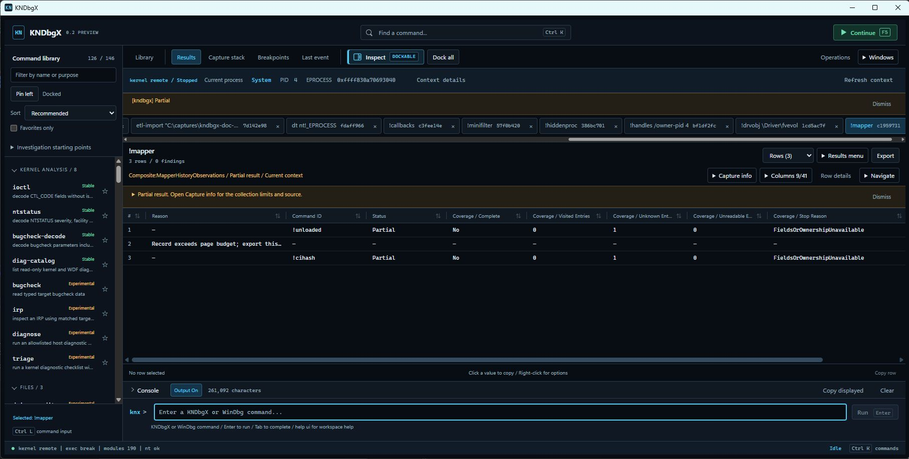

*세 행은 하위 수집 결과이며 의심 드라이버 세 개가 아니다. 이 게스트에서는 unloaded-driver·CI 메타데이터 일부를 검증하지 못했고, 중첩 PiDDB 레코드는 화면 표시 한도를 넘었다. 기록이 없다는 사실만으로 이력 삭제나 수동 매핑을 확정하지 않는다.* [이력 조사 절차](docs/UX.md#inspect-driver-history)

### 레지스트리 하이브와 ALPC 소유자

`!hive`는 관찰한 하이브의 `GetCellRoutine`을 심볼·모듈과 연결한다. **Routine**이나 **Symbol**로 정렬해 등록 정보를 비교하고, 현재 컨텍스트의 주소를 Disassembly로 연다.

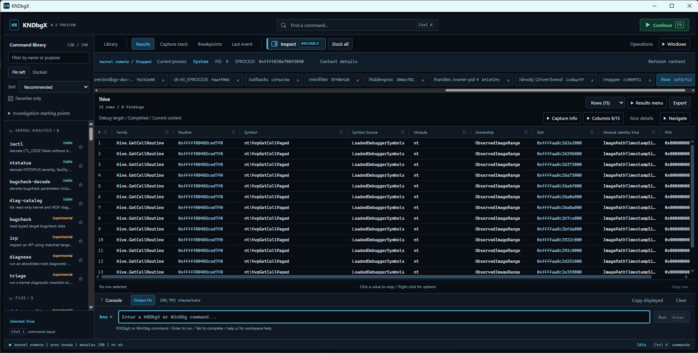

`!alpc`는 객체 네임스페이스를 순회해 ALPC 포트를 찾는다. **Row details**에서 소유 프로세스 식별 정보, 연결 포트와 네임스페이스 깊이를 함께 확인한다.

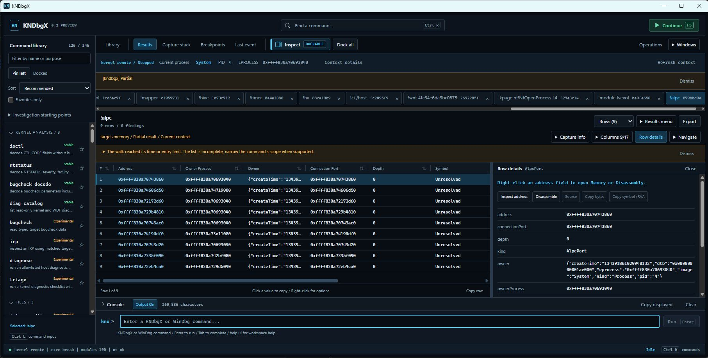

*하이브 캡처는 15행으로 완료됐다. ALPC는 순회 제한에 도달하기 전 포트 9개를 보관한 Partial 결과이며, 모든 통신 엔드포인트의 목록은 아니다.* [하이브와 ALPC 조사](docs/UX.md#inspect-hives-and-alpc-ports)

### 다른 콜백과 서비스 테이블

`!nmi`는 NMI 콜백 체인, `!hal`은 HAL 디스패치 함수 포인터, `!fwtable`은 펌웨어 테이블 공급자 등록을 조사한다. 확인할 수 있는 함수·모듈 정보와 레이아웃 공백을 결과에 남기며 등록을 변경하지 않는다.

`!ssdt`는 레이아웃과 범위를 검증할 수 있을 때 native/shadow 서비스 테이블을 수집한다. 표가 비어 있으면 **View output**에서 이유를 확인한다.

<details>
<summary>빈 SSDT 결과가 Partial로 남는 이유</summary>


이 게스트에서는 native 테이블의 범위와 shadow descriptor·session 관계를 확인하지 못했다. 0행은 정상 판정이 아니다. [수집 한계 확인](docs/UX.md#read-a-collectors-coverage-limits)

</details>

## 메모리 권한 조사하기

### VAD와 페이지 테이블 표본

`!vad image:smss.exe /hiddenpte /limit 32`를 실행하거나 **Processes > Memory (VADs)**를 선택한다. **Row details**에서 VAD의 보호 속성과 첫·마지막 페이지 표본을 비교한다. `/exec`로 조사 범위를 좁힐 수 있고, `/limit`는 보관 행이 아닌 콘솔 표시 수를 제한한다.

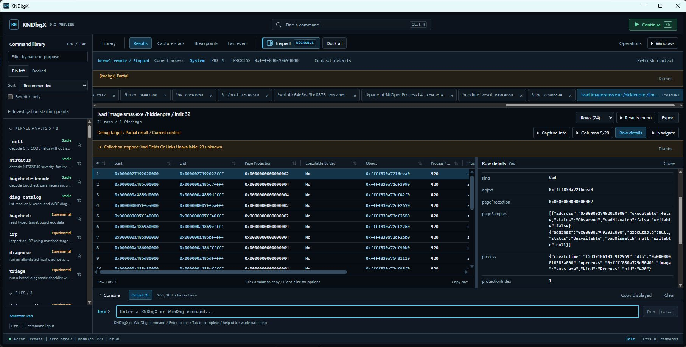

*이 캡처는 24행과 판정 불가 23건을 포함한다. 전역 256페이지 한도 안의 양 끝 표본은 모든 페이지를 조사하거나 모든 은닉 매핑을 찾지 못한다.* [VAD 조사](docs/UX.md#compare-vad-protection-with-page-samples)

### 주소 변환과 실제 페이지 권한

`!kpage nt!NtOpenProcess L4`로 페이지 경계에 맞춘 네 페이지의 변환 결과를 읽는다. 물리 주소와 유효 쓰기·실행 권한을 비교한다. `!address <address>`는 변환·권한·소유 정보를 함께 보고, `vtop <address>`는 VA를 변환하며, `query <address> [length]`는 읽기 가능 여부를 확인한다. `procctx`는 디버거 연결 컨텍스트와 별개인 변환용 DTB를 선택한다.


*이 네 페이지는 실행 가능·쓰기 불가로 관찰됐다. 변환 실패만으로 미매핑을 확정하지 않는다. PE 섹션 플래그나 할당 소유권은 별도로 확인해야 한다.* [페이지 조사](docs/UX.md#inspect-page-permissions-for-a-chosen-range)

### Big pool 할당과 W+X 관찰

`!pool big /wx /limit 16`을 실행한다. 대소문자를 구분하는 네 글자 `/tag`, 16진수 바이트 크기 `/min`·`/max`, `/addr`로 범위를 좁힌다. **wxObserved**, **inspectedPages**, **skippedPages**, **rangeClassified**를 함께 읽는다. `/wx`는 첫 페이지를 표본으로 조사하고 `/full`은 전역 예산 안에서 전체 페이지를 요청한다. `/wx`가 W+X 행만 필터링하는 것은 아니다.

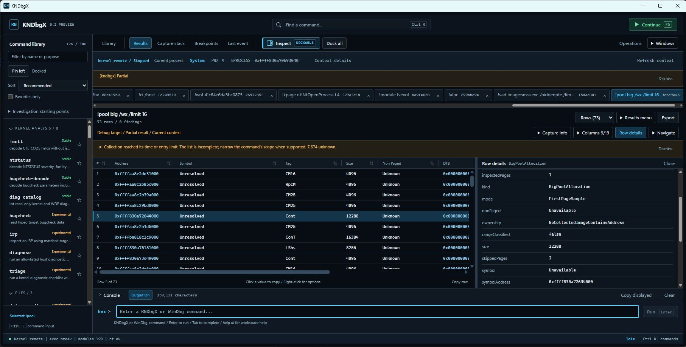

*73행의 Partial 캡처다. 선택한 할당에서는 한 페이지를 읽고 두 페이지를 건너뛰었다. `!payload`도 같은 big pool 표본 수집을 사용하며, true·false 어느 쪽도 전체 할당의 악성 여부를 판정하지 않는다. Small pool은 이 목록의 범위 밖이다.* [Pool 조사](docs/UX.md#inspect-big-pool-allocations-and-wx-samples)

## CPU와 플랫폼 상태 확인하기

### IDT·제어 레지스터·시스템 호출 MSR

`!idt`를 실행하고 **Vector**로 정렬해 CPU별 핸들러를 비교한다. `!cr`은 저장된 CR0·CR4·CR8과 WP·SMEP·SMAP·LA57 비트를 보여준다. 두 명령 모두 저장된 프로세서 상태를 사용하며 디버거 CPU를 전환하지 않는다.

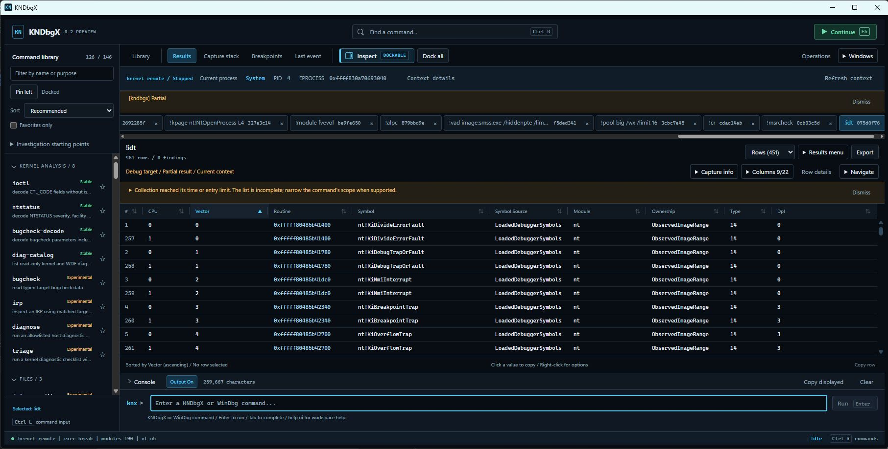

<details>
<summary>저장된 제어 레지스터와 보호 비트 확인</summary>

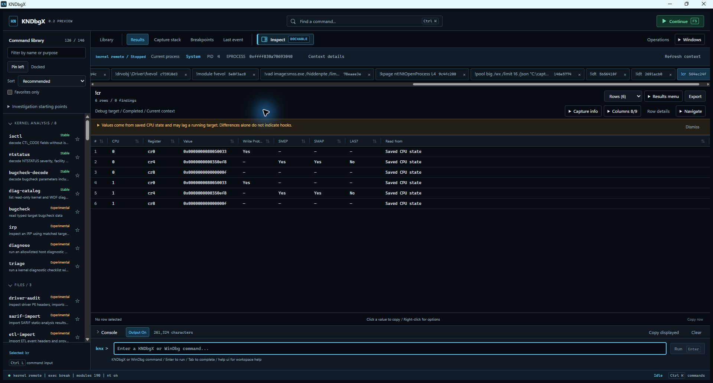

IDT 예제는 451개 게이트를 보관한 Partial 결과이고, 제어 레지스터 예제는 6행으로 완료됐다. 저장된 상태는 같은 순간의 실제 읽기와 다를 수 있다. [CPU 상태 조사](docs/UX.md#review-per-cpu-idt-and-control-state)

</details>

`!msrcheck`는 검증된 현재 이벤트 CPU에서 LSTAR·CSTAR·STAR·FMASK·EFER를 읽는다. 값을 비교하기 전에 **Read from**과 **Why unavailable**을 확인한다.

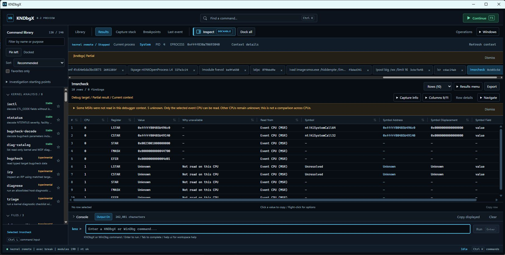

*이 캡처는 CPU 0만 읽었다. CPU 1은 Unknown이므로 모든 CPU의 후킹 여부를 확인한 결과가 아니다.*

### DPC 큐와 타이머

`!dpc`는 CPU별 DPC 큐를, `!timer`는 타이머 테이블을 순회한다. **CPU**·**Queue**·**Routine**·**Decode**를 함께 보고, 완료한 큐 수와 전체 예상 큐 수를 비교한다.

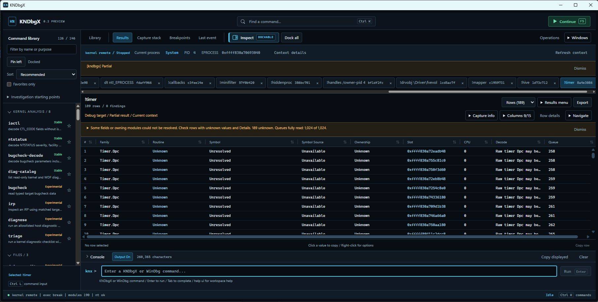

*타이머 캡처는 189행, 판정 불가 189건이다. 1,024개 큐를 모두 읽었지만 루틴 해석이 불가해 Partial로 남았다. 인코딩된 DPC 포인터를 확인 없이 함수 주소로 해석하지 않는다. 큐 밖에서 실행 중이거나 이미 완료된 작업은 포함하지 않는다.* [큐 조사](docs/UX.md#inspect-dpc-queues-and-timers)

### 호스트와 대상의 보안 상태

`!hv`는 **HostCpuidObservation**과 **TargetControlRegister**를 별도 레코드로 보여준다. 호스트 CPU·하이퍼바이저 CPUID와 디버깅 대상의 CR4는 출처가 다르며, 이 값만으로 게스트의 VBS나 보호 상태를 확정하지 않는다.


<details>
<summary>명시적인 호스트 CI/HVCI 조회와 로컬 KD 전용 기능</summary>

`!ci /host`는 디버거 호스트의 공개 CI/HVCI 플래그를 명시적으로 조회한다. `/host`가 없는 `!ci`는 검증된 로컬 KD가 필요하다. 아래 화면은 원격 VMware 게스트 정책이 아닌 **호스트 정보**다.


`!wfp`는 BFE filter·callout·provider·sublayer·layer를 열거하고, `!dma`는 DMAR/IVRS 펌웨어 테이블을 관찰한다. `!byovd`는 로컬 드라이버 파일의 SHA-256을 사용자가 제공한 카탈로그와 비교한다. 세 명령 모두 검증된 로컬 KD가 필요하므로 이 원격 게스트에는 사용할 수 없다. 테이블 존재는 DMA 보호 활성화의 증명이 아니며, 해시 일치는 악용 가능성이나 로드된 이미지의 무결성을 확정하지 않는다. [플랫폼 범위와 카탈로그 설정](docs/UX.md#distinguish-host-and-target-security-state)

</details>

### ETW 로거 메타데이터

`!etw`로 대상 host silo의 로거 ID와 clock 표현 등 메타데이터를 조사한다. **Capture info / View output**에서 레이아웃 공백과 실제 빈 목록을 구분한다.

<details>
<summary>이 게스트에서 확인하지 못한 ETW 메타데이터</summary>

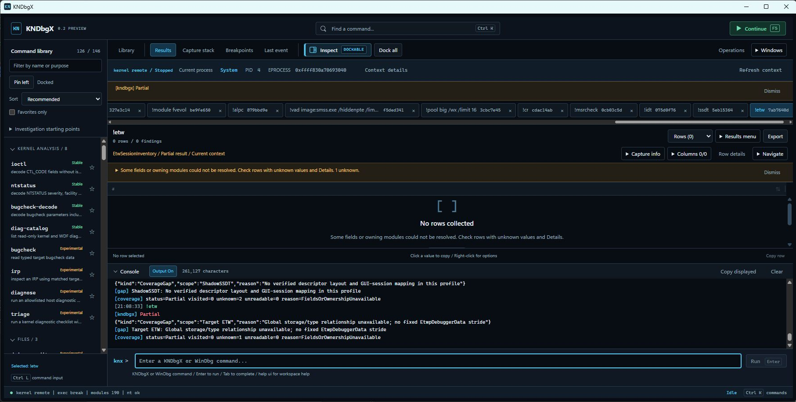

저장소·형식 관계를 확인하지 못해 0행, 판정 불가 1건으로 남았다. ETW가 비활성화됐다는 뜻이 아니다. 이 명령은 추적을 시작하지 않으며 호스트 로거를 게스트 정보로 대신하지 않는다. [ETW 조사](docs/UX.md#inspect-etw-logger-metadata)

</details>

## 스냅샷 저장과 비교

기준 상태를 저장하고 비교할 조사 단계를 수행한 뒤, 대상을 다시 중단하고 다른 **새 디렉터리**에 저장한다.

```text
!snapshot "C:\captures\before"
!snapshot "C:\captures\after"
!diff "C:\captures\before" "C:\captures\after"
```

**Artifact Committed**는 번들 저장 여부, **Collection Complete**는 수집 완전성을 각각 나타낸다. Snapshot v2는 프로세스·모듈·콜백·SSDT·IDT·제어 레지스터·HAL·드라이버 언로드 이벤트와 manifest 체크섬을 담는다. 수집은 순차적이며 원자적이지 않고, 원시 메모리는 포함하지 않는다.

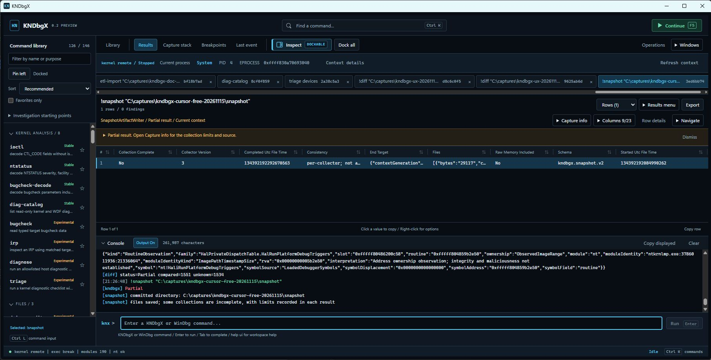

비교 표에서 **State**를 정렬하고 **Row details**로 전후 레코드를 읽는다. 식별 정보나 입력이 불완전하면 근거 없는 Added/Removed 대신 Unknown으로 남긴다.

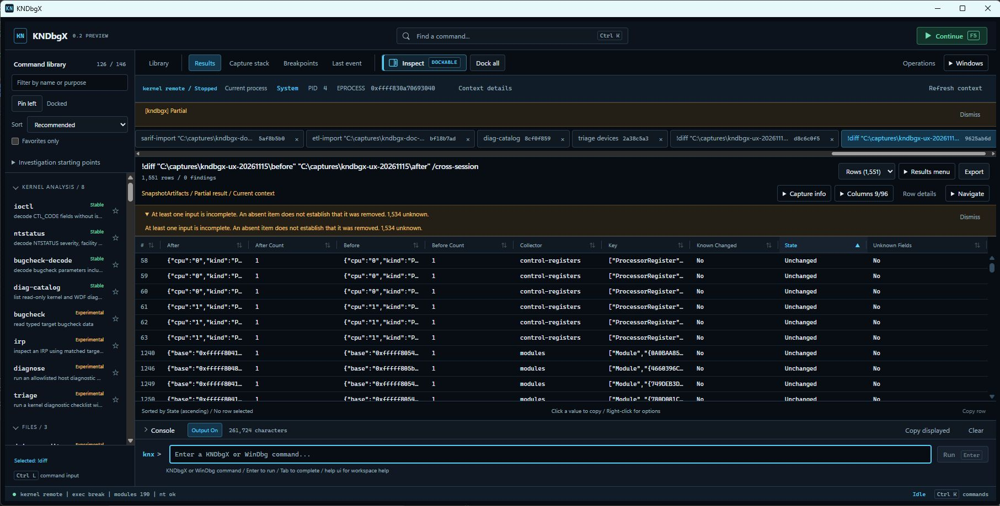

*비교 화면은 위에서 새로 저장한 번들과 별개인 기존 번들 쌍을 다시 열었다. 이 예제는 디버거 세션 재초기화를 사이에 둔 비교다. 1,551행 중 Unknown 1,534개와 Unchanged 17개이며, 모든 차이가 중간의 한 동작 때문에 발생했다는 뜻은 아니다.*

<details>
<summary>세션 검사·전후 원본·레거시 가져오기</summary>

세션 식별 정보가 다르면 `!diff "C:\captures\before" "C:\captures\after" /cross-session`을 명시해야 한다. 세션 간 프로세스 식별 정보와 언로드 이벤트는 여전히 비교 불가다.


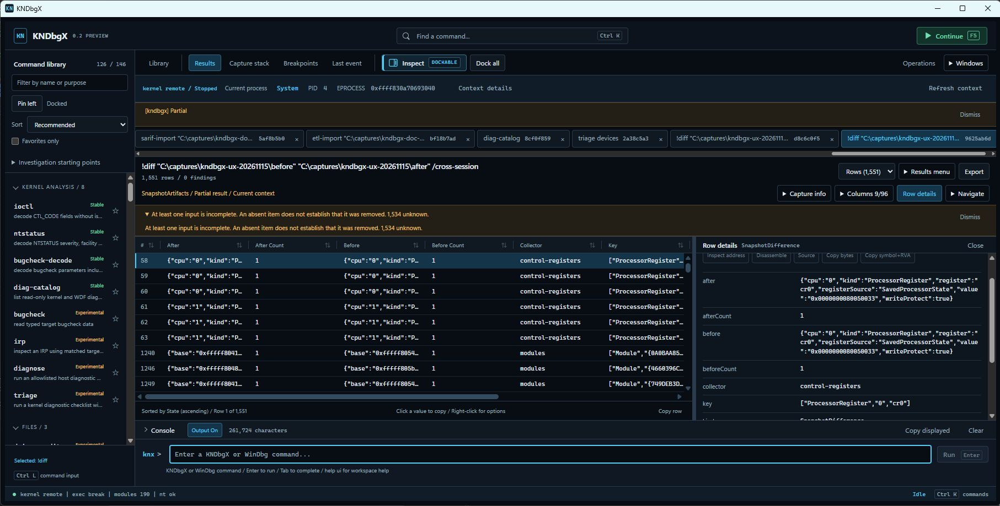

`!snapshot-import <text-file> <new-directory>`는 지원되는 레거시 텍스트를 Unknown 수집 범위의 번들로 가져온다. 오프라인 행의 저장된 주소는 현재 대상 주소로 연결되지 않는다. [스냅샷 절차](docs/UX.md#save-and-compare-kernel-snapshots)

</details>

## 파일 근거와 진단 결과 가져오기

### 드라이버 파일 분석

호스트 파일에 `driver-audit "C:\evidence\driver.sys"`를 실행한다. PE 식별 정보·완화 기능 선언·섹션·import·내장 서명 정책을 행으로 읽는다. 로드된 모듈과 연결하기 전에 **FileEvidence**의 경로·해시가 대상과 맞는지 확인한다.

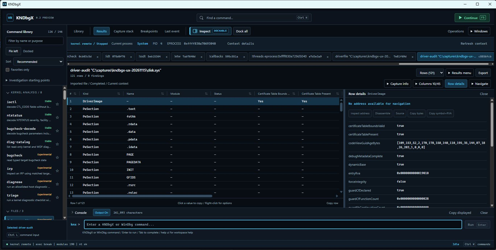

*예제는 호스트 `disk.sys` 사본을 읽은 121행이며 게스트 드라이버와의 관계는 검증하지 않았다. 선언된 완화 비트가 실행 중 강제를 증명하지 않는다.*

<details>
<summary>내장 서명 정책과 검사하지 않은 범위</summary>

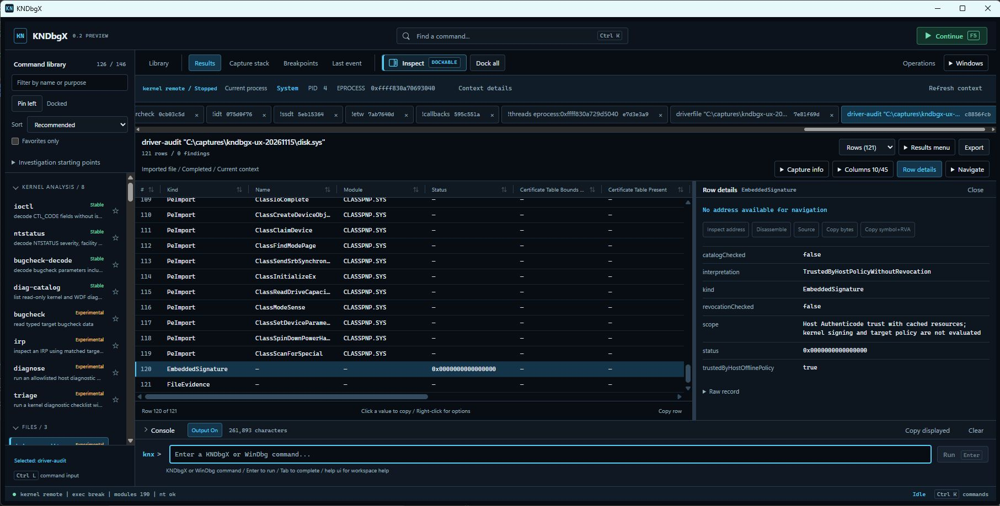

호스트 신뢰 정책을 사용하며 카탈로그 서명·폐기 여부·대상의 서명/HVCI 정책은 평가하지 않는다. NoEmbeddedSignature는 서명되지 않은 드라이버라는 판정이 아니다. [드라이버 파일 분석](docs/UX.md#audit-a-driver-file)

</details>

### SARIF와 ETL 가져오기

`sarif-import "C:\evidence\analysis.sarif"`를 실행하고 **StaticFinding**을 선택한다. **Row details**에서 규칙·수준·메시지·소스 위치를 확인하고 run·파일 근거 행에서 출처를 읽는다.

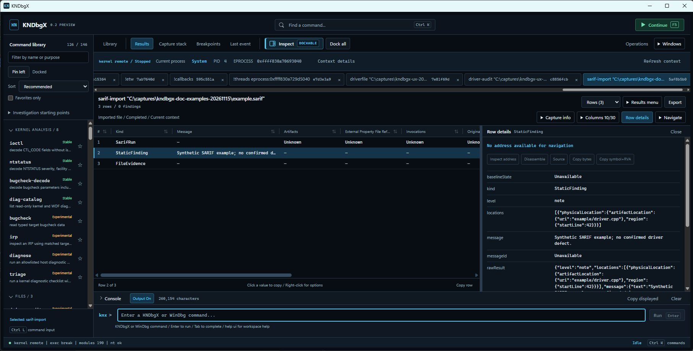

*문서용 예제임을 명시한 파일을 사용한 화면이다. 가져온 항목은 분석기의 출력이며, 독립적으로 확인된 결함이나 디버깅 대상과 자동 연결된 결과가 아니다.*

`etl-import "C:\evidence\trace.etl" 2048`로 기록된 이벤트 헤더·공급자 메타데이터·제한된 payload 미리보기를 읽는다. 10진수 이벤트 한도의 기본값은 2,048이며 최대 16,384다.

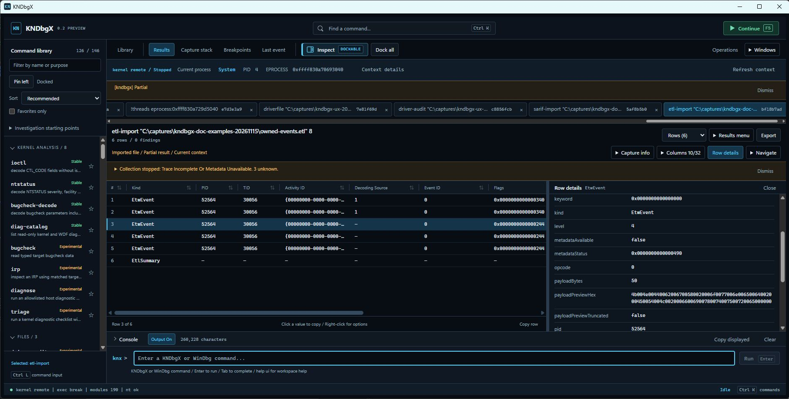

*기존에 만든 시험용 trace의 이벤트 5행과 요약 1행이다. 메타데이터 공백 3건으로 Partial이며 게스트 trace가 아니다. 가져오기는 추적을 시작하거나 임의 WPP payload를 해석하거나 DPC 지연을 추론하지 않는다.* [파일 가져오기 절차](docs/UX.md#import-sarif-and-etl-files)

### 진단 체크리스트·크래시·IRP

`diag-catalog`로 53개 레시피를 찾아본다. `diagnose <recipe> [operand]`는 한 항목, `triage devices`는 storage·USB·PnP 체크리스트를 실행한다. crash·hang·I/O·power·memory·network·WDF 프로필도 있으며 WDF에는 모듈 인자가 필요하다.

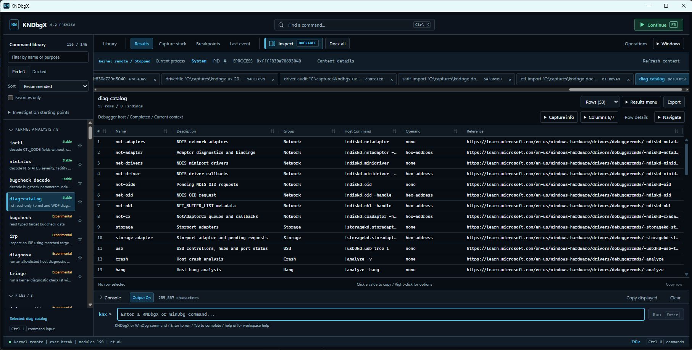

KNDbgX는 기존 WinDbg 확장 호출을 단계별 레코드·저장된 출력·컨텍스트 복구 관찰로 감싼다. **attempted**·**engineAccepted**·**contextRestored**와 건너뛴 이유를 확인한다. 엔진이 명령을 수락했다는 사실이 데이터의 완전성을 증명하지 않는다.

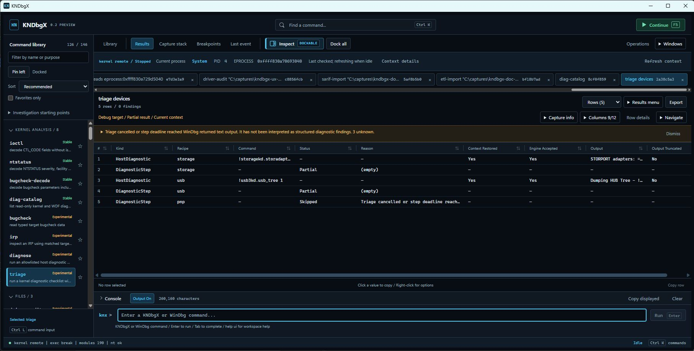

<details>
<summary>저장된 네이티브 출력과 크래시·I/O 객체 확인</summary>

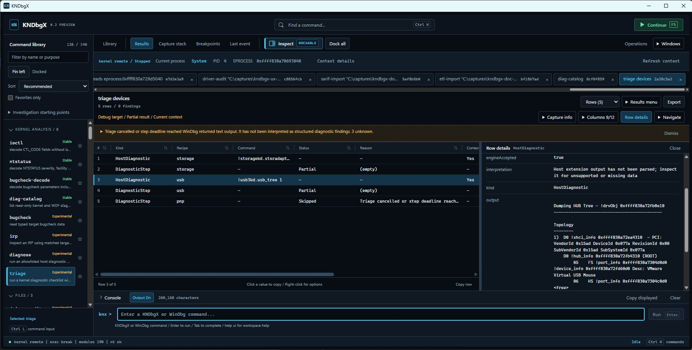

셀 미리보기가 짧게 표시되면 **View output**이나 **Raw record**로 읽는다. 이 실행은 storage·USB를 시도하고 기한이 지나 PnP를 건너뛰었다. 진행 중인 네이티브 호출은 기한보다 오래 걸릴 수 있다.

`bugcheck`는 대상의 형식화된 버그체크 정보를, `irp <address>`는 일치하는 PDB 레이아웃으로 관찰한 IRP를 읽는다. `bugcheck-decode <hex-code> <p1> <p2> <p3> <p4>`는 크래시를 발생시키지 않고 입력값을 해석하며 지원하는 KASAN 사례도 포함한다. [진단 절차](docs/UX.md#run-a-diagnostic-checklist)

</details>

### 숫자 값 디코더

`ioctl 222004`로 CTL_CODE 필드, `ntstatus c0000005`로 상태의 severity·facility·code, `!wnf 41c64e6da3bc0875`로 WNF 상태 이름 필드를 해석한다. 입력된 숫자를 해석하는 기능이며 `ioctl`은 실제 요청을 보내지 않는다.

<details>
<summary>문서용 WNF 디코딩 예제</summary>


이 숫자는 문서용으로 구성했다. 게스트의 구독·상태 payload·WNF 보안 속성을 수집한 결과가 아니다. [디코더 사용법](docs/UX.md#decode-values-without-reading-the-target)

</details>

## 주소를 따라 메모리와 코드 확인하기

결과 행을 선택하고 **Row details**에서 **Open Memory** 또는 **Disassemble**을 누른다. 콜백 행에서는 Routine·Pre·Post를 구분해서 선택한다. 인식 가능한 주소 셀을 오른쪽 클릭해도 **Open Memory / Open Disassembly**를 사용할 수 있다. 읽기 전에 원본 결과와 프로세스 컨텍스트를 확인한다.


**Memory > Read options**에서 Virtual/Physical과 바이트 수를 고른다. 저장된 바이트로 byte/word/dword/qword·ASCII 표시를 바꿀 수 있으며 `??`는 읽지 못한 바이트다. **Read details**에는 컨텍스트·범위·실제 읽은 수·네이티브 오류가 남는다. `s <address> L<bytes> <byte...>`로 제한된 범위를 검색할 수도 있다.

<details>
<summary>주소 작업과 저장된 메모리 읽기 상세</summary>


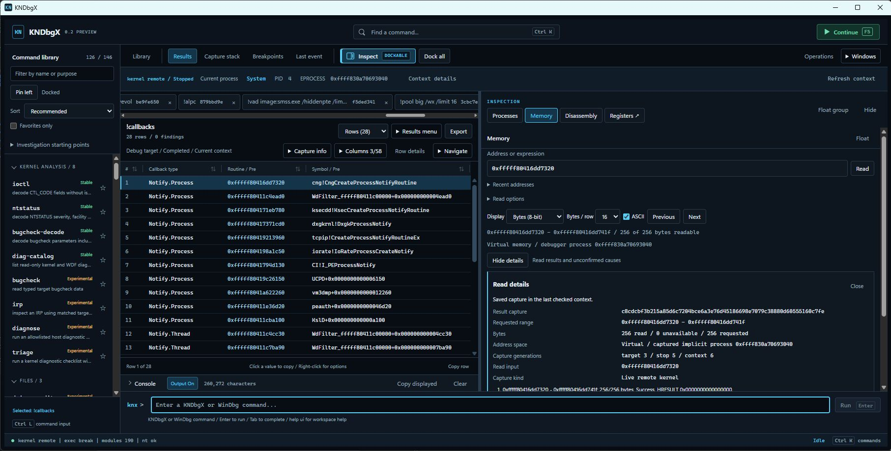

Previous/Next는 성공적으로 읽은 범위를 기준으로 이동한다. 주소를 수정하거나 컨텍스트가 바뀌면 새 읽기가 필요하다. 과거 또는 불일치 결과는 현재 대상 읽기의 근거로 사용하지 않는다. [Memory 사용법](docs/UX.md#memory-tab)

</details>

### 디스어셈블리·레지스터·부동 창

**Disassembly**는 Current IP·Next instructions·Follow IP·브레이크포인트 표시를 제공한다. 명령어를 선택해 주소 작업을 수행하며 `u`·`uf`로도 결과를 보관한다. **Registers**는 필터·고정·변경 표시·벡터 원시 바이트와 캡처 당시 CPU·스레드 식별 정보를 제공한다.


<details>
<summary>레지스터와 독립된 검사 창</summary>

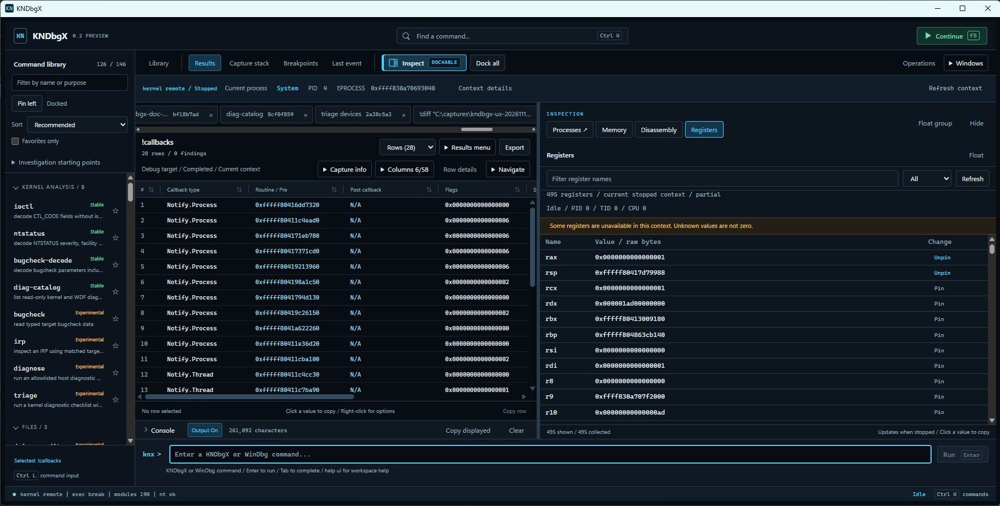

각 뷰는 **Float**로, Inspect 전체는 **Float group**으로 분리한다. 제목 표시줄의 도킹 가이드나 **Windows > Dock all views**로 돌아온다. **Bring windows into view**는 화면 밖 창을 되찾는다. 모든 창은 하나의 디버거 컨텍스트와 실행 슬롯을 공유한다.

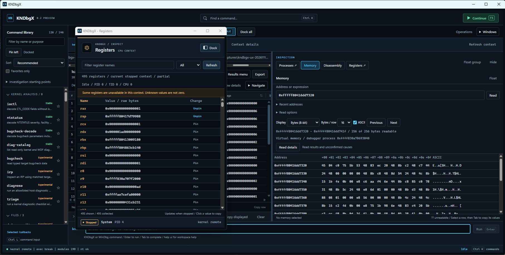

[부동 창 사용법](docs/UX.md#floating-inspection-windows)

</details>

`navigate va <address>`·`navigate pa <address>`는 주소 공간을 구분한 관찰을 보관한다. `history`·`back`·`forward`·`bookmark "note"`·`bookmarks`로 저장된 결과를 다시 찾는다. 이력 이동은 예전 주소를 다시 읽지 않는다. 검사 뷰의 **Recent** 목록은 선택한 식을 현재 컨텍스트에서 읽는 별도 기능이다. `source [address]`는 가능한 경우 호스트의 소스 조회를 사용한다.

## 프로세스에서 조사 시작하기

**Inspect > Processes**에서 프로세스를 선택하고 **Open details**, **Threads**, **Memory (VADs)** 또는 **Token**을 누른다. 프로세스 목록을 유지하면서 별도 결과 탭이 열린다. 결과 탭을 더블클릭하면 알아보기 쉬운 이름을 붙일 수 있다.

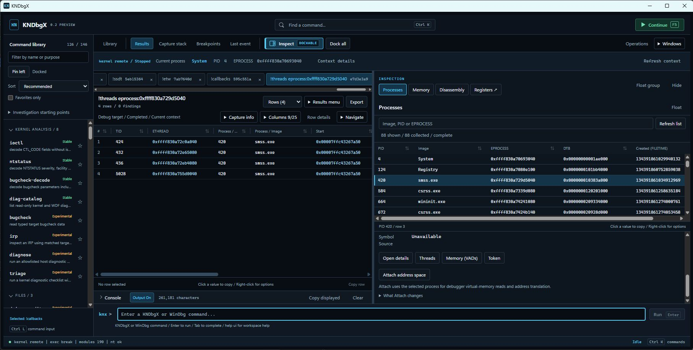

이미지·PID로 검색하고 EPROCESS·DTB·생성 시각을 확인한다. `!dml_proc`·`!process 0`은 프로세스를 열거하고, `!process pid:4`·`!threads pid:4`·`!token pid:4`는 대상을 명시한다. 선택자 없는 `!threads`는 현재 스레드를, `!token`은 활성 impersonation 토큰이 있으면 그것을, 없으면 현재 프로세스의 primary 토큰을 읽는다.

행 선택만으로 디버거의 주소 공간이 바뀌지는 않는다. **Attach address space**는 별도로 검증하는 동작이며, 레지스터의 스레드/CPU 컨텍스트도 구분한다. 목록이 불완전하면 이미지 이름으로 선택하지 못할 수 있으므로 관찰한 PID나 EPROCESS를 사용한다. [프로세스 조사](docs/UX.md#processes-tab)

## 컨텍스트와 심볼 확인하기

**Context details**에서 선택한 프로세스·암시적 주소 공간·디버거 스레드/CPU·scope·마지막 이벤트를 구분한다. **Refresh context**로 관찰을 갱신한다.

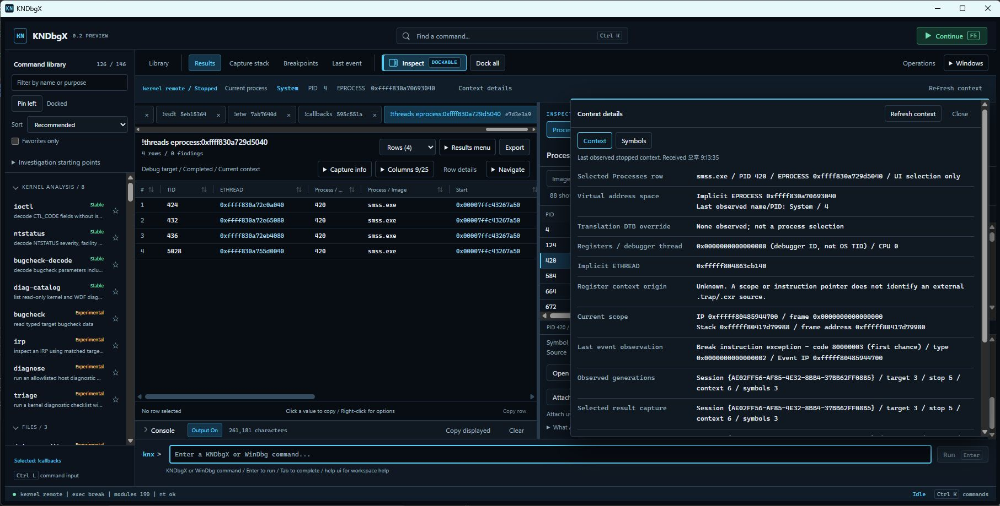

**Symbols**에서 **Read modules**를 누르고 모듈을 고른 뒤 **Inspect selected module**을 실행한다. Type/Field에 `_EPROCESS`·`UniqueProcessId` 같은 이름을 넣어 메타데이터 가용성을 확인할 수 있다. 이미지/PDB 일치와 비공개 필드 가용성은 별개다. **Insert reload draft**는 명령 초안만 넣는다.

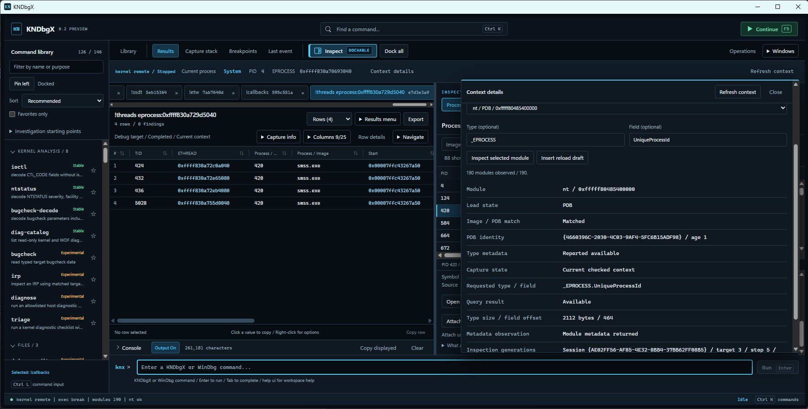

<details>
<summary>Results에서 형식 레이아웃과 값 살펴보기</summary>

`dt nt!_EPROCESS`로 필드 offset·size·비트 범위·출처를 읽는다. 실제 필드 값이 필요하면 관찰한 인스턴스 주소를 뒤에 넣는다. **Offset**으로 정렬하거나 개별 레코드를 확인한다.

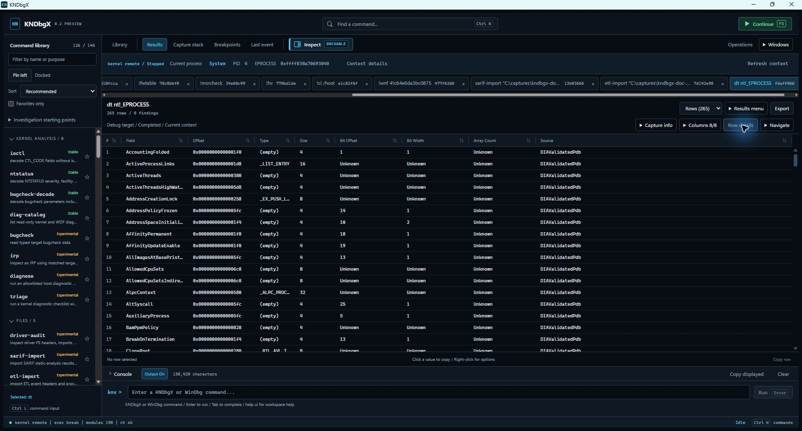

이 캡처는 인스턴스 없이 레이아웃만 요청했다. 없는 형식 이름이나 선택적 메타데이터는 확인 불가로 남는다. `lm`·`x`·`ln`·`.sympath`·`.reload`로 모듈과 심볼을 다룰 수 있지만, 같은 PDB를 반복 로드한다고 없는 비공개 형식이 생기지는 않는다. [심볼 조사](docs/UX.md#context-symbols-and-waits)

</details>

## 결과 보관·실행 제어·작업 복구

### 결과 탭과 내보내기

다시 수집하지 않고 탭을 전환한다. 더블클릭/F2로 이름을 바꾸고 끌어서 순서를 조정한다. **Columns**·정렬·전체 셀 값 복사·**Row details**로 필요한 필드를 살펴본다. 숨긴 열도 저장된 결과에 남는다. **Capture info**는 출처와 범위를 설명하며, **Export**는 화면 밖 행과 저장된 출력을 포함한 전체 결과를 내보낸다.


기본 저장 위치는 `%LOCALAPPDATA%\kndbgx\logs`이며 **Copy saved path**로 확인된 경로를 가져온다. 다른 위치는 `results`에서 ID를 찾은 뒤 `result-export <id> "C:\captures\result.json"`으로 지정한다. `result-read <id> [row-offset] [finding-offset]`는 저장된 데이터를 나눠 읽는다. 최근 비고정 결과 16개와 열린 탭의 보호된 결과 128개가 64 MiB를 공유하므로 퇴출이나 DLL unload 전에 내보낸다. [저장과 복구](docs/UX.md#export-and-recovery)

### Operations·취소·백그라운드 작업

**Operations**는 단계·경과 시간·취소 상태·보관된 결과를 보여준다. **Cancel operation**은 협력적 취소를 요청하므로 진행 중인 네이티브 심볼·메모리 호출이 먼저 반환해야 한다. **Refresh outcomes**는 재실행 없이 기존 결과를 조회한다. 수동 갱신만 원하면 자동 inspection 읽기를 일시 중지한다.

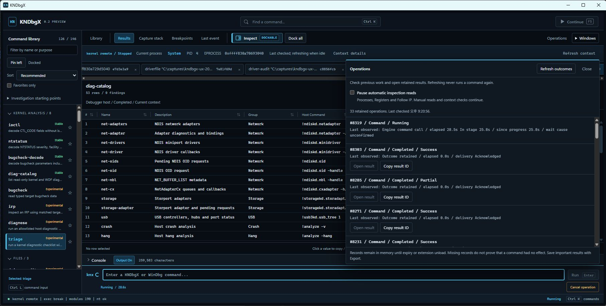

<details>
<summary>제한 시간 뒤 남은 결과의 수집 범위 확인</summary>


이 실행은 취소 요청 없이 단계 제한 시간에 도달했다. PnP는 **attempted: false**와 Skipped로 남고, 앞선 단계의 출력은 보관된다. 보관된 행이 완전한 목록을 의미하지는 않는다. `submit <command>`·`jobs`·`job <id>`·`cancel <id>`로도 백그라운드 작업을 관리한다. 엔진 작업은 한 번에 하나만 실행된다. [Operations 사용법](docs/UX.md#context-symbols-and-waits)

</details>

### 실행 제어와 승인된 변경

지원되는 live 대상에서 **Continue / Break**, F5와 Disassembly의 F10/F11을 사용한다. **Breakpoints**는 설정, **Last event**는 이벤트 정보를 별도로 보여준다. Disassembly의 명령어 표에 포커스가 있고 선택한 명령어에 브레이크포인트가 없을 때 F9는 추가 미리보기를 연다. 명령어 옆 **+**도 같은 동작이다. 기존 브레이크포인트가 하나 있으면 F9나 채워진/빈 표시는 추가 미리보기 없이 바로 비활성/활성으로 전환한다. 여러 개가 겹치면 브레이크포인트 목록을 연다. Add/Delete는 미리보기 승인이 필요하며 Enable/Disable은 클릭 시 컨텍스트에 연결된 동작을 적용한다.

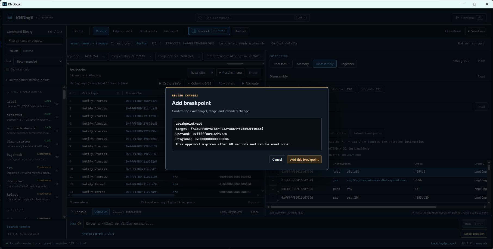

*이 캡처의 미리보기는 취소했다. 브레이크포인트 적용·스텝·대상 메모리 쓰기를 검증한 화면은 아니다.*

등록된 `eb`·`ew`·`ed`·`eq`·`f`·`setfield` 변경은 `plan <mutation-command>`와 일회용 승인을 사용한다. `approve <plan-id> <approval-token>` 전에 원본·변경 바이트, 형식·필드와 대상 컨텍스트를 확인한다. 계획은 60초 후 만료되며 컨텍스트·원본 바이트를 다시 검사한다. 부분 쓰기는 자동 재시도나 롤백을 하지 않는다. `debug-plan`·`debug-approve`는 별도의 브레이크포인트·실행 계획 흐름이다. [변경 절차](docs/UX.md#execution-and-changes)

<details>
<summary>대상 실행 중에도 남는 과거 결과</summary>

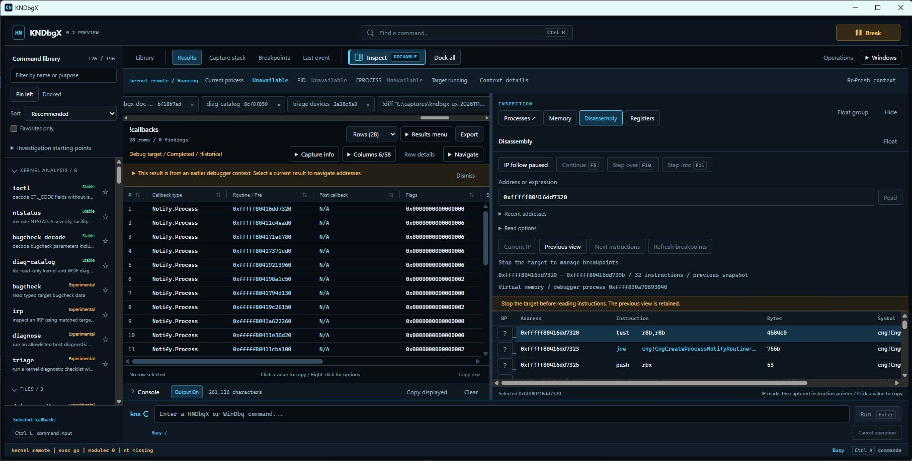

과거 캡처는 읽을 수 있지만 새 대상 작업을 허가하지 않는다. 다시 읽으려면 대상을 중단하고 갱신한다.

</details>

### 덤프·메모리 내보내기·Data Model

`dump-raw <address> <length> "C:\captures\range.bin"`은 제한된 VA 범위를, `/phys`는 PA 범위를 저장한다. `dump-pe <module|address> "C:\captures\mapped.bin"`은 매핑된 이미지를 저장한다. 출력 한도는 64 MiB이며 요청한 바이트를 읽지 못하면 출력 파일을 게시하지 않는다. 매핑된 PE는 가상 섹션 offset을 사용하며 원래 디스크 파일을 재구성하지 않는다. `.dump <path>`는 호스트 엔진으로 덤프를 만들고 `dump-analyze <path>`는 기존 덤프 헤더를 조사한다.

`IHostDataModelAccess`가 있는 호스트에서는 `model publish <result-id>`로 최대 128행과 128개 finding을 `Debugger.Models.KNDbgX`에 복사해 `dx`로 읽을 수 있다. 복사된 값은 확장 unload 후에도 읽을 수 있으며 대상을 다시 읽지 않는다. 미지원 호스트에서도 일반 CLI/UI 결과는 유지된다. [명령과 제약](docs/COMMANDS.md#limits)

[사용법 문서](docs/UX.md)에서 상세 절차와 [단축키](docs/UX.md#shortcuts)를 확인한다. UI 초기화에 실패해도 WinDbg에서 `!kndbgx !callbacks`처럼 작업 명령 앞에 `!kndbgx`를 붙여 CLI로 실행할 수 있다.

## 전체 명령 색인

컴파일된 레지스트리에는 **126개 항목**이 있으며 명시적으로 미지원인 명령 5개도 포함한다. 아래는 기능별 색인이고, 정확한 문법·별칭·옵션·대상 모드는 생성된 [명령 참조](docs/COMMANDS.md)에서 확인한다. Stable 표시가 모든 커널 빌드의 호환성을 보장하지는 않는다.

<details>
<summary>그룹별 전체 등록 명령 보기</summary>

- **커널 분석:** `ioctl`, `ntstatus`, `bugcheck-decode`, `diag-catalog`, `bugcheck`, `irp`, `diagnose`, `triage`.
- **파일:** `driver-audit`, `sarif-import`, `etl-import`.
- **세션:** `help`, `status`, `cls`, `procctx`, `?`, `raw`, `plan`, `approve`, `reconnect`, `version`, `features`, `command-schema`, `policy`.
- **디버거와 탐색:** `debug-plan`, `debug-approve`, `stack`, `registers`, `breakpoints`, `event`, `navigate`, `source`, `history`, `back`, `forward`, `bookmark`, `bookmarks`.
- **결과:** `results`, `result-export`, `result-read`, `model`.
- **심볼과 형식:** `lm`, `x`, `ln`, `.reload`, `.sympath`, `dt`, `setfield`.
- **메모리:** `db`, `dw`, `dd`, `dq`, `dc`, `dds`, `dqs`, `da`, `du`, `s`, `f`, `eb`, `ew`, `ed`, `eq`, `!db`, `!dw`, `!dd`, `!dq`.
- **커널 수집기:** `vtop`, `query`, `!address`, `!kpage`, `!dml_proc`, `!vad`, `!threads`, `!hiddenproc`, `!handles`, `!token`, `!callbacks`, `!ssdt`, `!idt`, `!msrcheck`, `!cr`, `!dpc`, `!timer`, `!pool`, `!nmi`, `!hal`, `!etw`, `!wnf`, `!hive`, `!alpc`, `!fwtable`, `!drvobj`, `!devstack`, `!driver`, `!module`, `!minifilter`, `!unloaded`, `!piddb`, `!cihash`, `!mapper`, `!payload`, `!byovd`, `!wfp`, `!ci`, `!hv`, `!dma`, `!snapshot`, `!diff`, `!snapshot-import`, `!process`.
- **코드:** `u`, `uf`.
- **덤프:** `.dump`, `dump-analyze`, `dump-raw`, `dump-pe`.
- **작업:** `submit`, `jobs`, `job`, `cancel`.

**이번 릴리즈에서 미지원:** `!eb`, `!ew`, `!ed`, `!eq`, `dump-live`.

물리/MMIO 쓰기, 콜백 변경, 별도 UI 프로세스, TTD·Replay SDK 어댑터는 비활성화돼 있다. `features`로 선택적 어댑터 가용성을 확인한다. `policy`는 호환용 항목이며 전역 쓰기 모드를 켜지 않는다. 별칭과 인자는 `help <command>`로 확인한다.

</details>

## 결과 해석과 명령 전달

심볼·페이지 누락이나 수집 한도는 **Partial** 또는 **Unavailable**로 표시한다. 행이 없다는 사실만으로 객체 부재를 단정하지 않는다. 결과는 수집 당시 컨텍스트를 유지하며, 과거 결과로 현재 대상을 변경할 수 없다. 중요한 결과는 보관 한도 도달이나 DLL 언로드 전에 내보낸다.

UI에서 직접 입력한 미등록 명령은 WinDbg로 전달되며 대상이나 호스트를 변경할 수 있다. 등록된 이름에는 KNDbgX의 검증과 승인 규칙이 적용된다. CLI와 작업에서 미등록 명령을 실행하려면 `raw --ack-effects <명령>`이 필요하다. 덤프와 로컬 KD는 대상 쓰기와 실행 제어를 지원하지 않는다. [지원 범위와 제약](docs/SUPPORT.md)

## 소스 빌드

Visual Studio 2022 C++ 도구(v143)와 Windows 10/11 SDK를 설치하고 저장소 루트의 PowerShell에서 실행한다.

```powershell
.\tools\build.ps1 -Configuration Release -RunTests
```

스크립트가 `vswhere`로 Visual Studio를 찾아 `x64\Release`에 확장을 생성한다. `-RunTests`의 프런트엔드 검사에는 Node.js가 필요하며 빌드만 하려면 이 옵션을 생략한다. 배포 도구에는 Python 3.11 이상, `samples/snapshot-demo`에는 별도로 WDK가 필요하다. [빌드 검증과 배포 패키징](docs/VALIDATION.md)을 참고한다.

## 라이선스

KNDbgX는 [MIT 라이선스](LICENSE)로 배포한다. Copyright (c) 2026 kernullist.
서드파티 구성요소에는 각각의 라이선스가 적용된다. [THIRD_PARTY_NOTICES.md](THIRD_PARTY_NOTICES.md)를 참고한다.
