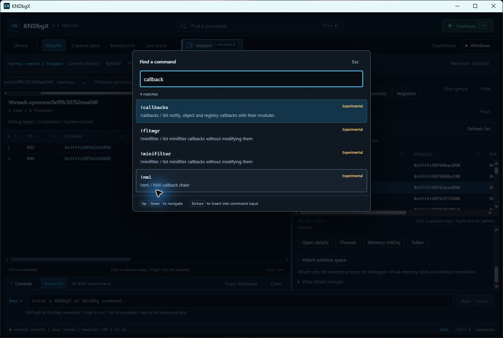
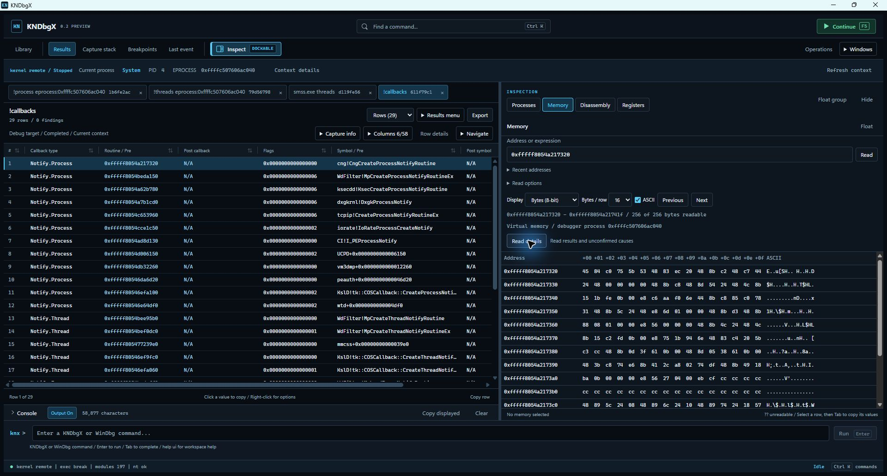

# KNDbgX

English · [한국어](README.ko.md)

KNDbgX brings a visual investigation workspace to x64 WinDbg. Inspect kernel callbacks and minifilter registrations, compare process inventories and snapshots, and review driver-file evidence in retained result tabs. Memory, disassembly and registers stay beside the results or in floating windows. The extension does not install a kernel driver.

These are captures of **0.2.0-preview.7** running in WinDbg against a live Windows 11 x64 VMware guest. Kernel collectors and Data Model integration remain experimental; see [supported sessions and limits](docs/SUPPORT.md).

## Investigate with KNDbgX collectors

### Kernel callbacks: `!callbacks`

Find `!callbacks` in **Library / Ctrl+K** and run it on a stopped, supported kernel target. Inspect notify, object and registry callback registrations, their routine addresses and owning modules. Choose the fields in **Columns**, open **Row details** for the full record, and follow a Routine, Pre or Post address into **Memory** or **Disassembly**. [Callback workflow](docs/UX.md#inspect-kernel-callbacks)


*Registered callbacks are investigation evidence. A callback's presence or module ownership alone does not establish a hook or malicious code.*

### Minifilter callbacks: `!minifilter`

Run `!minifilter` (alias `!fltmgr`) to inspect filter identities, altitudes and separate PreOperation/PostOperation callbacks. Compare the operation, routine and ownership fields, then use **Row details** or **Export** to retain the full record. [Minifilter workflow](docs/UX.md#follow-minifilter-registrations)


*The capture contains 469 rows covering filter records and operation callbacks; this is not a count of 469 filters.*

### Process cross-view: `!hiddenproc`

Find `!hiddenproc` in **Library / Ctrl+K** and run it on a stopped, supported kernel target. Remote KD compares the active process list with the target's CID table, keeping both identities and the comparison outcome in one table. **Row details** shows the original fields; **Export** saves the retained comparison.


*Process cross-view: 190 total comparison rows, including matching processes. The visible rows show `SameObservedIdentity`; this is not a count of hidden processes.*

### More investigation workflows

- **Process-handle access:** run `!handles /owner-pid 4` to inspect the System process's VM-access handles, or filter by an observed target PID. Compare owner, destination, access mask and cross-process status. [Handle workflow](docs/UX.md#inspect-process-handle-access)
- **Snapshot comparison:** save two `!snapshot` bundles into new directories, then open `!diff` in Results. Check collection coverage and identity before interpreting Added, Removed, Changed or Unknown. [Save and compare](docs/UX.md#save-and-compare-kernel-snapshots)
- **Driver-file evidence:** `driver-audit` turns a supplied host PE file into rows for identity, mitigations, sections, imports and embedded-signature policy. [Driver audit workflow](docs/UX.md#audit-a-driver-file)
- **Driver dispatch:** use `!driver`, `!drvobj` and `!module` to inspect driver objects, dispatch ownership and loaded-image metadata. [Driver dispatch workflow](docs/UX.md#inspect-driver-dispatch-and-loaded-image-metadata)
- **Memory permissions:** compare VAD protection with page samples, inspect translations for a chosen range, and examine big-pool W+X observations with explicit sampling limits. [VAD samples](docs/UX.md#compare-vad-protection-with-page-samples) · [Page permissions](docs/UX.md#inspect-page-permissions-for-a-chosen-range) · [Big pool](docs/UX.md#inspect-big-pool-allocations-and-wx-samples)
- **Kernel state and diagnostics:** retain per-CPU IDT/control state and ETW logger metadata, or run a fixed diagnostic checklist with each step's saved output. [CPU state](docs/UX.md#review-per-cpu-idt-and-control-state) · [ETW](docs/UX.md#inspect-etw-logger-metadata) · [Diagnostic recipes](docs/UX.md#run-a-diagnostic-checklist)
- **Coverage:** **Capture info** and **View output** retain unreadable ranges, missing layouts and other gaps. Zero rows with Partial coverage do not establish absence. [Coverage example](docs/UX.md#read-a-collectors-coverage-limits)

Cross-view differences and handle access rights are investigation evidence, not automatic hiding or injection verdicts. [Process comparison and its limits](docs/UX.md#compare-two-process-inventories)

## Open the workspace

Use x64 WinDbg, the Microsoft VC++ x64 runtime and WebView2 Evergreen Runtime. Extract the complete release ZIP, keeping `runtime\dia\msdia140.dll` beside the extension at that relative path. Connect WinDbg to your target and stop it before inspecting memory.

Load the extension and open its window once:

```text
.load C:\path\to\kndbgx.dll
!kndbgx
```

Continue in the **KNDbgX window**. **Library** finds commands, **Results** keeps captures, and **Inspect** opens the four inspection views. **Windows** controls layout and detached windows. Closing the window keeps the workspace in the loaded extension; `!kndbgx` reopens it.

## Choose a task, then run it

Open **Library** or press **Ctrl+K**. Search by purpose, such as `callback`, choose an entry and press Enter to insert its draft. Fill any required arguments and select **Run**. **Tab** completes syntax and loaded symbols. Selection and completion do not execute the command.



**Pin left** keeps Library beside Results; stars, filters and folded groups keep frequently used commands nearby. Expand **Investigation starting points > Kernel investigation** for tasks such as crash, I/O or driver analysis. [Command discovery](docs/UX.md#find-and-run-commands)

## Start from a process

Open **Inspect > Processes**, select a process, then choose **Open details**, **Threads**, **Memory (VADs)** or **Token**. The result opens in its own tab while the process list remains available. Double-click a result tab to give it a useful name.


Selecting a row does not switch the debugger's address space. **Attach address space** is a separate verified action; register thread/CPU context is separate too. [Process inspection](docs/UX.md#processes-tab)

## Follow an address into Memory or Disassembly

Right-click a recognized result address and choose **Open Memory** or **Open Disassembly**. Callback rows let you choose Routine, Pre or Post. The action checks the source capture and process context before reading.



**Memory** provides byte/word/dword/qword views, ASCII and saved **Read details**. **Disassembly** provides Current IP, Next instructions, Follow IP and breakpoint markers. **Registers** shows pinned and changed values, including raw vector bytes. Each view can **Float** independently, or **Float group** detaches the Inspect tabs. [Inspection and floating windows](docs/UX.md#floating-inspection-windows)

## Keep results, control execution and recover work

- **Results:** switch captures without rerunning them, choose columns, sort, copy values and open **Row details**. **Capture info** explains status and coverage; **Export** saves the full retained result, including rows outside the viewport. [Results and export](docs/UX.md#export-and-recovery)
- **Execution:** use **Continue / Break**, F5 and Disassembly's F10/F11 controls on supported live targets. **Breakpoints** manages settings; Add/Delete and registered memory writes require preview approval. [Execution and changes](docs/UX.md#execution-and-changes)
- **Context and symbols:** open **Context details > Symbols** to inspect a selected module's PDB identity and type availability. [Symbol inspection](docs/UX.md#context-symbols-and-waits)
- **Long operations:** **Operations** shows stages and retained outcomes. **Cancel operation** requests cancellation; a pending native symbol or memory call can delay completion. Refresh outcomes checks existing work without replaying it. [Operations and coverage](docs/UX.md#context-symbols-and-waits)

The [illustrated workspace guide](docs/UX.md) covers these controls, keyboard shortcuts and snapshot comparison. The generated [command reference](docs/COMMANDS.md) supplies exact syntax when needed; CLI commands remain available if the UI cannot start.

## Build from source

Install Visual Studio 2022 C++ tools (v143) and a Windows 10/11 SDK, then run from the repository root in PowerShell:

```powershell
.\tools\build.ps1 -Configuration Release -RunTests
```

The script finds Visual Studio with `vswhere` and writes the extension to `x64\Release`. `-RunTests` requires Node.js for frontend regressions; omit the switch for a build only. Release tooling requires Python 3.11+. WDK is needed only for `samples/snapshot-demo`. See [build verification and release packaging](docs/VALIDATION.md).

## Interpretation and command routing

Missing symbols, unreadable pages and collection limits remain **Partial** or **Unavailable**. A missing row does not establish absence. Results retain their captured context; historical data cannot authorize current target actions. Export important results before eviction or DLL unload.

Unregistered commands entered manually in the UI run directly in WinDbg and may change the target or host. Registered names keep KNDbgX validation and approval rules. CLI and jobs require `raw --ack-effects <command>` for opaque execution. Dumps and local KD do not support target writes or execution controls. [Support and limits](docs/SUPPORT.md)

## License

KNDbgX is licensed under the [MIT License](LICENSE). Copyright (c) 2026 kernullist.
Third-party components retain their own licenses; see [THIRD_PARTY_NOTICES.md](THIRD_PARTY_NOTICES.md).
