# KNDbgX

English · [한국어](README.ko.md)

KNDbgX brings a visual investigation workspace to x64 WinDbg. Inspect kernel callbacks and minifilter registrations, compare process inventories and snapshots, and review driver-file evidence in retained result tabs. Memory, disassembly and registers stay beside the results or in floating windows. The extension does not install a kernel driver.

## Open the workspace

Use x64 WinDbg, the Microsoft VC++ x64 runtime and WebView2 Evergreen Runtime. Download and extract the complete [release ZIP](https://github.com/kernullist/kndbgx/releases), preserving `runtime\dia\msdia140.dll` relative to the folder containing `kndbgx.dll`.

Connect WinDbg to your target and stop it before inspecting memory. In **WinDbg's command input**, run the following to load the extension and open its window. Replace the example DLL path with your extracted file's location:

```text
.load C:\path\to\kndbgx.dll
!kndbgx
```

Continue in the **KNDbgX window**. **Library** finds commands, **Results** keeps captures, and **Inspect** opens Processes, Memory, Disassembly and Registers. **Windows** controls layout and detached windows. Closing the window keeps the workspace in the loaded extension; `!kndbgx` reopens it.

Explore [kernel collectors](#investigate-with-kndbgx-collectors), [memory permissions](#inspect-memory-permissions), [CPU and platform state](#inspect-cpu-and-platform-state), [snapshots](#save-and-compare-snapshots), [file analysis and diagnostics](#bring-file-evidence-and-diagnostics-into-results), then [the inspection workspace](#follow-an-address-into-memory-or-disassembly). The [command index](#command-index) covers every registered command, including unavailable entries.

## Choose a task, then run it

Open **Library** or press **Ctrl+K**. Search by purpose, such as `callback`, choose `!callbacks` and press Enter to insert its draft. Fill any required arguments and select **Run**; the capture opens in a new **Results** tab. **Tab** completes syntax and loaded symbols. Selection and completion do not execute the command.

The screenshots were captured on 2026-11-15 from the actual **0.2.0-preview.7** workspace connected to a Windows 11 x64 VMware guest. Host-only observations and synthetic file/decoder examples are labeled separately. Counts and addresses belong to those captures; use your own target's values. Kernel collectors and Data Model integration remain experimental; see [supported sessions and limits](docs/SUPPORT.md).


**Pin left** keeps Library beside Results; stars, filters and folded groups keep frequently used commands nearby. Expand **Investigation starting points > Kernel investigation** for tasks such as crash, I/O or driver analysis. [Command discovery](docs/UX.md#find-and-run-commands)

## Investigate with KNDbgX collectors

### Kernel callbacks: `!callbacks`

Find `!callbacks` in **Library / Ctrl+K** and run it on a stopped, supported kernel target. Inspect notify, object and registry callback registrations, their routine addresses and owning modules. Choose the fields in **Columns**, open **Row details** for the full record, and follow a Routine, Pre or Post address into **Memory** or **Disassembly**. [Callback workflow](docs/UX.md#inspect-kernel-callbacks)


*Registered callbacks are investigation evidence. A callback's presence or module ownership alone does not establish a hook or malicious code.*

### Minifilter callbacks: `!minifilter`

Run `!minifilter` (alias `!fltmgr`) to inspect filter identities, altitudes and separate PreOperation/PostOperation callbacks. Compare the operation, routine and ownership fields, then use **Row details** or **Export** to retain the full record. [Minifilter workflow](docs/UX.md#follow-minifilter-registrations)

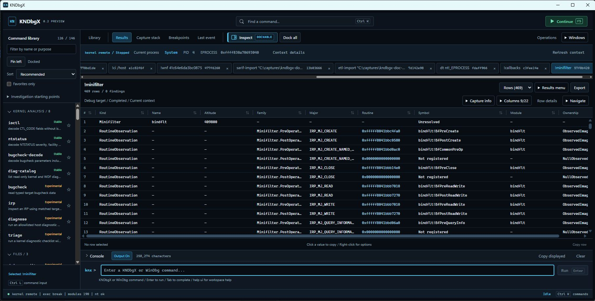

*The capture contains 469 rows covering filter records and operation callbacks; this is not a count of 469 filters.*

### Process cross-view: `!hiddenproc`

Find `!hiddenproc` in **Library / Ctrl+K** and run it on a stopped, supported kernel target. Remote KD compares the active process list with the target's CID table, keeping both identities and the comparison outcome in one table. **Row details** shows the original fields; **Export** saves the retained comparison.


*This capture shows Total 88 / Matched 88 / Mismatch candidates 0 / Indeterminate 0. Total includes matching processes; all 88 collected rows report the same observed identity in both views.*

Mismatch candidates require re-observation; process creation, teardown and PID reuse can explain differences. Incomplete inputs remain Indeterminate, and a process absent from both views is invisible to this comparison. [Comparison limits](docs/UX.md#compare-two-process-inventories)

### Process-handle access

Run `!handles /owner-pid 4` to inspect System's Process handles with VM-access rights. Use `/target-pid` with an observed PID to narrow the destination. Compare owner, target, granted access and cross-process classification; select a row for its original identity and mask. Remote KD reads the guest's handle tables.


*This capture completed with 437 rows for Process handles owned by System. A granted access right does not prove that a read, write or injection occurred.*

<details>
<summary>Inspect the original handle fields</summary>


[Handle workflow](docs/UX.md#inspect-process-handle-access)

</details>

### Driver objects, dispatch routines and device stacks

Run `!driver`, choose an observed driver, then inspect it with `!drvobj \Driver\fvevol` or its object address. Compare major-function slots, handler symbols and owning modules. Follow a device address with `!devstack <device-address>`; replace angle-bracket operands with observed values.


*The example retains 34 driver/dispatch/device records. A handler in another module can be legitimate shared code; ownership alone is not an integrity verdict.*

<details>
<summary>Inspect the loaded module and PE sections</summary>

Run `!module fvevol` for target-memory PE and section observations. `/disk` is available only with verified local-target file correlation and uses bounded, identity-matched samples, not a complete relocated-image comparison.


[Driver and module workflow](docs/UX.md#inspect-driver-dispatch-and-loaded-image-metadata)

</details>

### Driver load history

Run `!mapper` to display individual records from `!unloaded`, `!piddb` and `!cihash` together, identified by **Source Command**. Capture info and exports retain each collection's coverage and profile. `!cihash` displays names, two raw hashes and cached raw status when its CI image profile is verified. Missing records do not prove history erasure or manual mapping. [History workflow](docs/UX.md#inspect-driver-history)

### Registry hives and ALPC owners

Run `!hive` to compare registry root paths, backing-file names, flags and file sizes. Routine symbols remain available. On the reviewed 28000.2952 kernel, `!alpc` walks the global list of initialized ports, including unnamed client/server endpoints. It shows port type, owner PID/image, connection name and peer address. `Unnamed` is distinct from an unreadable name. Without that profile, named-namespace observations remain available when their layouts can be verified, with an explicit unnamed-port coverage gap. [Hive and ALPC workflow](docs/UX.md#inspect-hives-and-alpc-ports)

### Other callback and service-table surfaces

Use `!nmi` for the NMI callback chain, `!hal` for HAL dispatch function pointers and `!fwtable` for registered firmware-table providers. Each result carries the available routine/module evidence and layout gaps; these commands do not modify registrations.

`!ssdt` collects native, per-session Shadow SSDT and conditional filtered dispatch observations when their layout, code and extent can be verified. `!ssdt /policy` lists process filter policies; append a PID, EPROCESS address or unambiguous image name for service-level filter decisions. Open **View output** when the table is empty.

<details>
<summary>See why an empty SSDT result is still Partial</summary>


This screenshot predates the reviewed 28000.2952 profiles. The profiles cover 490 native entries and 1,497 win32k services per populated session, with separate normal and filtered rows. The table distinguishes entry wrappers, implementation targets and verified unregistered targets. Filtered routes are conditional, not a prediction of a process's policy. Unsupported layouts still produce explicit gaps; zero rows do not establish a clean table. [Coverage workflow](docs/UX.md#read-a-collectors-coverage-limits)

</details>

## Inspect memory permissions

### VADs and page-table samples

Run `!vad image:smss.exe /hiddenpte /limit 32`, or choose **Processes > Memory (VADs)**. Compare the declared VAD protection with first/last-page samples in **Row details**. `/exec` narrows the requested investigation; `/limit` limits console display, not retained rows.


*This capture has 24 rows and 23 unknown observations. Endpoint samples, bounded to 256 pages globally, do not cover every page or find every hidden mapping.* [VAD workflow](docs/UX.md#compare-vad-protection-with-page-samples)

### Address translation and effective permissions

Run `!kpage nt!NtOpenProcess L4` for four page-aligned translations. Compare physical addresses and effective writable/executable permissions. `!address <address>` combines translation, permissions and ownership; `vtop <address>` translates a VA, and `query <address> [length]` probes readability. `procctx` selects the translation DTB, separately from debugger attachment.


*These four pages were executable and not writable. A failed walk does not establish an unmapped page; PE section flags and allocation ownership answer different questions.* [Page workflow](docs/UX.md#inspect-page-permissions-for-a-chosen-range)

### Big-pool allocations and W+X observations

Run `!pool big /wx /limit 16`. Narrow by a four-character case-sensitive `/tag`, hexadecimal `/min` or `/max`, or `/addr`. Inspect **wxObserved**, **inspectedPages**, **skippedPages** and **rangeClassified** together. `/wx` samples the first page; `/full` requests all pages within the global budget. `/wx` does not filter the table to W+X rows.


*The 73-row capture is Partial. The selected allocation has one inspected page and two skipped pages. `!payload` uses the same big-pool sampling; neither a true nor false sample is a whole-allocation malware verdict. Small pool is outside this inventory.* [Pool workflow](docs/UX.md#inspect-big-pool-allocations-and-wx-samples)

## Inspect CPU and platform state

### IDT, control registers and system-call MSRs

Run `!idt` and sort **Vector** to compare handlers across CPUs. `!cr` shows saved CR0/CR4/CR8 with decoded WP, SMEP, SMAP and LA57 bits. Both use saved processor state without switching the debugger CPU.


<details>
<summary>See saved control-register values and decoded protection bits</summary>


The IDT example retained 451 gates with Partial coverage; the control-register example completed six rows. Saved state can differ from a contemporaneous read. [CPU workflow](docs/UX.md#review-per-cpu-idt-and-control-state)

</details>

Run `!msrcheck` for LSTAR, CSTAR, STAR, FMASK and EFER on the verified current event CPU. Inspect **Read from** and **Why unavailable** before comparing values.

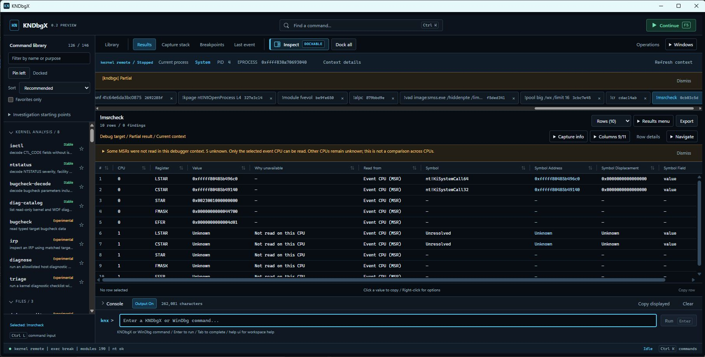

*Only CPU 0 was read here. CPU 1 remains Unknown, so this is not an all-CPU hook check.*

### DPC queues and timers

Run `!dpc` for per-CPU routine, context and importance observations. `!timer` displays raw due time, period in milliseconds, signal state and timer object. On the verified 28000.2952 NT image it also decodes the DPC, including encoded NULL, and resolves its routine. Other images retain Unknown when no decoder is verified. Compare completed queues with expected queues; active/completed work outside these queues is not covered. [Queue workflow](docs/UX.md#inspect-dpc-queues-and-timers)

### Host and target security observations

Run `!hv` to see **HostCpuidObservation** and **TargetControlRegister** as separate records. The host CPU/hypervisor leaves and the debuggee's CR4 come from different sources; they do not establish the guest's VBS or protection state.


<details>
<summary>Inspect explicit host CI/HVCI flags and local-KD-only collectors</summary>

`!ci /host` explicitly queries the debugger host's public CI/HVCI flags. Without `/host`, `!ci` requires verified local KD. The screenshot is **host information**, not the remote VMware guest's policy.


`!wfp filters callouts` reads the remote target runtime on the matched 28000.2952 NETIO/fwpkclnt/NT profiles. Verified local KD retains BFE filters, callouts, providers, sublayers and layers. `!dma` observes DMAR/IVRS firmware tables and `!byovd` compares local driver-file SHA-256 hashes with an operator-supplied catalog; those two still require verified local KD. Table presence does not prove active DMA protection, and a catalog match does not prove exploitability or loaded-image integrity. [Platform scope and catalog setup](docs/UX.md#distinguish-host-and-target-security-state)

</details>

### ETW logger metadata

Run `!etw` for the target host silo's logger names, IDs, modes, status, lost-event counts, log files and clock representation. Use **Capture info / View output** to distinguish missing layouts from an empty inventory. The command neither starts tracing nor substitutes host loggers for guest data. [ETW workflow](docs/UX.md#inspect-etw-logger-metadata)

## Save and compare snapshots

Capture a baseline, perform the investigation step you want to compare, stop the target again and save to another **new** directory:

```text
!snapshot "C:\captures\before"
!snapshot "C:\captures\after"
!diff "C:\captures\before" "C:\captures\after"
```

**Artifact Committed** confirms the bundle was saved; **Collection Complete** describes its evidence coverage separately. Snapshot v2 contains processes, modules, callbacks, SSDT, IDT, control registers, HAL and unloaded-driver events with manifest checksums. Collection is sequential, not atomic; raw memory is not included.

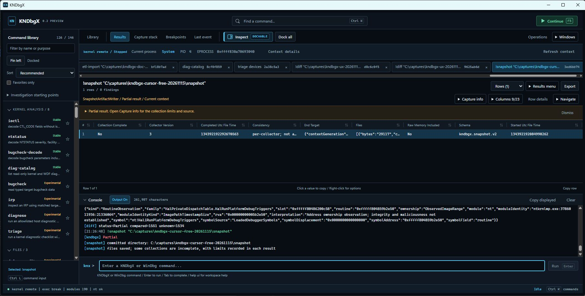

Sort **State** in the comparison, then open **Row details** for before/after records. Missing identity or incomplete input remains Unknown instead of an unsupported Added/Removed claim.

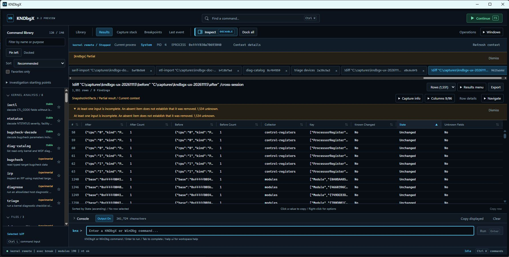

*The comparison reopens an earlier pair of saved bundles, separate from the new save shown above. It spans debugger session reinitialization: 1,551 rows, 1,534 Unknown and 17 Unchanged. It does not attribute all differences to one intervening action.*

<details>
<summary>Session guard, before/after details and legacy import</summary>

Different session identities require `!diff "C:\captures\before" "C:\captures\after" /cross-session`. Process identities and unloaded-driver events remain incomparable across sessions.


`!snapshot-import <text-file> <new-directory>` imports supported legacy text into a bundle with Unknown coverage. Offline rows do not bind saved addresses to the current target. [Snapshot workflow](docs/UX.md#save-and-compare-kernel-snapshots)

</details>

## Bring file evidence and diagnostics into Results

### Driver-file audit

Run `driver-audit "C:\evidence\driver.sys"` on a host file. Inspect PE identity, mitigation declarations, sections, imports and embedded-signature policy as rows. Match **FileEvidence** path/hash to the target before correlating it with a loaded module.

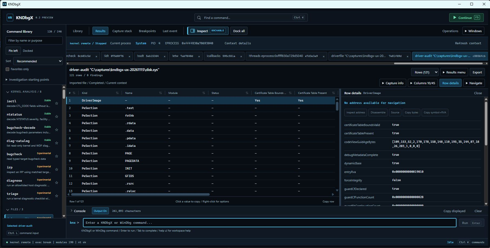

*The example is a host `disk.sys` copy with 121 rows; its relationship to the guest driver is unverified. Declared mitigation bits do not prove runtime enforcement.*

<details>
<summary>Inspect embedded-signature policy and unchecked scopes</summary>


The check uses host trust policy and does not evaluate catalog signing, revocation or the target's signing/HVCI policy. NoEmbeddedSignature is not an unsigned-driver verdict. [Driver audit workflow](docs/UX.md#audit-a-driver-file)

</details>

### SARIF and ETL imports

Run `sarif-import "C:\evidence\analysis.sarif"`, select a **StaticFinding**, then open **Row details** for its rule, level, message and source location. The run and file-evidence rows retain provenance.

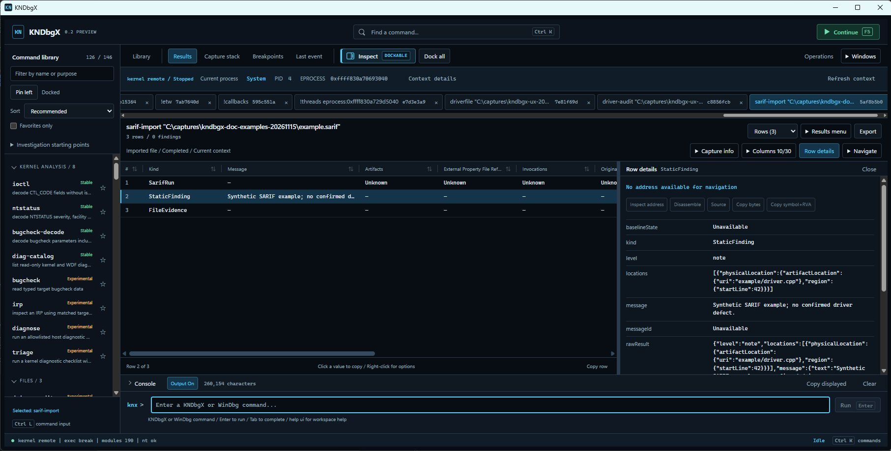

*This screenshot uses a clearly labeled documentation fixture. Imported findings are analyzer output, not independently confirmed defects or automatic matches to the debuggee.*

Run `etl-import "C:\evidence\trace.etl" 2048` to inspect recorded event headers, provider metadata and bounded payload previews. The decimal event limit defaults to 2,048 and cannot exceed 16,384.

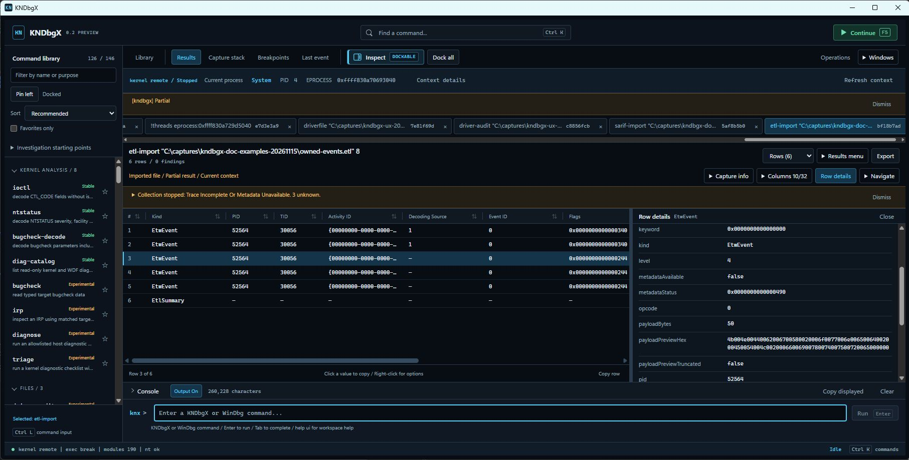

*This pre-existing synthetic test trace has five event rows and a summary; three missing metadata observations make it Partial. It is not a guest trace. Import does not start tracing, decode arbitrary WPP payloads or infer DPC latency.* [File-import workflow](docs/UX.md#import-sarif-and-etl-files)

### Diagnostic checklists, crash data and IRPs

Run `diag-catalog` to browse 53 recipes. Choose `diagnose <recipe> [operand]` for one, or `triage devices` for storage, USB and PnP. Other profiles cover crash, hang, I/O, power, memory, network and WDF; WDF needs a module.

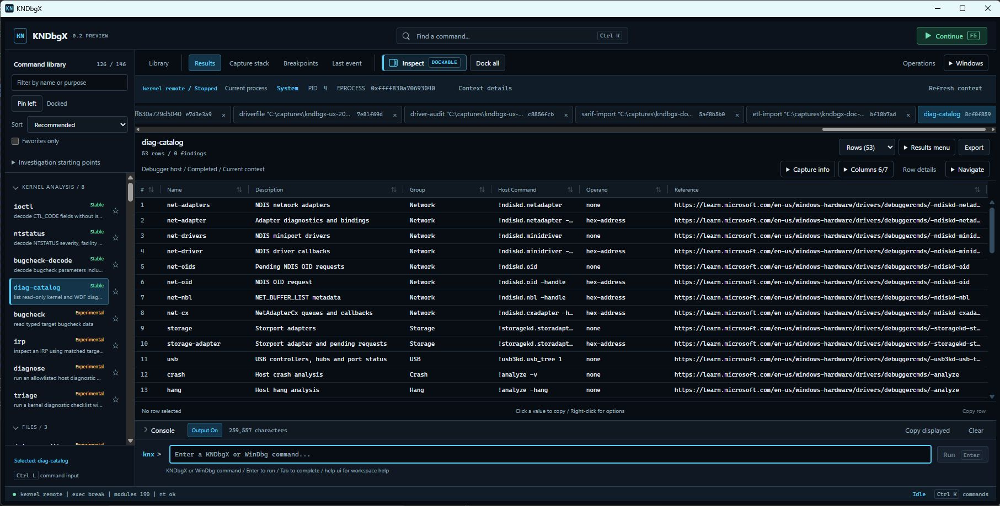

KNDbgX wraps existing WinDbg extensions with step records, saved output and context-restoration observations. Inspect **attempted**, **engineAccepted**, **contextRestored** and skipped-step reasons; native acceptance is not proof of complete data.


<details>
<summary>Read saved native output and inspect crash/I/O objects</summary>

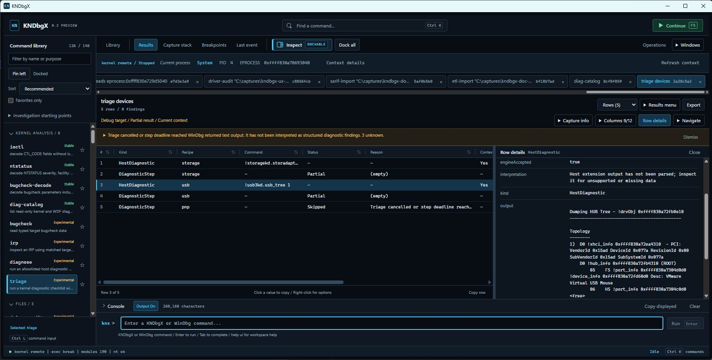

Use **View output** or **Raw record** when a cell preview is abbreviated. This captured run attempted storage/USB and skipped PnP after the deadline; an active native call can outlast that deadline.

`bugcheck` reads typed target bugcheck data; `irp <address>` reads an observed IRP with matched PDB layouts. `bugcheck-decode <hex-code> <p1> <p2> <p3> <p4>` decodes supplied parameters, including supported KASAN cases, without creating a crash. [Diagnostic workflow](docs/UX.md#run-a-diagnostic-checklist)

</details>

### Value decoders

Use `ioctl 222004` for CTL_CODE fields, `ntstatus c0000005` for status severity/facility/code, or `!wnf 41c64e6da3bc0875` for WNF state-name fields. These decode supplied numbers; `ioctl` does not send a request.

<details>
<summary>See the synthetic WNF decoding example</summary>


The example number was constructed for documentation. No subscription, state payload or WNF security property was collected from the guest. [Decoder workflow](docs/UX.md#decode-values-without-reading-the-target)

</details>

## Follow an address into Memory or Disassembly

Select a result row and open **Row details**, then choose **Open Memory** or **Disassemble**. Callback rows let you choose Routine, Pre or Post. Recognized address cells also offer **Open Memory / Open Disassembly** in their context menu. The action checks the source capture and process context before reading.


**Memory > Read options** chooses Virtual/Physical and byte count. Change byte/word/dword/qword display and ASCII using captured data; `??` marks unavailable bytes. **Read details** retains the context, ranges, transferred counts and native errors. `s <address> L<bytes> <byte...>` searches a bounded range.

<details>
<summary>Address actions and saved memory-read details</summary>


Previous/Next uses the successfully captured range. Edited addresses or changed context require a new read. Historical or mismatched results cannot authorize current target reads. [Memory workflow](docs/UX.md#memory-tab)

</details>

### Disassembly, registers and floating windows

**Disassembly** provides Current IP, Next instructions, Follow IP and breakpoint markers. Select an instruction for address actions; `u`/`uf` also retain disassembly results. **Registers** supports filtering, pinned/changed values and raw vector bytes while keeping its captured CPU/thread identity visible.


<details>
<summary>Registers and independent inspection windows</summary>

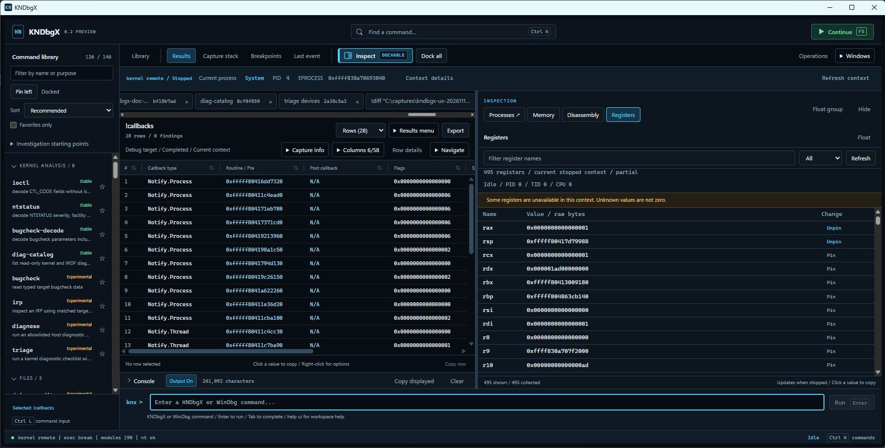

Each view can **Float** independently; **Float group** detaches Inspect. Dock via its title-bar guides or **Windows > Dock all views**. **Bring windows into view** recovers misplaced windows; views share one debugger context and execution slot.

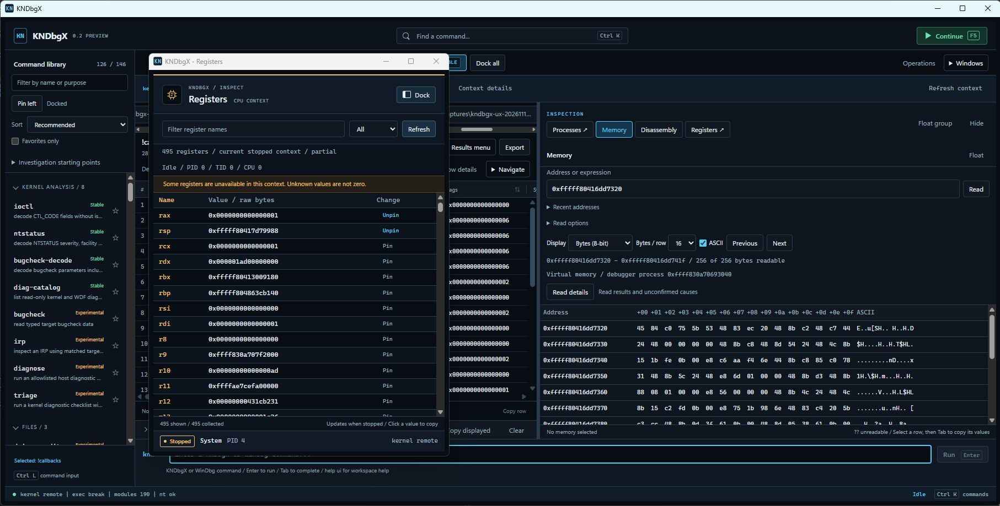

[Floating-window workflow](docs/UX.md#floating-inspection-windows)

</details>

`navigate va <address>` / `navigate pa <address>` keeps scoped address observations. `history`, `back`, `forward`, `bookmark "note"` and `bookmarks` retain/revisit saved results. They do not re-read old addresses; inspection inputs' **Recent** lists instead read the chosen expression in the current context. `source [address]` uses the host's source lookup when available.

## Start from a process

Open **Inspect > Processes**, select a process, then choose **Open details**, **Threads**, **Memory (VADs)** or **Token**. The result opens in its own tab while the process list remains available. Double-click a result tab to give it a useful name.

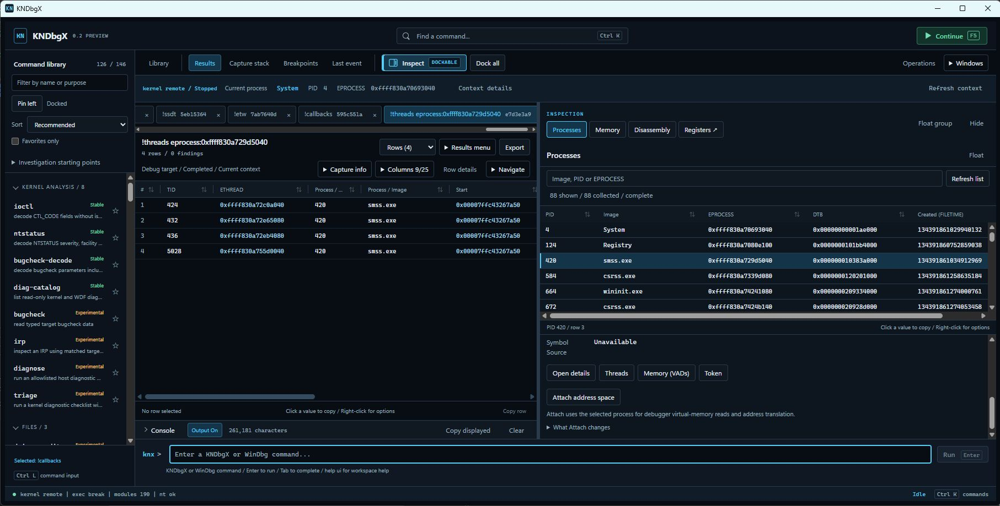

Search by image/PID and inspect EPROCESS, DTB and creation time. `!dml_proc` / `!process 0` enumerate processes; `!process pid:4`, `!threads pid:4` and `!token pid:4` select one explicitly. Without a selector, `!threads` observes the current thread and `!token` uses its impersonation token when active, otherwise the current process primary token.

Selecting a row does not switch the debugger's address space. **Attach address space** is a separate verified action; register thread/CPU context is separate too. Incomplete inventories may prevent image-name selection; use an observed PID or EPROCESS. [Process inspection](docs/UX.md#processes-tab)

## Check context and symbols

Open **Context details** to distinguish selected process, implicit address space, debugger thread/CPU, scope and last event. **Refresh context** updates observations.

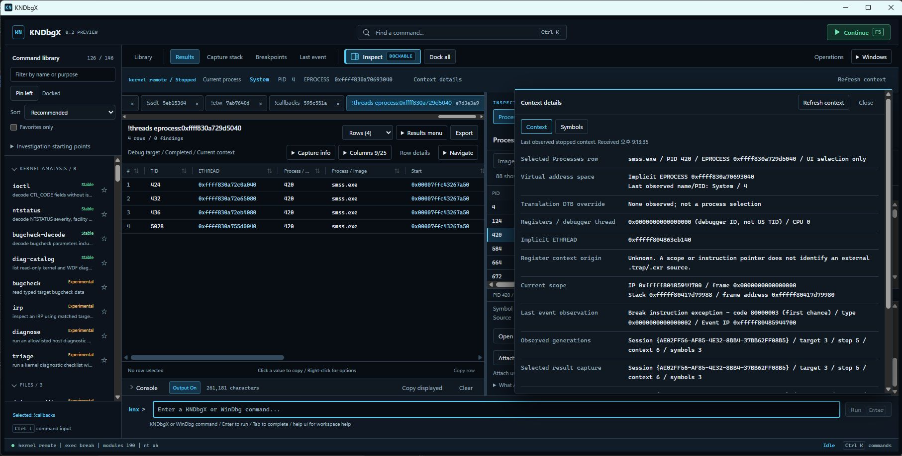

Under **Symbols**, choose **Read modules**, select a module and **Inspect selected module**. Optional Type/Field inputs such as `_EPROCESS` / `UniqueProcessId` test metadata availability. A matching image/PDB and an available private field are separate checks; **Insert reload draft** only prepares a command.


<details>
<summary>Browse typed layouts and values in Results</summary>

Run `dt nt!_EPROCESS` for field offsets, sizes, bit ranges and provenance; append an observed instance address to request field values. Sort by **Offset** or inspect individual records.


This capture requests the layout only, not an instance. Missing type names or optional metadata remain unavailable. `lm`, `x`, `ln`, `.sympath` and `.reload` provide module/symbol tools; missing private types cannot be repaired by repeatedly loading the same PDB. [Symbol workflow](docs/UX.md#context-symbols-and-waits)

</details>

## Keep results, control execution and recover work

### Retained results and export

Switch tabs without rerunning captures. Double-click/F2 to rename, drag to reorder, choose **Columns**, sort, copy full cell values or open **Row details**. Hidden columns remain in the saved result. **Capture info** explains source and coverage; **Export** saves all retained rows and output, including data outside the viewport.


Exports go to `%LOCALAPPDATA%\kndbgx\logs`; **Copy saved path** retrieves the confirmed destination. For another destination, use `results` to find an ID, then `result-export <id> "C:\captures\result.json"`. `result-read <id> [row-offset] [finding-offset]` pages through retained data. Up to 16 unpinned and 128 protected open-tab results share 64 MiB; export before eviction or DLL unload. [Export and recovery](docs/UX.md#export-and-recovery)

### Operations, cancellation and jobs

**Operations** shows stages, elapsed time, cancellation state and retained outcomes. **Cancel operation** requests cooperative cancellation; a native symbol/memory call must return first. **Refresh outcomes** checks existing work without resubmitting it. Pause automatic inspection reads when you want manual control of refreshes.


<details>
<summary>Inspect incomplete coverage after a deadline</summary>


This run reached the step deadline without a cancellation request. PnP remains Skipped with **attempted: false**; earlier outputs remain available. Retained rows do not become a complete inventory. `submit <command>`, `jobs`, `job <id>` and `cancel <id>` offer background-job control from commands. Only one engine operation runs at a time. [Operations workflow](docs/UX.md#context-symbols-and-waits)

</details>

### Execution and approved changes

Use **Continue / Break**, F5 and Disassembly's F10/F11 on supported live targets. **Breakpoints** shows settings; **Last event** retains event information separately. With Disassembly's instruction grid focused, F9 opens an addition preview when the selected instruction has no breakpoint; **+** beside the instruction does the same. If exactly one breakpoint already exists, F9 or its filled/hollow marker directly disables/enables it without an addition preview. Multiple matches open the breakpoint list. Add/Delete needs preview approval; Enable/Disable applies its context-bound action on click.

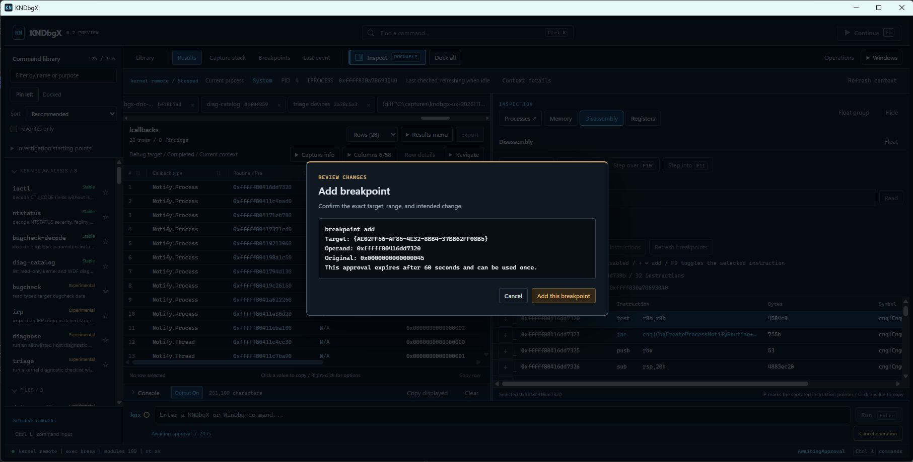

*The captured preview was canceled. It does not demonstrate breakpoint application, stepping or a target-memory write.*

Registered `eb`/`ew`/`ed`/`eq`, `f` and `setfield` changes use `plan <mutation-command>` followed by one-use approval. Review original/proposed bytes, type/field and target context before `approve <plan-id> <approval-token>`. Plans expire after 60 seconds and recheck context/original bytes; partial writes have no automatic retry or rollback. `debug-plan` / `debug-approve` provide the separate breakpoint/execution plan flow. [Change workflow](docs/UX.md#execution-and-changes)

<details>
<summary>See retained history while the target runs</summary>

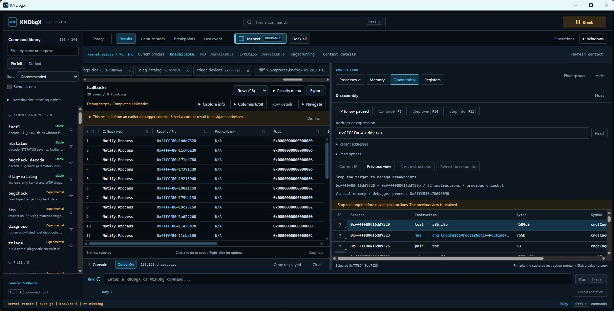

Historical captures remain readable but cannot authorize new target actions. Stop the target and refresh before another read.

</details>

### Dumps, bounded memory exports and Data Model

Use `dump-raw <address> <length> "C:\captures\range.bin"` for a bounded VA range (`/phys` for PA), or `dump-pe <module|address> "C:\captures\mapped.bin"` for a mapped image. Exports are capped at 64 MiB; unreadable requested bytes prevent publication. A mapped PE uses virtual section offsets and does not reconstruct the original disk file. `.dump <path>` delegates dump creation to the host; `dump-analyze <path>` inspects an existing dump header.

On hosts with `IHostDataModelAccess`, `model publish <result-id>` copies a bounded page into `Debugger.Models.KNDbgX` for `dx` inspection (up to 128 rows and 128 findings). These copied values remain readable after extension unload and do not read the target. Unsupported hosts retain normal CLI/UI results. [Commands and limits](docs/COMMANDS.md#limits)

The [workspace guide](docs/UX.md) adds detailed steps and [keyboard shortcuts](docs/UX.md#shortcuts). CLI remains available if the UI cannot start: prefix a workspace command with `!kndbgx` in WinDbg, for example `!kndbgx !callbacks`.

## Command index

All **126 registered commands** are documented below: **121 Stable/Experimental entries** and **5 Unsupported entries**, plus their **20 aliases**. Groups follow investigation tasks. The generated [command reference](docs/COMMANDS.md) remains the source for registry grammar and target-mode metadata; each entry here adds a purpose and usage example.

Enter examples in the **KNDbgX command input**. In WinDbg, prefix them with `!kndbgx`: UI `!callbacks` becomes `!kndbgx !callbacks`, and UI `db <va> L20` becomes `!kndbgx db <va> L20`. This distinguishes the extension from native WinDbg commands with the same names.

**Notation:** `<...>` is a value to replace, `[...]` is optional, and `|` separates alternatives; do not type the notation itself. Examples containing placeholders are templates, not commands ready to paste unchanged. Addresses, object identities and IDs must come from your current target/results; quoted file paths are on the debugger host. Run command lines separately.

**Availability:** Stable/Experimental labels are scoped to the [supported environments](docs/SUPPORT.md), not a promise of complete collection on every Windows build. Stop a live target before inspecting its memory. Live-kernel-only and verified-local-KD requirements are called out per entry. A wrapper such as `submit` still applies its child command requirements. Missing layouts/pages stay Partial or Unavailable.

**Numbers:** `pid:` selectors and PID filters, stack limits, result offsets, ETL limits and VAD/pool `/limit` use decimal. Memory-display/disassembly `L` counts, byte patterns and mutation values use hexadecimal; `L20` is 32 elements. Pool `/min` and `/max` use hexadecimal byte sizes. Use `help <command>` to check an entry before changing or exporting data.

- [Kernel callbacks, filters and driver evidence](#kernel-callbacks-filters-and-driver-evidence)
- [Processes, threads, tokens and address space](#processes-threads-tokens-and-address-space)
- [Page translation, permissions and pool](#page-translation-permissions-and-pool)
- [CPU, kernel tables and platform state](#cpu-kernel-tables-and-platform-state)
- [Snapshot capture, comparison and import](#snapshot-capture-comparison-and-import)
- [Kernel diagnostics and value decoders](#kernel-diagnostics-and-value-decoders)
- [Host-file evidence and dump exports](#host-file-evidence-and-dump-exports)
- [Virtual and physical memory reads](#virtual-and-physical-memory-reads)
- [Symbols, types and disassembly](#symbols-types-and-disassembly)
- [Debugger context and saved navigation](#debugger-context-and-saved-navigation)
- [Retained results, Data Model and jobs](#retained-results-data-model-and-jobs)
- [Planned memory changes and execution actions](#planned-memory-changes-and-execution-actions)
- [Session, help and native command forwarding](#session-help-and-native-command-forwarding)
- [Registered but unsupported](#registered-but-unsupported)

### Kernel callbacks, filters and driver evidence

These collectors are Experimental and need an x64 kernel target with usable symbols/layouts. Registrations and owning modules are observations, not integrity or malware verdicts. Read Partial/Unknown coverage before interpreting an empty result.

<details>
<summary>16 commands — purpose, syntax and examples</summary>

| Command / aliases | Purpose and availability | Syntax and examples |
|---|---|---|
| `!callbacks` | List notify, object and registry callback routines and their owning modules.<br>Experimental · Kernel x64 / dump | `!callbacks`<br>Examples: `!callbacks` |
| `!minifilter`<br>Aliases: `!fltmgr` | List filters, altitudes and PreOperation/PostOperation callbacks.<br>Experimental · Kernel x64 / dump | `!minifilter`<br>Examples: `!minifilter` |
| `!driver` | Enumerate driver objects in the \Driver namespace.<br>Experimental · Kernel x64 / dump | `!driver`<br>Examples: `!driver` |
| `!drvobj` | Inspect a DRIVER_OBJECT, IRP dispatch slots and associated devices.<br>Experimental · Kernel x64 / dump | `!drvobj <name\|address>`<br>Examples: `!drvobj \Driver\fvevol`<br>`!drvobj <driver-object>` |
| `!devstack` | Walk the device stack attached to an observed device object.<br>Experimental · Kernel x64 / dump | `!devstack <device-address>`<br>Examples: `!devstack <device-address>` |
| `!module` | Read loaded PE identity and section metadata; /disk adds a file comparison only in verified local KD.<br>Experimental · Kernel x64 / dump | `!module [module] [/disk]`<br>Examples: `!module fvevol`<br>`!module fvevol /disk` |
| `!unloaded` | Inspect retained MmUnloadedDrivers entries; missing history does not establish erasure.<br>Experimental · Kernel x64 / dump | `!unloaded`<br>Examples: `!unloaded` |
| `!piddb` | Show verified PiDDB driver names, raw PE timestamps and cached load-result NTSTATUS values. Entry decoding currently supports the 28000.2952 x64 profile.<br>Experimental · Kernel x64 / dump | `!piddb`<br>Examples: `!piddb` |
| `!cihash` | Show verified CI cache names, two raw 20-byte hashes and cached raw status.<br>Experimental · Kernel x64 / dump | `!cihash`<br>Examples: `!cihash` |
| `!mapper` | Show individual !unloaded, !piddb and !cihash records together, preserving source and collection coverage.<br>Experimental · Kernel x64 / dump | `!mapper`<br>Examples: `!mapper` |
| `!nmi` | Walk registered NMI callbacks and resolve their routines where possible.<br>Experimental · Kernel x64 / dump | `!nmi`<br>Examples: `!nmi` |
| `!hal` | Inspect verified HAL dispatch pointers and their owning modules.<br>Experimental · Kernel x64 / dump | `!hal`<br>Examples: `!hal` |
| `!hive` | List registry hive paths, backing files, flags, sizes and GetCellRoutine observations.<br>Experimental · Kernel x64 / dump | `!hive`<br>Examples: `!hive` |
| `!alpc` | List verified named and unnamed ALPC ports with type, owner and connection endpoints; inspect coverage limits.<br>Experimental · Kernel x64 / dump | `!alpc`<br>Examples: `!alpc` |
| `!fwtable` | Inspect registered firmware-table providers when their target layout is known.<br>Experimental · Kernel x64 / dump | `!fwtable`<br>Examples: `!fwtable` |
| `!etw` | Inspect target ETW logger metadata; does not start a trace or establish an InfinityHook verdict.<br>Experimental · Kernel x64 / dump | `!etw`<br>Examples: `!etw` |

</details>

### Processes, threads, tokens and address space

Use `pid:<decimal-pid>`, `image:<name>` or `eprocess:<hex-address>` for process selectors. Name selection needs a complete inventory. `!hiddenproc` and `!handles` require a live kernel; other collection entries here also support kernel dumps. `/owner` and `/target` are short forms of the PID filters. `/json` writes to a host path.

<details>
<summary>8 commands — purpose, syntax and examples</summary>

| Command / aliases | Purpose and availability | Syntax and examples |
|---|---|---|
| `!dml_proc`<br>Aliases: `!processes` | List PID, image, EPROCESS and DTB; optionally select one process and save JSON.<br>Experimental · Kernel x64 / dump | `!dml_proc [pid:PID\|image:NAME\|eprocess:ADDRESS] [/json path]`<br>Examples: `!dml_proc`<br>`!dml_proc pid:4 /json "C:\captures\process.json"` |
| `!process` | Read the current process, an explicit selector, or all processes with 0.<br>Experimental · Kernel x64 / dump | `!process [process\|0]`<br>Examples: `!process`<br>`!process 0`<br>`!process pid:4` |
| `!threads` | Without a selector, read the current ETHREAD; an explicit process lists its threads.<br>Experimental · Kernel x64 / dump | `!threads [process\|ethread:ADDRESS]`<br>Examples: `!threads`<br>`!threads pid:4`<br>`!threads ethread:<thread-address>` |
| `!hiddenproc` | Compare active-list and CID process views remotely, or Toolhelp in verified local KD. Differences are candidates, not confirmed hidden processes.<br>Experimental · Live kernel x64 | `!hiddenproc`<br>Examples: `!hiddenproc` |
| `!handles` | Inspect Process handles with VM-access rights, filtered by owner and/or target PID; rights do not prove use.<br>Experimental · Live kernel x64 | `!handles [/owner-pid PID] [/target-pid PID] [/json path]`<br>Examples: `!handles /owner-pid 4`<br>`!handles /owner-pid 4 /target-pid <pid> /json "C:\captures\handles.json"` |
| `!token` | Read the current thread effective token, or an explicit process primary token.<br>Experimental · Kernel x64 / dump | `!token [process]`<br>Examples: `!token`<br>`!token pid:4` |
| `!vad` | Walk the current or selected process VADs. /exec selects executable VADs; /hiddenpte adds page samples; /limit limits console display.<br>Experimental · Kernel x64 / dump | `!vad [process] [/exec] [/hiddenpte] [/limit count] [/json path]`<br>Examples: `!vad`<br>`!vad image:smss.exe /exec /hiddenpte /limit 32 /json "C:\captures\vad.json"` |
| `procctx` | Show, set or reset the manual translation DTB. It does not switch the debugger process, thread or register context.<br>Stable · Attached target / dump | `procctx [show\|reset\|pid:<id>\|eprocess:<address>]`<br>Examples: `procctx show`<br>`procctx pid:4`<br>`procctx reset` |

</details>

### Page translation, permissions and pool

Page commands require an x64 kernel target. Big-pool commands require a live kernel and do not enumerate small pool. `/tag` (`/t`) is case-sensitive and exactly four ASCII characters; `/min` and `/max` are hexadecimal bytes. `/limit` is a decimal console-display limit, not a guarantee of complete traversal. `/wx` requests permission samples rather than filtering the table to W+X rows; `/json <path>` saves retained pool rows.

<details>
<summary>6 commands — purpose, syntax and examples</summary>

| Command / aliases | Purpose and availability | Syntax and examples |
|---|---|---|
| `vtop` | Walk PML4/PML5 entries for a virtual address, using an explicit DTB, procctx override or current CR3.<br>Experimental · Kernel x64 / dump | `vtop <virtual-address> [dtb]`<br>Examples: `vtop nt!NtOpenProcess`<br>`vtop <va> <dtb>` |
| `query` | Probe a virtual range for readable bytes; length defaults to one byte and is bounded to 64 KiB.<br>Experimental · Kernel x64 / dump | `query <address> [length]`<br>Examples: `query nt!NtOpenProcess 0x20` |
| `!address` | Combine address translation, effective page permissions and available ownership information.<br>Experimental · Kernel x64 / dump | `!address <address>`<br>Examples: `!address nt!NtOpenProcess` |
| `!kpage` | Walk page translations and permissions for a VA range, aligned to the first containing page.<br>Experimental · Kernel x64 / dump | `!kpage <address> [L<count>]`<br>Examples: `!kpage nt!NtOpenProcess L4` |
| `!pool` | Summarize or list big-pool allocations. Filter by tag, size or address; /wx samples permissions and /full requests all pages within the collection budget.<br>Experimental · Live kernel x64 | `!pool [big\|find\|summary] [/tag TAG] [/min hex] [/max hex] [/addr VA] [/wx] [/full] [/limit count] [/json path]`<br>Examples: `!pool summary`<br>`!pool find /tag Cont /min 1000 /max 10000 /limit 32`<br>`!pool big /addr <va> /wx /full` |
| `!payload` | Run the big-pool collector with permission sampling. A W+X observation is not a malware verdict or complete allocation classification.<br>Experimental · Live kernel x64 | `!payload`<br>Examples: `!payload` |

</details>

### CPU, kernel tables and platform state

`!byovd` and `!dma` require verified local KD. Remote/dump `!wfp [filters] [callouts]` reads target runtime memory only on matched image/PDB/code profiles; it never substitutes host BFE state. BFE providers, sublayers and layers remain local-KD collections. `!ci /host` and the CPUID part of `!hv` explicitly describe the debugger host. For `!byovd`, prepare the catalog documented in the [platform workflow](docs/UX.md#distinguish-host-and-target-security-state); a hash match does not establish exploitability.

<details>
<summary>11 commands — purpose, syntax and examples</summary>

| Command / aliases | Purpose and availability | Syntax and examples |
|---|---|---|
| `!idt` | Inspect per-CPU IDT gates, handler addresses and modules; compare matching vectors across CPUs.<br>Experimental · Kernel x64 / dump | `!idt`<br>Examples: `!idt` |
| `!ssdt` | Read service dispatch targets or process filter policies and service-level decisions.<br>Experimental · Kernel x64 / dump | `!ssdt [/policy [pid\|eprocess\|image]]`<br>Examples: `!ssdt`, `!ssdt /policy`, `!ssdt /policy pid:PID` |
| `!msrcheck` | Read LSTAR/CSTAR/STAR/FMASK/EFER on the verified selected CPU; other CPUs remain Unknown.<br>Experimental · Kernel x64 / dump | `!msrcheck`<br>Examples: `!msrcheck` |
| `!cr` | Read saved per-CPU CR0, CR4 and CR8 values and decoded flags.<br>Experimental · Kernel x64 / dump | `!cr`<br>Examples: `!cr` |
| `!dpc` | Walk declared per-CPU DPC queues; does not measure latency or cover completed work.<br>Experimental · Kernel x64 / dump | `!dpc`<br>Examples: `!dpc` |
| `!timer` | Show timer due values, periods, signal states and queue coverage; encoded DPC values may remain Unknown.<br>Experimental · Kernel x64 / dump | `!timer`<br>Examples: `!timer` |
| `!hv` | Show host CPUID/hypervisor observations separately from available debuggee CR4 state.<br>Experimental · Host CPUID; target CR4 if available | `!hv`<br>Examples: `!hv` |
| `!ci` | Read public CI/HVCI flags in verified local KD; /host explicitly queries the debugger host.<br>Experimental · Local KD, or explicit /host | `!ci [/host]`<br>Examples: `!ci`<br>`!ci /host` |
| `!byovd` | Compare local driver-file SHA-256 values with an operator-provided catalog. /status reads catalog metadata only.<br>Experimental · Verified local KD x64 | `!byovd [/status]`<br>Examples: `!byovd /status`<br>`!byovd` |
| `!wfp` | Read target runtime filters/callouts on the matched remote KD or dump profile; use BFE management collections in verified local KD.<br>Experimental · Kernel x64 | `!wfp [filters] [callouts]`<br>Examples: `!wfp filters callouts` |
| `!dma` | Observe host DMAR/IVRS firmware tables in verified local KD; table presence does not prove active DMA protection.<br>Experimental · Verified local KD x64 | `!dma`<br>Examples: `!dma` |

</details>

### Snapshot capture, comparison and import

Use a new output directory for every save/import. Snapshot collection is sequential, not atomic; Artifact Committed and Collection Complete are separate. Offline comparisons never bind saved addresses to the current target. Cross-session process and unload-event identities remain incomparable even with `/cross-session`.

<details>
<summary>3 commands — purpose, syntax and examples</summary>

| Command / aliases | Purpose and availability | Syntax and examples |
|---|---|---|
| `!snapshot` | Save a versioned kernel collection bundle, manifest and checksums to a new directory; no raw memory is included.<br>Experimental · Kernel x64 / dump | `!snapshot <new-directory>`<br>Examples: `!snapshot "C:\captures\before"` |
| `!diff` | Compare saved bundles offline; preserve Unknown for incomplete inputs. Different sessions require /cross-session.<br>Experimental · No target required | `!diff <before-directory> <after-directory> [/cross-session]`<br>Examples: `!diff "C:\captures\before" "C:\captures\after"`<br>`!diff "C:\captures\before" "C:\captures\after" /cross-session` |
| `!snapshot-import` | Import supported legacy text into a new snapshot bundle; collection coverage remains Unknown.<br>Experimental · No target required | `!snapshot-import <text-file> <new-directory>`<br>Examples: `!snapshot-import "C:\captures\legacy.txt" "C:\captures\imported"` |

</details>

Example sequence: save `before`, perform the intended investigation step, save a different `after` directory, then compare the two. A successful save can still contain Partial collections.

### Kernel diagnostics and value decoders

`ioctl`, `ntstatus`, `bugcheck-decode`, `!wnf` and `diag-catalog` do not need a target. Their numeric decoding examples are synthetic. The diagnostic recipes wrap host extensions and retain their text; acceptance does not prove complete structured findings. Check attempted, context restoration and deadline/skipped-step records. `triage` profiles are `crash`, `hang`, `io`, `power`, `memory`, `wdf`, `network` and `devices`.

<details>
<summary>9 commands — purpose, syntax and examples</summary>

| Command / aliases | Purpose and availability | Syntax and examples |
|---|---|---|
| `ioctl` | Decode CTL_CODE device, access, function and method fields without sending an IOCTL.<br>Stable · No target required | `ioctl <hex-code>`<br>Examples: `ioctl 222004` |
| `ntstatus` | Decode NTSTATUS severity, facility and status code.<br>Stable · No target required | `ntstatus <hex-code>`<br>Examples: `ntstatus c0000005` |
| `bugcheck-decode` | Decode supplied bugcheck parameters, including supported KASAN cases; does not crash the target.<br>Stable · No target required | `bugcheck-decode <hex-code> <p1> <p2> <p3> <p4>`<br>Examples: `bugcheck-decode a 0 2 0 0` |
| `diag-catalog` | List diagnostic recipe IDs, required operands and native commands before choosing one.<br>Stable · No target required | `diag-catalog`<br>Examples: `diag-catalog` |
| `bugcheck` | Read the target bugcheck record through verified typed fields.<br>Experimental · Kernel x64 / dump | `bugcheck`<br>Examples: `bugcheck` |
| `irp` | Inspect an observed IRP using matched target PDB layouts.<br>Experimental · Kernel x64 / dump | `irp <hex-address>`<br>Examples: `irp <irp-address>` |
| `diagnose` | Run one allowlisted native diagnostic, retaining output and context-restoration observations.<br>Experimental · Kernel x64 / dump | `diagnose <recipe> [hex-address\|module]`<br>Examples: `diagnose storage`<br>`diagnose irp <irp-address>` |
| `triage` | Run a bounded diagnostic checklist for the chosen profile; WDF requires a module operand.<br>Experimental · Kernel x64 / dump | `triage crash\|hang\|io\|power\|memory\|wdf\|network\|devices [module]`<br>Examples: `triage devices`<br>`triage wdf <module>` |
| `!wnf` | Decode a supplied WNF state name; does not enumerate subscriptions or read state payloads.<br>Experimental · No target required | `!wnf <state-name>`<br>Examples: `!wnf 41c64e6da3bc0875` |

</details>

### Host-file evidence and dump exports

Paths refer to the debugger host, including when the debuggee is a VM. Imports and `dump-analyze` do not need an attached target; exports do. `etl-import` uses a decimal event limit (default 2,048, maximum 16,384). Raw/mapped-image exports are limited to 64 MiB. Driver audit uses host embedded-signature policy without catalog or revocation checks; it does not establish target HVCI acceptance.

<details>
<summary>7 commands — purpose, syntax and examples</summary>

| Command / aliases | Purpose and availability | Syntax and examples |
|---|---|---|
| `driver-audit` | Read a host PE file and retain headers, mitigation declarations, sections, imports and limited embedded-signature policy.<br>Experimental · No target required | `driver-audit <path>`<br>Examples: `driver-audit "C:\evidence\driver.sys"` |
| `sarif-import` | Import bounded SARIF run/finding/location records with file provenance; findings remain analyzer output.<br>Experimental · No target required | `sarif-import <path>`<br>Examples: `sarif-import "C:\evidence\analysis.sarif"` |
| `etl-import` | Read ETL event headers, available provider metadata and bounded payload previews; does not start a trace.<br>Experimental · No target required | `etl-import <path> [decimal-limit]`<br>Examples: `etl-import "C:\evidence\trace.etl" 2048` |
| `.dump` | Ask the host debugger to write a dump of the current target to a host path.<br>Stable · Attached target / dump | `.dump <path>`<br>Examples: `.dump "C:\captures\target.dmp"` |
| `dump-analyze` | Read a host dump file header and identity offline; does not run a full crash diagnosis.<br>Stable · No target required | `dump-analyze <path>`<br>Examples: `dump-analyze "C:\captures\target.dmp"` |
| `dump-raw` | Export a bounded virtual range, or physical range with /phys; incomplete reads prevent publication.<br>Stable · Attached target / dump | `dump-raw <address> <length> <path> [/phys]`<br>Examples: `dump-raw <va> 0x1000 "C:\captures\range.bin"`<br>`dump-raw <pa> 0x1000 "C:\captures\physical.bin" /phys` |
| `dump-pe` | Export a mapped module image with virtual section offsets; this is not the original disk-file layout.<br>Stable · Attached target / dump | `dump-pe <module\|address> <path>`<br>Examples: `dump-pe fvevol "C:\captures\fvevol-mapped.bin"` |

</details>

### Virtual and physical memory reads

The `L` count is hexadecimal: `L20` means 32 elements, not necessarily 32 bytes. Unit widths are shown below; `da` counts bytes and `du` counts UTF-16 code units. Omit the address to continue after the last successful display, initially at the current instruction for virtual memory or zero for physical memory. `L<count>` alone uses that default address. Virtual, physical and disassembly cursors are separate and invalidated by context changes; `??` means unreadable bytes.

<details>
<summary>14 commands — purpose, syntax and examples</summary>

| Command / aliases | Purpose and availability | Syntax and examples |
|---|---|---|
| `db`<br>Aliases: `d` | Display virtual memory as 1-byte values; d is an alias.<br>Stable · Attached target / dump | `db [address] [L<elements>\|end-address]`<br>Examples: `db nt!NtOpenProcess L20` |
| `dw` | Display virtual memory as 2-byte words.<br>Stable · Attached target / dump | `dw [address] [L<elements>\|end-address]`<br>Examples: `dw <va> L10` |
| `dd` | Display virtual memory as 4-byte dwords.<br>Stable · Attached target / dump | `dd [address] [L<elements>\|end-address]`<br>Examples: `dd <va> L10` |
| `dq`<br>Aliases: `dp` | Display virtual memory as 8-byte qwords; dp is an alias.<br>Stable · Attached target / dump | `dq [address] [L<elements>\|end-address]`<br>Examples: `dq <va> L10` |
| `dc` | Display dwords with ASCII characters.<br>Stable · Attached target / dump | `dc [address] [L<elements>\|end-address]`<br>Examples: `dc <va> L10` |
| `dds` | Display dword values with available symbol annotations.<br>Stable · Attached target / dump | `dds [address] [L<elements>\|end-address]`<br>Examples: `dds <va> L10` |
| `dqs`<br>Aliases: `dps` | Display qword values with symbol annotations; dps is an alias.<br>Stable · Attached target / dump | `dqs [address] [L<elements>\|end-address]`<br>Examples: `dqs <va> L10` |
| `da` | Read an ASCII string up to the byte limit or terminator.<br>Stable · Attached target / dump | `da [address] [L<count>]`<br>Examples: `da <string-address> L40` |
| `du` | Read a UTF-16 string up to the code-unit limit or terminator.<br>Stable · Attached target / dump | `du [address] [L<count>]`<br>Examples: `du <string-address> L40` |
| `!db`<br>Aliases: `phys`, `pdb` | Display physical memory as 1-byte values; phys and pdb are aliases, not PDB-file commands.<br>Stable · Attached target / dump | `!db [physical-address] [L<elements>\|end-address]`<br>Examples: `!db <pa> L20` |
| `!dw`<br>Aliases: `pdw` | Display physical memory as 2-byte words.<br>Stable · Attached target / dump | `!dw [physical-address] [L<elements>\|end-address]`<br>Examples: `!dw <pa> L10` |
| `!dd`<br>Aliases: `pdd` | Display physical memory as 4-byte dwords.<br>Stable · Attached target / dump | `!dd [physical-address] [L<elements>\|end-address]`<br>Examples: `!dd <pa> L10` |
| `!dq`<br>Aliases: `pdq` | Display physical memory as 8-byte qwords.<br>Stable · Attached target / dump | `!dq [physical-address] [L<elements>\|end-address]`<br>Examples: `!dq <pa> L10` |
| `s` | Search a bounded virtual range for a sequence of hexadecimal bytes.<br>Stable · Attached target / dump | `s <address> L<bytes> <byte...>`<br>Examples: `s <va> L1000 4d 5a` |

</details>

### Symbols, types and disassembly

These are KNDbgX grammars, not the full native WinDbg syntax of similarly named commands. `dt` without an address reads a layout only. `ln` and `uf` without an address use the current instruction, independently of the `u` cursor. Missing private layouts or source metadata remain unavailable after a reload.

<details>
<summary>8 commands — purpose, syntax and examples</summary>

| Command / aliases | Purpose and availability | Syntax and examples |
|---|---|---|
| `lm` | List loaded modules with available identity and symbol information.<br>Stable · Attached target / dump | `lm`<br>Examples: `lm` |
| `x` | Find symbols matching a pattern and retain their addresses.<br>Stable · Attached target / dump | `x <symbol-pattern>`<br>Examples: `x nt!*CreateProcess*` |
| `ln` | Find symbols nearest an address; defaults to the current instruction.<br>Stable · Attached target / dump | `ln [address]`<br>Examples: `ln nt!NtOpenProcess`<br>`ln` |
| `.reload` | Request symbol/module reload for the supplied module or the current target.<br>Stable · Attached target / dump | `.reload [module]`<br>Examples: `.reload nt` |
| `.sympath` | Show or replace the debugger symbol path.<br>Stable · Debugger engine | `.sympath [path]`<br>Examples: `.sympath`<br>`.sympath "C:\symbols"` |
| `dt` | Display type layout; add an instance address to request typed values.<br>Stable · Attached target / dump | `dt <type> [address]`<br>Examples: `dt nt!_EPROCESS`<br>`dt nt!_EPROCESS <eprocess>` |
| `u` | Decode instructions from an address, or continue the previous successful disassembly.<br>Stable · Attached target / dump | `u [address] [L<count>]`<br>Examples: `u nt!NtOpenProcess L20`<br>`u` |
| `uf` | Request native function disassembly; defaults to the current instruction and retains Partial coverage.<br>Stable · Attached target / dump | `uf [address]`<br>Examples: `uf nt!NtOpenProcess` |

</details>

### Debugger context and saved navigation

`stack` and `registers` require a stopped target; stack depth is decimal (1–256). Registers use the current debugger thread/CPU, not the selected process row. Start with `navigate` before adding a bookmark. History and bookmarks retain old observations; `back`/`forward` do not re-read memory. Source lookup depends on available symbols and files.

<details>
<summary>11 commands — purpose, syntax and examples</summary>

| Command / aliases | Purpose and availability | Syntax and examples |
|---|---|---|
| `stack`<br>Aliases: `k` | Read typed stack frames with context, symbol and source observations; the frame limit is decimal.<br>Stable · Stopped target / dump | `stack [decimal-frame-count]`<br>Examples: `stack 32` |
| `registers`<br>Aliases: `r` | Read all registers or a named register in the debugger current thread/CPU context.<br>Stable · Stopped target / dump | `registers [name]`<br>Examples: `registers`<br>`registers rax` |
| `breakpoints`<br>Aliases: `bl` | List current debugger breakpoints and their observed settings.<br>Stable · Attached target / dump | `breakpoints`<br>Examples: `breakpoints` |
| `event` | Read the last debugger event, exception details and related breakpoint observations.<br>Stable · Attached target / dump | `event`<br>Examples: `event` |
| `navigate` | Read a scoped virtual/physical address observation and add it to navigation history.<br>Stable · Attached target / dump | `navigate va\|pa <address>`<br>Examples: `navigate va nt!NtOpenProcess`<br>`navigate pa <pa>` |
| `source` | Look up source for an address or the current instruction; source files and line metadata must be available.<br>Stable · Attached target / dump | `source [address]`<br>Examples: `source <code-address>`<br>`source` |
| `history` | List saved address observations with their original session and stop context.<br>Stable · No target required | `history`<br>Examples: `history` |
| `back` | Display the previous saved address observation without reading the target again.<br>Stable · No target required | `back`<br>Examples: `back` |
| `forward` | Display the next saved address observation without reading the target again.<br>Stable · No target required | `forward`<br>Examples: `forward` |
| `bookmark` | Bookmark the current navigation observation, optionally with a quoted note.<br>Stable · No target required | `bookmark [quoted-note]`<br>Examples: `bookmark "callback entry"` |
| `bookmarks` | List saved bookmarks as retained results that can be exported.<br>Stable · No target required | `bookmarks`<br>Examples: `bookmarks` |

</details>

### Retained results, Data Model and jobs

Obtain `<result-id>` from `results` and `<job-id>` from `submit`/`jobs`; they are different identifiers. Result offsets are decimal; pages contain at most 128 rows and 128 findings. Export before eviction or extension unload. `model publish` copies values for native `dx -r4 Debugger.Models.KNDbgX`. Only one engine operation runs at a time, and cooperative cancellation does not interrupt an active native call.

<details>
<summary>8 commands — purpose, syntax and examples</summary>

| Command / aliases | Purpose and availability | Syntax and examples |
|---|---|---|
| `results` | List retained result IDs, status, row counts and captured context shared by CLI and UI.<br>Stable · No target required | `results`<br>Examples: `results` |
| `result-export` | Save the complete retained result and checksums to a host JSON file.<br>Stable · No target required | `result-export <id> <path>`<br>Examples: `result-export <result-id> "C:\captures\result.json"` |
| `result-read` | Read a page from a retained result with decimal row and finding offsets; no target read occurs.<br>Stable · No target required | `result-read <id> [row-offset] [finding-offset]`<br>Examples: `result-read <result-id> 0 0` |
| `model` | Report Data Model availability or copy a result page into Debugger.Models.KNDbgX; requires host API support.<br>Experimental · Debugger engine | `model [publish <result-id> [row-offset] [finding-offset]]`<br>Examples: `model`<br>`model publish <result-id> 0 0` |
| `submit` | Queue a background command and return a job ID; the child command keeps its target and effect requirements.<br>Stable · No target required | `submit <command>`<br>Examples: `submit !callbacks` |
| `jobs` | List jobs still retained in the bounded job history.<br>Stable · No target required | `jobs`<br>Examples: `jobs` |
| `job`<br>Aliases: `result` | Read one job status and its retained result; result is an alias, not a result-store ID lookup.<br>Stable · No target required | `job <id>`<br>Examples: `job <job-id>` |
| `cancel` | Request cooperative cancellation of one job; an active native call must return first.<br>Stable · No target required | `cancel <id>`<br>Examples: `cancel <job-id>` |

</details>

### Planned memory changes and execution actions

Use a stopped live user-mode or remote-kernel target; dumps and local KD refuse these actions. Examples use an explicitly chosen test buffer/object. Memory commands go through `plan` → review → `approve`; entering a write verb directly does not replace that approval. Memory plans are at most 64 KiB, expire after 60 seconds, and revalidate the context/original bytes. Partial writes have no automatic rollback. Breakpoint/execution plans have separate IDs/tokens and use `debug-approve`.

<details>
<summary>10 commands — purpose, syntax and examples</summary>

| Command / aliases | Purpose and availability | Syntax and examples |
|---|---|---|
| `plan` | Prepare original/proposed bytes for a virtual-memory change; does not apply it.<br>Stable · Stopped live user / remote kernel | `plan <mutation-command>`<br>Examples: `plan eb <test-buffer> 41 42` |
| `approve` | Consume the matching memory-plan ID/token once after context and original-byte revalidation.<br>Stable · Stopped live user / remote kernel | `approve <plan-id> <approval-token>`<br>Examples: `approve <plan-id> <approval-token>` |
| `eb`<br>Aliases: `e` | Prepare byte writes through plan; e is an alias. Values are hexadecimal.<br>Stable · Stopped live user / remote kernel | `eb <address> <value...>`<br>Examples: `plan eb <test-buffer> 41 42` |
| `ew` | Prepare 2-byte word writes through plan.<br>Stable · Stopped live user / remote kernel | `ew <address> <value...>`<br>Examples: `plan ew <test-buffer> 1234` |
| `ed` | Prepare 4-byte dword writes through plan.<br>Stable · Stopped live user / remote kernel | `ed <address> <value...>`<br>Examples: `plan ed <test-buffer> 12345678` |
| `eq` | Prepare 8-byte qword writes through plan.<br>Stable · Stopped live user / remote kernel | `eq <address> <value...>`<br>Examples: `plan eq <test-buffer> 1122334455667788` |
| `f` | Prepare a bounded fill with a repeated byte sequence or quoted ASCII through plan.<br>Stable · Stopped live user / remote kernel | `f <address> L<bytes> <byte...\|quoted-ascii>`<br>Examples: `plan f <test-buffer> L10 00`<br>`plan f <test-buffer> L10 "AB"` |
| `setfield` | Prepare a write to a verified typed field through plan; unavailable or incompatible metadata refuses the change.<br>Experimental · Stopped live user / remote kernel | `setfield <address> <type> <field> <value>`<br>Examples: `plan setfield <test-object> <module!type> <field> 1` |
| `debug-plan` | Prepare a breakpoint or execution action bound to the current stopped live context.<br>Experimental · Stopped live user / remote kernel | `debug-plan <operation> [operand]`<br>Examples: `debug-plan breakpoint-add <code-address>`<br>`debug-plan step-over` |
| `debug-approve` | Consume a debugger-action plan ID/token once and apply its breakpoint or execution action.<br>Experimental · Stopped live user / remote kernel | `debug-approve <plan-id> <approval-token>`<br>Examples: `debug-approve <plan-id> <approval-token>` |

</details>

`debug-plan` operations: `breakpoint-add <address>`, `breakpoint-remove <decimal-id>`, `breakpoint-enable <decimal-id>`, `breakpoint-disable <decimal-id>`, `go`, `step-into`, `step-over`. Get existing breakpoint IDs from `breakpoints`. Plans do not execute until their matching approval; use the returned ID/token, not a value copied from another plan. [Detailed workflow](docs/UX.md#execution-and-changes)

### Session, help and native command forwarding

Unregistered input entered manually in the KNDbgX UI is forwarded to WinDbg. The CLI and jobs require `raw --ack-effects` for opaque host syntax, and registered names retain KNDbgX grammar. `:help` is the UI shortcut for workspace help. `policy`/`gate` cannot turn on a global write mode. Physical/MMIO writes, callback mutation, TTD and Replay SDK adapters remain disabled.

<details>
<summary>10 commands — purpose, syntax and examples</summary>

| Command / aliases | Purpose and availability | Syntax and examples |
|---|---|---|
| `help` | Show registry help, one command syntax/options, or workspace help.<br>Stable · No target required | `help [command\|ui]`<br>Examples: `help`<br>`help !pool`<br>`help ui` |
| `status` | Show the current KNDbgX session summary and availability.<br>Stable · No target required | `status`<br>Examples: `status` |
| `cls` | Clear the KNDbgX output console; retained result tabs remain available.<br>Stable · No target required | `cls`<br>Examples: `cls` |
| `?` | Evaluate a complete debugger expression and show its numeric value.<br>Stable · Attached target / dump | `? <expression>`<br>Examples: `? nt!NtOpenProcess + 10` |
| `raw` | Explicitly forward opaque syntax to WinDbg; the acknowledgement does not make its effects read-only.<br>Stable · Debugger engine | `raw --ack-effects <command>`<br>Examples: `raw --ack-effects .echo KNDbgX` |
| `reconnect` | Rebuild the KNDbgX client after a fault so subsequent operations can use a fresh client.<br>Stable · No target required | `reconnect`<br>Examples: `reconnect` |
| `version` | Show the extension version.<br>Stable · No target required | `version`<br>Examples: `version` |
| `features` | Report optional adapter availability; unavailable adapters remain disabled.<br>Stable · No target required | `features`<br>Examples: `features` |
| `command-schema` | Export the registered command definitions, aliases, options and support metadata as JSON.<br>Stable · No target required | `command-schema`<br>Examples: `command-schema` |
| `policy`<br>Aliases: `gate` | Compatibility entry for the removed global policy; readonly/planned do not enable writes or bypass per-operation approval.<br>Stable · No target required | `policy [readonly\|planned]`<br>Examples: `policy` |

</details>

### Registered but unsupported

These entries and aliases exist for explicit refusal and discoverability. They have no usable execution example in this release; their registered syntax is shown only to identify them.

<details>
<summary>5 unsupported commands — syntax and status</summary>

| Command / aliases | Purpose and availability | Syntax and examples |
|---|---|---|
| `!eb`<br>Aliases: `peb` | Physical byte writes are disabled.<br>Unsupported | `!eb <address> <value...>`<br>Unavailable; no execution example. |
| `!ew`<br>Aliases: `pew` | Physical word writes are disabled.<br>Unsupported | `!ew <address> <value...>`<br>Unavailable; no execution example. |
| `!ed`<br>Aliases: `ped` | Physical dword writes are disabled.<br>Unsupported | `!ed <address> <value...>`<br>Unavailable; no execution example. |
| `!eq`<br>Aliases: `peq` | Physical qword writes are disabled.<br>Unsupported | `!eq <address> <value...>`<br>Unavailable; no execution example. |
| `dump-live` | Privileged live-dump capture is disabled; use supported host tooling for that operation.<br>Unsupported | `dump-live [path]`<br>Unavailable; no execution example. |

</details>

## Interpretation and command routing

Missing symbols, unreadable pages and collection limits remain **Partial** or **Unavailable**. A missing row does not establish absence. Results retain their captured context; historical data cannot authorize current target actions. Export important results before eviction or DLL unload.

Unregistered commands entered manually in the UI run directly in WinDbg and may change the target or host. Registered names keep KNDbgX validation and approval rules. CLI and jobs require `raw --ack-effects <command>` for opaque execution. Dumps and local KD do not support target writes or execution controls. [Support and limits](docs/SUPPORT.md)

## Build from source

Install Visual Studio 2022 C++ tools (v143) and a Windows 10/11 SDK, then run from the repository root in PowerShell:

```powershell
.\tools\build.ps1 -Configuration Release -RunTests
```

The script finds Visual Studio with `vswhere` and writes the extension to `x64\Release`. `-RunTests` requires Node.js for frontend regressions; omit the switch for a build only. Release tooling requires Python 3.11+. WDK is needed only for `samples/snapshot-demo`. See [build verification and release packaging](docs/VALIDATION.md).

## License

KNDbgX is licensed under the [MIT License](LICENSE). Copyright (c) 2026 kernullist.
Third-party components retain their own licenses; see [THIRD_PARTY_NOTICES.md](THIRD_PARTY_NOTICES.md).
