# KNDbgX

English · [한국어](README.ko.md)

KNDbgX brings a visual investigation workspace to x64 WinDbg. Inspect kernel callbacks and minifilter registrations, compare process inventories and snapshots, and review driver-file evidence in retained result tabs. Memory, disassembly and registers stay beside the results or in floating windows. The extension does not install a kernel driver.

## Open the workspace

Use x64 WinDbg, the Microsoft VC++ x64 runtime and WebView2 Evergreen Runtime. Download and extract the complete [release ZIP](https://github.com/kernullist/kndbgx/releases), preserving `runtime\dia\msdia140.dll` relative to the folder containing `kndbgx.dll`.

Connect WinDbg to your target and stop it before inspecting memory. In **WinDbg's command input**, run the following to load the extension and open its window. Replace the example DLL path with your extracted file's location:

```text
.load C:\path\to\kndbgx.dll
!kndbgx
```

Continue in the **KNDbgX window**. **Library** finds commands, **Results** keeps captures, and **Inspect** opens Processes, Memory, Disassembly and Registers. **Windows** controls layout and detached windows. Closing the window keeps the workspace in the loaded extension; `!kndbgx` reopens it.

Explore [kernel collectors](#investigate-with-kndbgx-collectors), [memory permissions](#inspect-memory-permissions), [CPU and platform state](#inspect-cpu-and-platform-state), [snapshots](#save-and-compare-snapshots), [file analysis and diagnostics](#bring-file-evidence-and-diagnostics-into-results), then [the inspection workspace](#follow-an-address-into-memory-or-disassembly). The [command index](#command-index) covers every registered command, including unavailable entries.

## Choose a task, then run it

Open **Library** or press **Ctrl+K**. Search by purpose, such as `callback`, choose `!callbacks` and press Enter to insert its draft. Fill any required arguments and select **Run**; the capture opens in a new **Results** tab. **Tab** completes syntax and loaded symbols. Selection and completion do not execute the command.

The screenshots show the actual **0.2.0-preview.7** workspace connected to a Windows 11 x64 VMware guest. Host-only observations and synthetic file/decoder examples are labeled separately. Counts and addresses belong to those captures; use your own target's values. Kernel collectors and Data Model integration remain experimental; see [supported sessions and limits](docs/SUPPORT.md).


**Pin left** keeps Library beside Results; stars, filters and folded groups keep frequently used commands nearby. Expand **Investigation starting points > Kernel investigation** for tasks such as crash, I/O or driver analysis. [Command discovery](docs/UX.md#find-and-run-commands)

## Investigate with KNDbgX collectors

### Kernel callbacks: `!callbacks`

Find `!callbacks` in **Library / Ctrl+K** and run it on a stopped, supported kernel target. Inspect notify, object and registry callback registrations, their routine addresses and owning modules. Choose the fields in **Columns**, open **Row details** for the full record, and follow a Routine, Pre or Post address into **Memory** or **Disassembly**. [Callback workflow](docs/UX.md#inspect-kernel-callbacks)

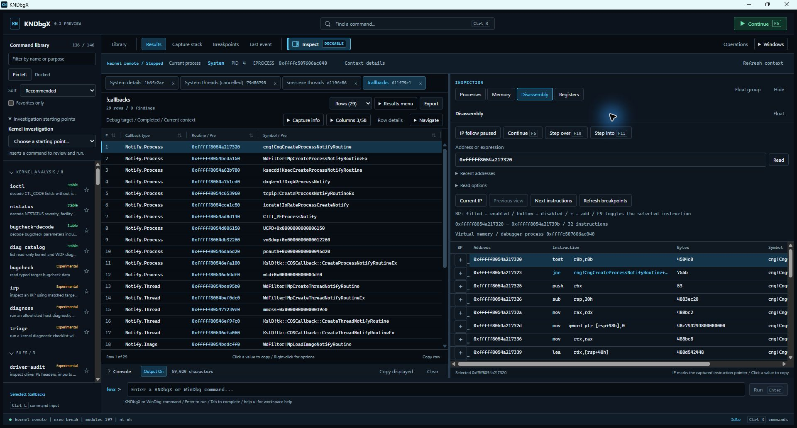

*Registered callbacks are investigation evidence. A callback's presence or module ownership alone does not establish a hook or malicious code.*

### Minifilter callbacks: `!minifilter`

Run `!minifilter` (alias `!fltmgr`) to inspect filter identities, altitudes and separate PreOperation/PostOperation callbacks. Compare the operation, routine and ownership fields, then use **Row details** or **Export** to retain the full record. [Minifilter workflow](docs/UX.md#follow-minifilter-registrations)

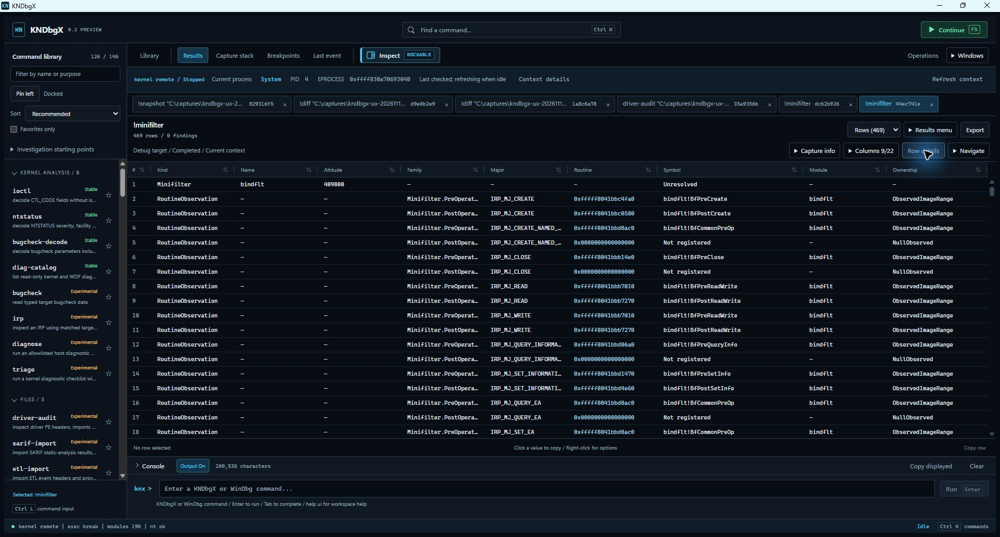

*The capture contains 469 rows covering filter records and operation callbacks; this is not a count of 469 filters.*

### Process cross-view: `!hiddenproc`

Find `!hiddenproc` in **Library / Ctrl+K** and run it on a stopped, supported kernel target. Remote KD compares the active process list with the target's CID table, keeping both identities and the comparison outcome in one table. **Row details** shows the original fields; **Export** saves the retained comparison.

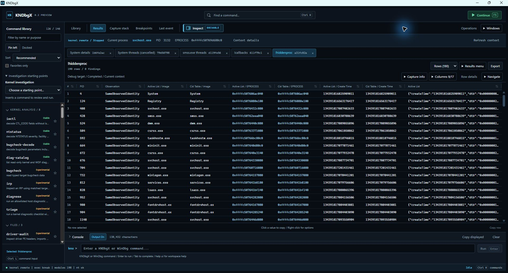

*This capture shows Total 88 / Matched 88 / Mismatch candidates 0 / Indeterminate 0. Total includes matching processes; all 88 collected rows report the same observed identity in both views.*

Mismatch candidates require re-observation; process creation, teardown and PID reuse can explain differences. Incomplete inputs remain Indeterminate, and a process absent from both views is invisible to this comparison. [Comparison limits](docs/UX.md#compare-two-process-inventories)

### Process-handle access

Run `!handles /owner-pid 4` to inspect System's Process handles with VM-access rights. Use `/target-pid` with an observed PID to narrow the destination. Compare owner, target, granted access and cross-process classification; select a row for its original identity and mask. Remote KD reads the guest's handle tables.

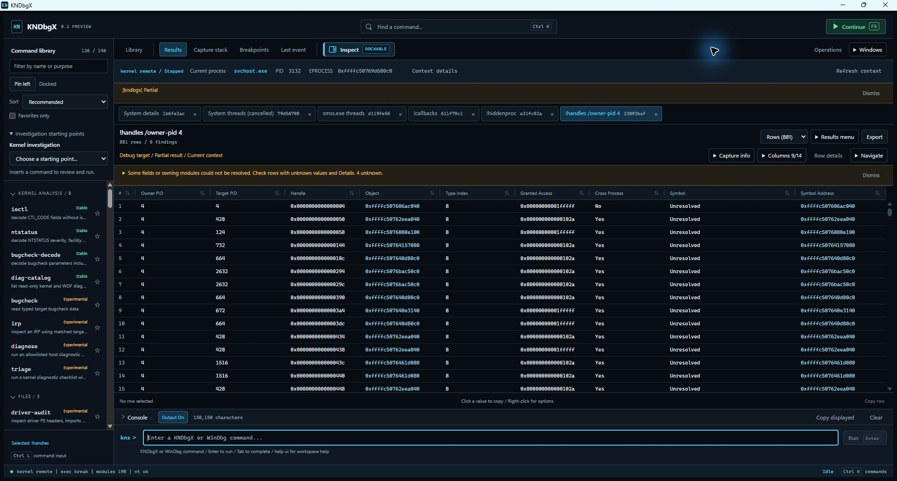

*This capture has 881 rows, Partial coverage and four unknown observations. A granted access right does not prove that a read, write or injection occurred.*

<details>
<summary>Inspect the original handle fields</summary>

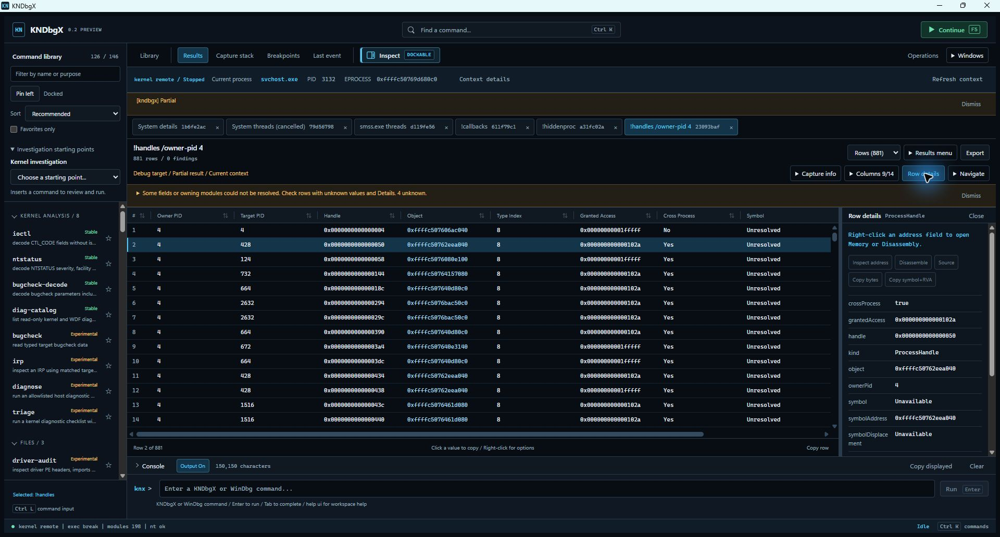

[Handle workflow](docs/UX.md#inspect-process-handle-access)

</details>

### Driver objects, dispatch routines and device stacks

Run `!driver`, choose an observed driver, then inspect it with `!drvobj \Driver\fvevol` or its object address. Compare major-function slots, handler symbols and owning modules. Follow a device address with `!devstack <device-address>`; replace angle-bracket operands with observed values.

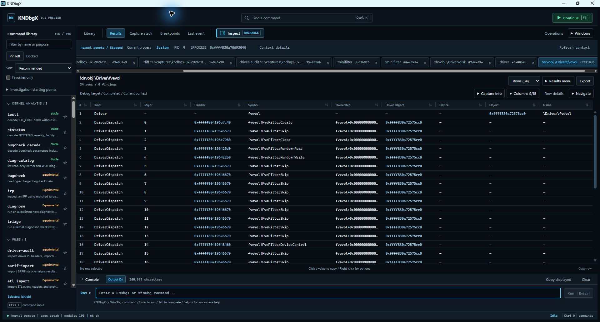

*The example retains 34 driver/dispatch/device records. A handler in another module can be legitimate shared code; ownership alone is not an integrity verdict.*

<details>
<summary>Inspect the loaded module and PE sections</summary>

Run `!module fvevol` for target-memory PE and section observations. `/disk` is available only with verified local-target file correlation and uses bounded, identity-matched samples, not a complete relocated-image comparison.

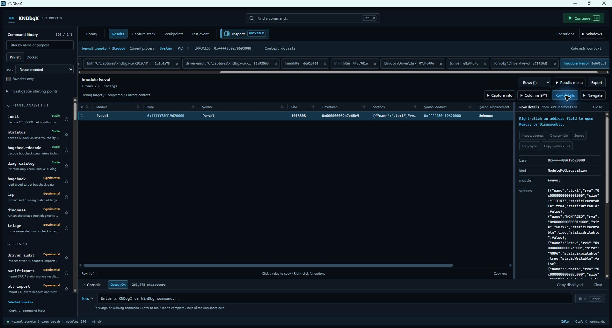

[Driver and module workflow](docs/UX.md#inspect-driver-dispatch-and-loaded-image-metadata)

</details>

### Driver load history

Run `!mapper` to keep the `!unloaded`, `!piddb` and `!cihash` collections together. Select a child record to inspect its status and coverage, or run that command separately for its own table. **Export** retains nested records that exceed the on-screen page budget.

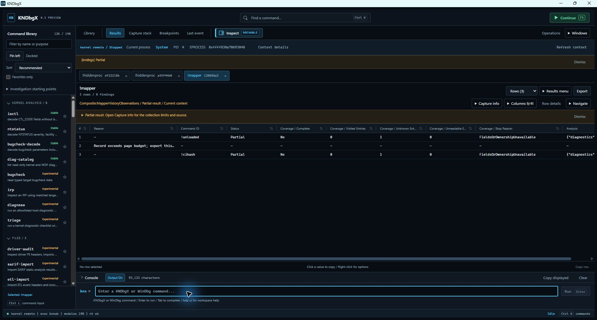

*These three rows are child collections, not three suspicious drivers. This guest has unverified unloaded-driver/CI metadata; the nested PiDDB record exceeds the display budget. Missing records do not prove history erasure or manual mapping.* [History workflow](docs/UX.md#inspect-driver-history)

### Registry hives and ALPC owners

Run `!hive` to associate each observed hive's `GetCellRoutine` with a symbol and module. Sort **Routine** or **Symbol** to compare registrations, then follow a current address into Disassembly.

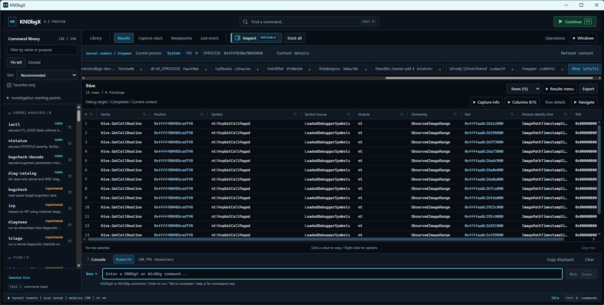

Run `!alpc` to walk the object namespace for ALPC ports. **Row details** exposes the owner process identity, connection port and namespace depth together.

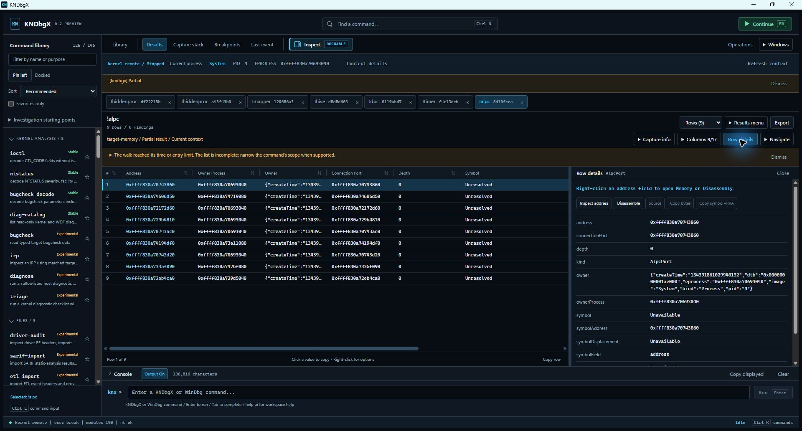

*The hive capture completed with 15 rows. The ALPC capture retained nine ports before its walk budget was reached; it is not an inventory of all communication endpoints.* [Hive and ALPC workflow](docs/UX.md#inspect-hives-and-alpc-ports)

### Other callback and service-table surfaces

Use `!nmi` for the NMI callback chain, `!hal` for HAL dispatch function pointers and `!fwtable` for registered firmware-table providers. Each result carries the available routine/module evidence and layout gaps; these commands do not modify registrations.

`!ssdt` collects native/shadow service-table observations only when their layout and extent can be verified. Open **View output** when the table is empty.

<details>
<summary>See why an empty SSDT result is still Partial</summary>

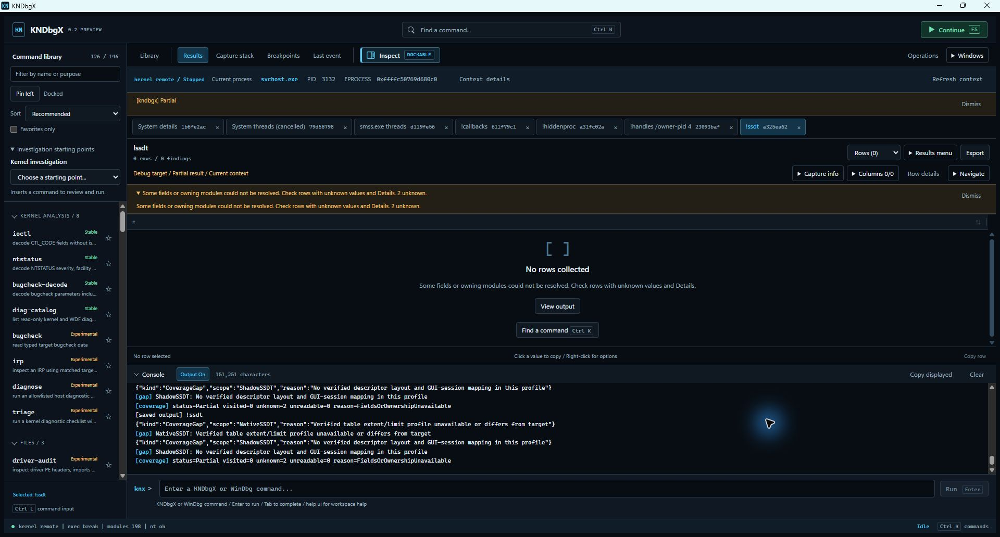

This guest's native-table extent and shadow descriptor/session relationship were unavailable. Zero rows do not establish a clean table. [Coverage workflow](docs/UX.md#read-a-collectors-coverage-limits)

</details>

## Inspect memory permissions

### VADs and page-table samples

Run `!vad image:smss.exe /hiddenpte /limit 32`, or choose **Processes > Memory (VADs)**. Compare the declared VAD protection with first/last-page samples in **Row details**. `/exec` narrows the requested investigation; `/limit` limits console display, not retained rows.

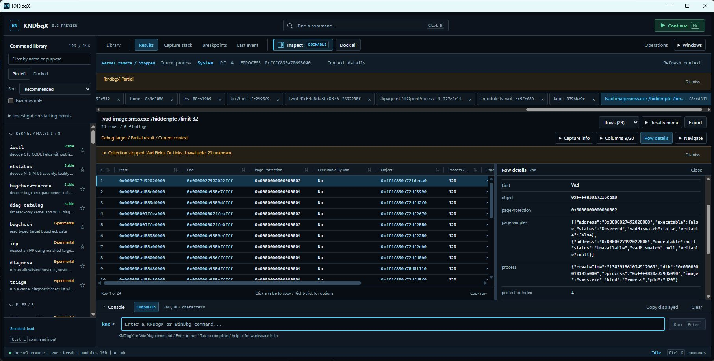

*This capture has 24 rows and 23 unknown observations. Endpoint samples, bounded to 256 pages globally, do not cover every page or find every hidden mapping.* [VAD workflow](docs/UX.md#compare-vad-protection-with-page-samples)

### Address translation and effective permissions

Run `!kpage nt!NtOpenProcess L4` for four page-aligned translations. Compare physical addresses and effective writable/executable permissions. `!address <address>` combines translation, permissions and ownership; `vtop <address>` translates a VA, and `query <address> [length]` probes readability. `procctx` selects the translation DTB, separately from debugger attachment.

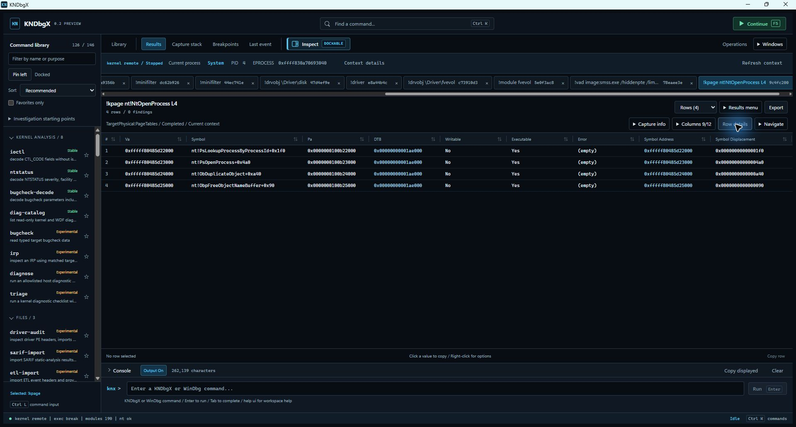

*These four pages were executable and not writable. A failed walk does not establish an unmapped page; PE section flags and allocation ownership answer different questions.* [Page workflow](docs/UX.md#inspect-page-permissions-for-a-chosen-range)

### Big-pool allocations and W+X observations

Run `!pool big /wx /limit 16`. Narrow by a four-character case-sensitive `/tag`, hexadecimal `/min` or `/max`, or `/addr`. Inspect **wxObserved**, **inspectedPages**, **skippedPages** and **rangeClassified** together. `/wx` samples the first page; `/full` requests all pages within the global budget. `/wx` does not filter the table to W+X rows.

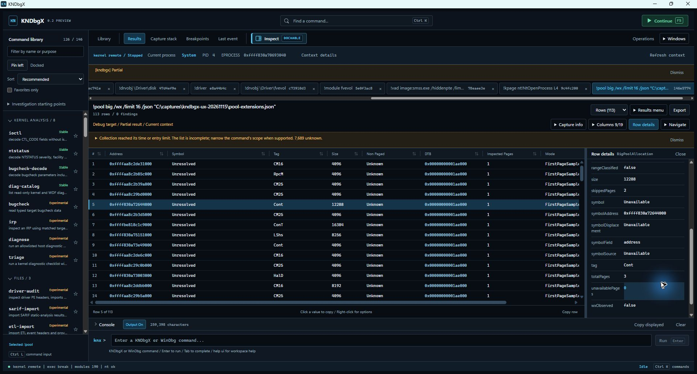

*The 113-row capture is Partial. The selected allocation has one inspected page and two skipped pages. `!payload` uses the same big-pool sampling; neither a true nor false sample is a whole-allocation malware verdict. Small pool is outside this inventory.* [Pool workflow](docs/UX.md#inspect-big-pool-allocations-and-wx-samples)

## Inspect CPU and platform state

### IDT, control registers and system-call MSRs

Run `!idt` and sort **Vector** to compare handlers across CPUs. `!cr` shows saved CR0/CR4/CR8 with decoded WP, SMEP, SMAP and LA57 bits. Both use saved processor state without switching the debugger CPU.

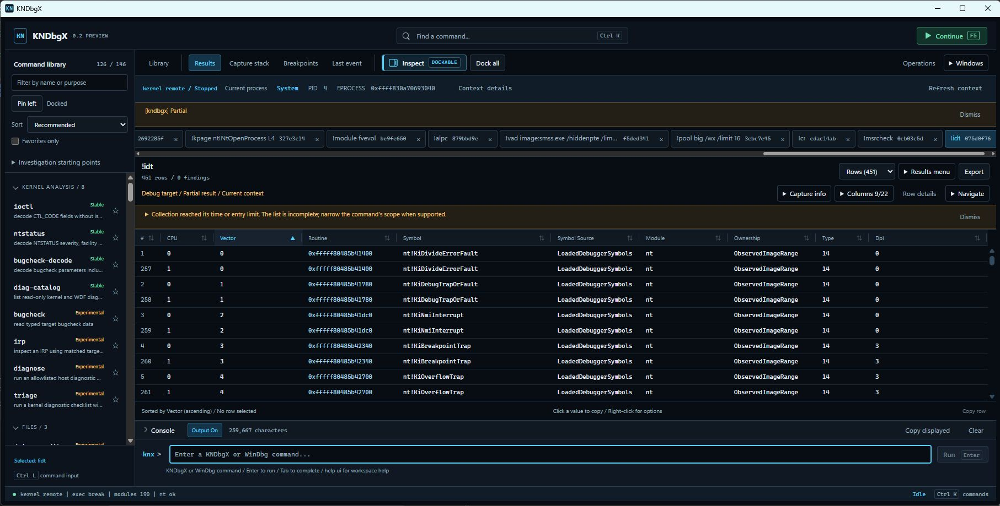

<details>
<summary>See saved control-register values and decoded protection bits</summary>

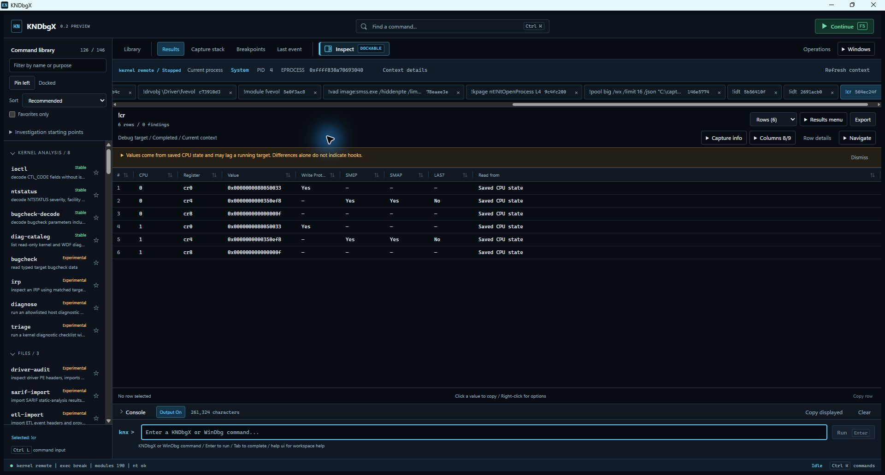

The IDT example retained 368 gates with Partial coverage; the control-register example completed six rows. Saved state can differ from a contemporaneous read. [CPU workflow](docs/UX.md#review-per-cpu-idt-and-control-state)

</details>

Run `!msrcheck` for LSTAR, CSTAR, STAR, FMASK and EFER on the verified current event CPU. Inspect **Read from** and **Why unavailable** before comparing values.

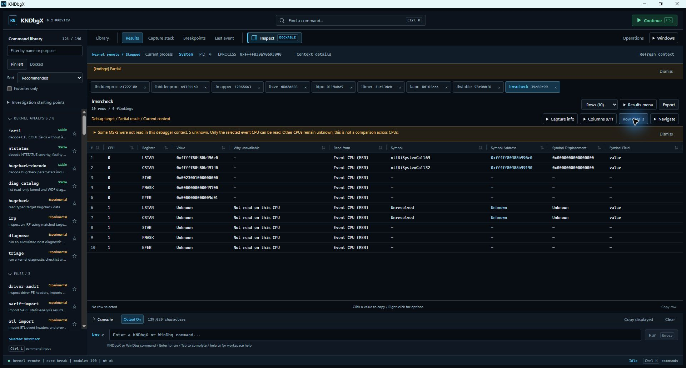

*Only CPU 0 was read here. CPU 1 remains Unknown, so this is not an all-CPU hook check.*

### DPC queues and timers

Run `!dpc` for per-CPU DPC queues or `!timer` for timer tables. Read **CPU**, **Queue**, **Routine** and **Decode** together, and compare completed queues with the expected queue count.

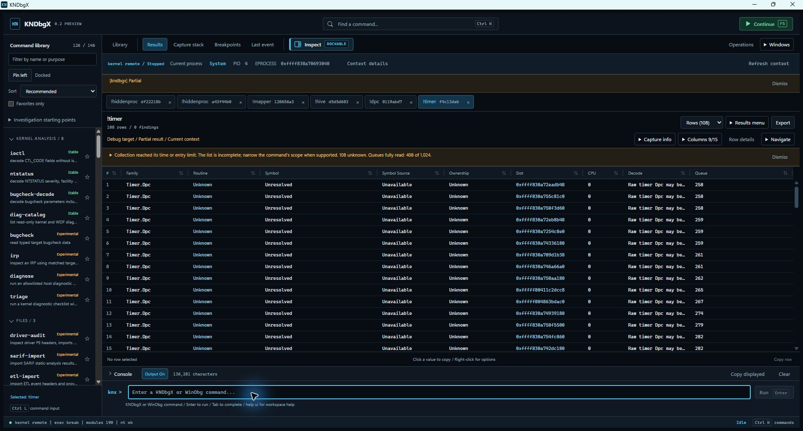

*This capture has 108 rows and 108 unknown observations; only 408 of 1,024 queues were fully read. Encoded timer DPC pointers are not interpreted as routine addresses without verification. Active/completed work outside the declared queues is not covered.* [Queue workflow](docs/UX.md#inspect-dpc-queues-and-timers)

### Host and target security observations

Run `!hv` to see **HostCpuidObservation** and **TargetControlRegister** as separate records. The host CPU/hypervisor leaves and the debuggee's CR4 come from different sources; they do not establish the guest's VBS or protection state.

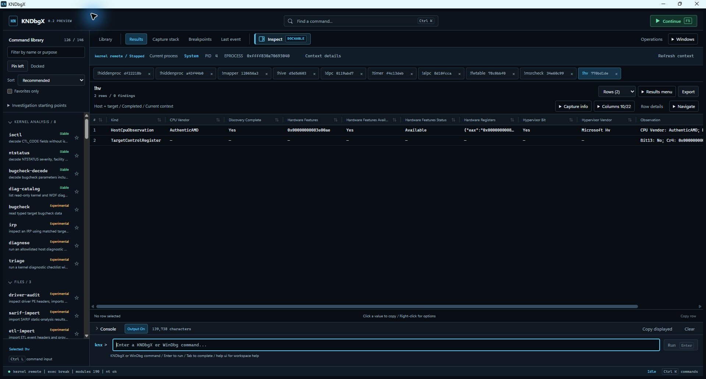

<details>
<summary>Inspect explicit host CI/HVCI flags and local-KD-only collectors</summary>

`!ci /host` explicitly queries the debugger host's public CI/HVCI flags. Without `/host`, `!ci` requires verified local KD. The screenshot is **host information**, not the remote VMware guest's policy.

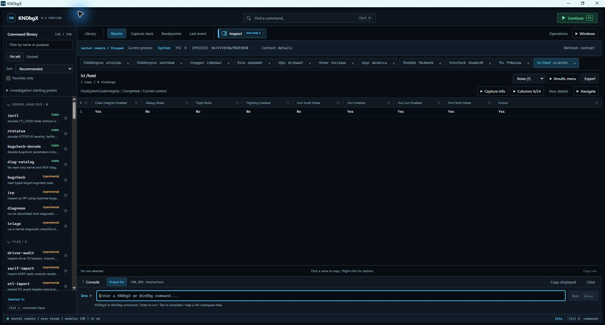

`!wfp` enumerates BFE filters, callouts, providers, sublayers and layers; `!dma` observes DMAR/IVRS firmware tables; `!byovd` compares local driver-file SHA-256 hashes with an operator-supplied catalog. All three require verified local KD and are unavailable for this remote guest. Table presence does not prove active DMA protection, and a catalog match does not prove exploitability or loaded-image integrity. [Platform scope and catalog setup](docs/UX.md#distinguish-host-and-target-security-state)

</details>

### ETW logger metadata

Run `!etw` for the target host silo's logger metadata, including logger IDs and clock representation when available. Use **Capture info / View output** to distinguish missing layouts from an empty inventory.

<details>
<summary>See this guest's unresolved ETW metadata scope</summary>

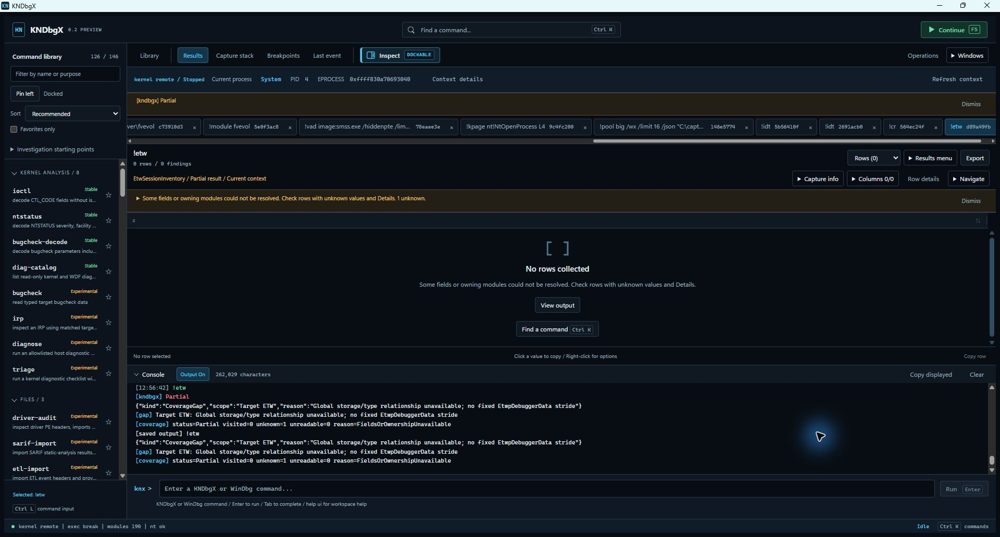

This capture has zero rows and one unknown observation because the storage/type relationship could not be verified. It does not show that ETW is inactive. The command neither starts tracing nor substitutes host loggers for guest data. [ETW workflow](docs/UX.md#inspect-etw-logger-metadata)

</details>

## Save and compare snapshots

Capture a baseline, perform the investigation step you want to compare, stop the target again and save to another **new** directory:

```text
!snapshot "C:\captures\before"
!snapshot "C:\captures\after"
!diff "C:\captures\before" "C:\captures\after"
```

**Artifact Committed** confirms the bundle was saved; **Collection Complete** describes its evidence coverage separately. Snapshot v2 contains processes, modules, callbacks, SSDT, IDT, control registers, HAL and unloaded-driver events with manifest checksums. Collection is sequential, not atomic; raw memory is not included.

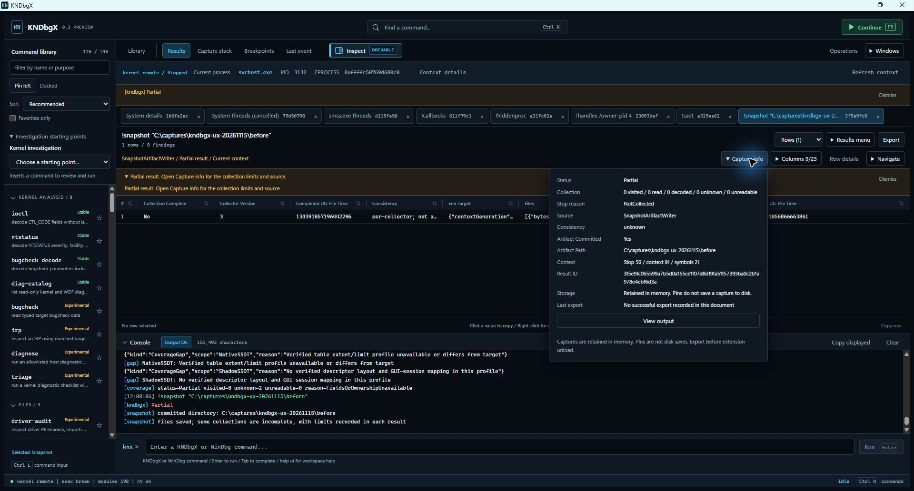

Sort **State** in the comparison, then open **Row details** for before/after records. Missing identity or incomplete input remains Unknown instead of an unsupported Added/Removed claim.

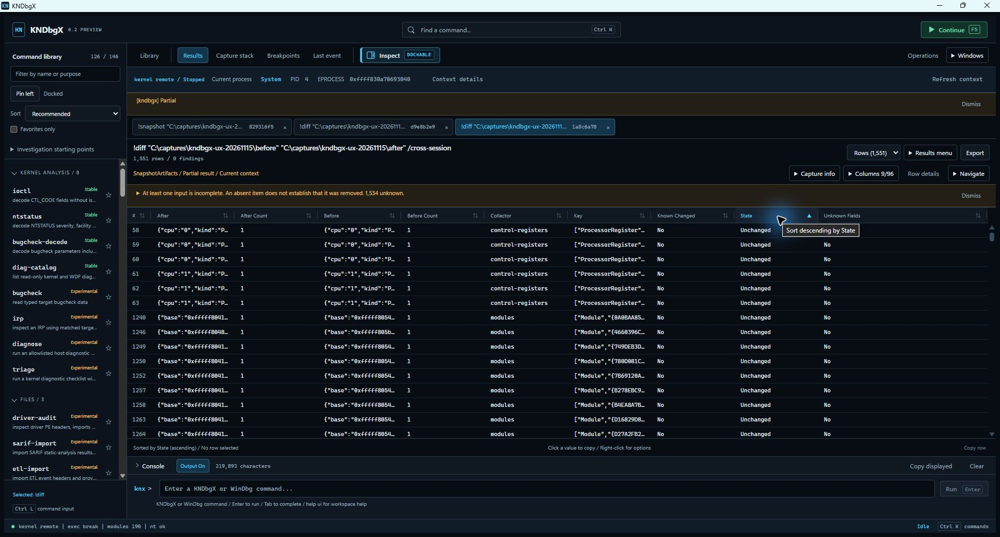

*This example spans debugger session reinitialization: 1,551 rows, 1,534 Unknown and 17 Unchanged. It does not attribute all differences to one intervening action.*

<details>
<summary>Session guard, before/after details and legacy import</summary>

Different session identities require `!diff "C:\captures\before" "C:\captures\after" /cross-session`. Process identities and unloaded-driver events remain incomparable across sessions.

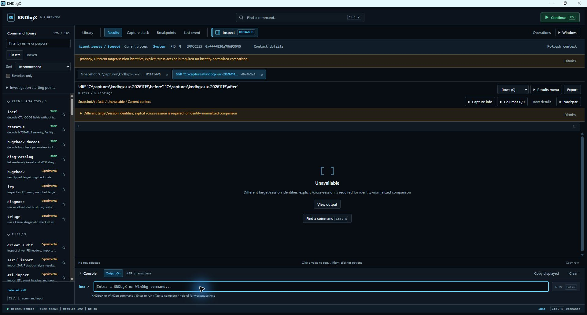

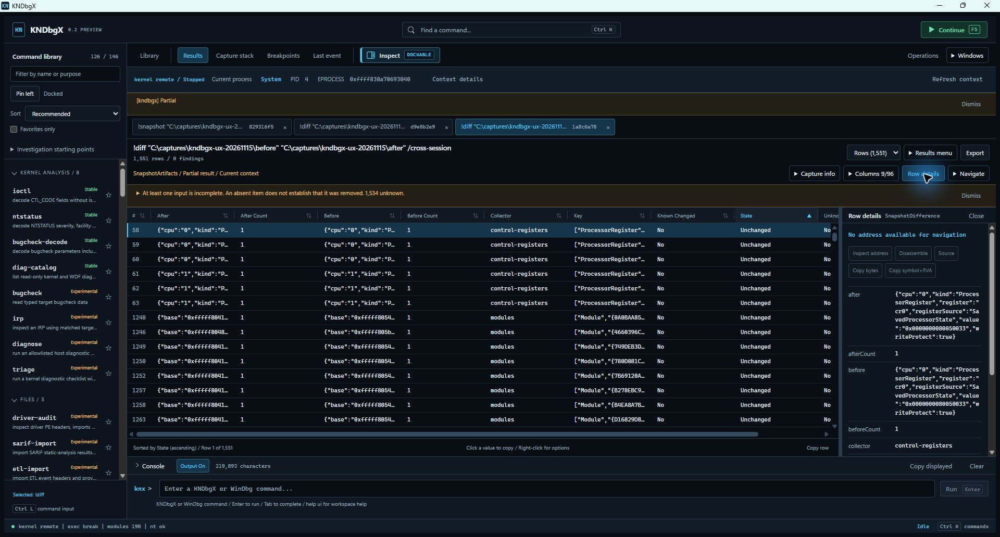

`!snapshot-import <text-file> <new-directory>` imports supported legacy text into a bundle with Unknown coverage. Offline rows do not bind saved addresses to the current target. [Snapshot workflow](docs/UX.md#save-and-compare-kernel-snapshots)

</details>

## Bring file evidence and diagnostics into Results

### Driver-file audit

Run `driver-audit "C:\evidence\driver.sys"` on a host file. Inspect PE identity, mitigation declarations, sections, imports and embedded-signature policy as rows. Match **FileEvidence** path/hash to the target before correlating it with a loaded module.

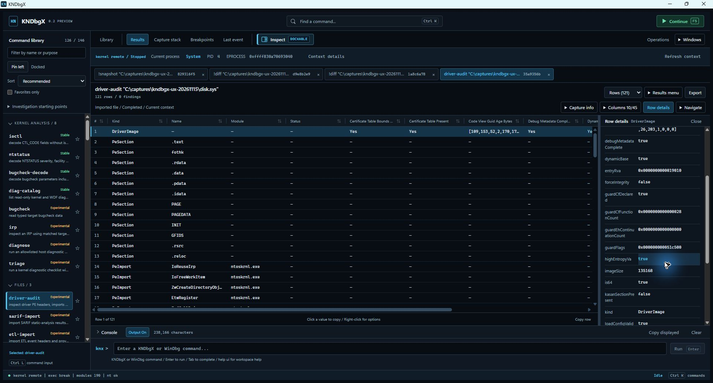

*The example is a host `disk.sys` copy with 121 rows; its relationship to the guest driver is unverified. Declared mitigation bits do not prove runtime enforcement.*

<details>
<summary>Inspect embedded-signature policy and unchecked scopes</summary>

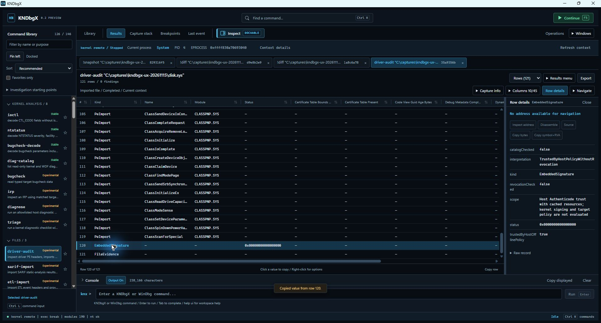

The check uses host trust policy and does not evaluate catalog signing, revocation or the target's signing/HVCI policy. NoEmbeddedSignature is not an unsigned-driver verdict. [Driver audit workflow](docs/UX.md#audit-a-driver-file)

</details>

### SARIF and ETL imports

Run `sarif-import "C:\evidence\analysis.sarif"`, select a **StaticFinding**, then open **Row details** for its rule, level, message and source location. The run and file-evidence rows retain provenance.

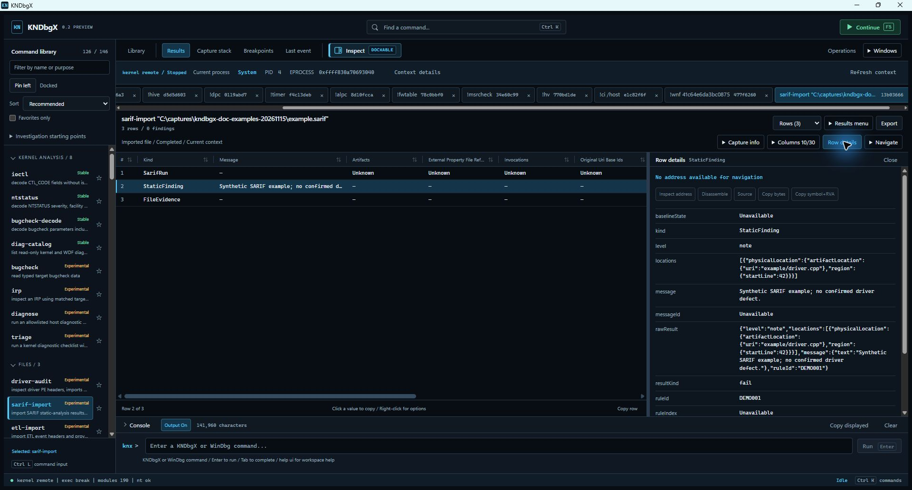

*This screenshot uses a clearly labeled documentation fixture. Imported findings are analyzer output, not independently confirmed defects or automatic matches to the debuggee.*

Run `etl-import "C:\evidence\trace.etl" 2048` to inspect recorded event headers, provider metadata and bounded payload previews. The decimal event limit defaults to 2,048 and cannot exceed 16,384.

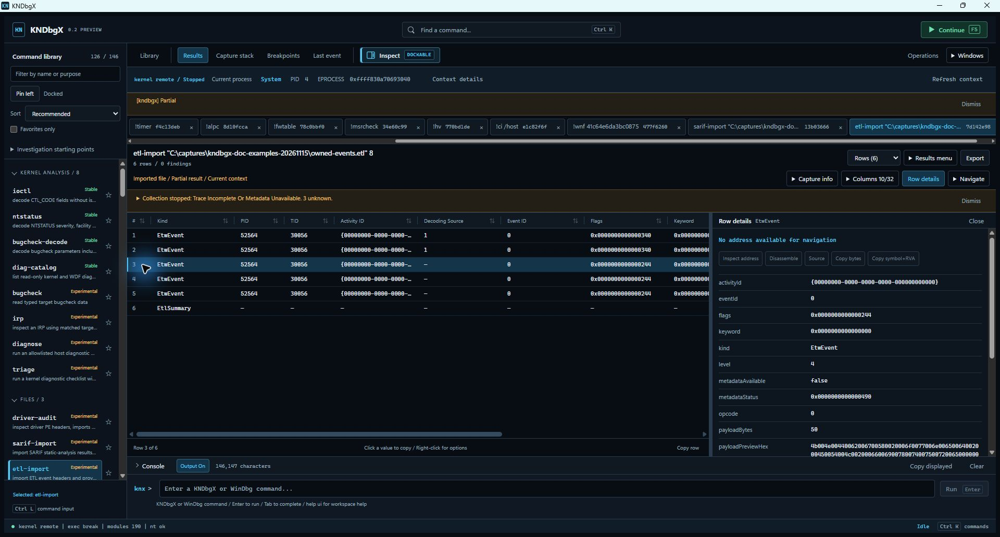

*This pre-existing synthetic test trace has five event rows and a summary; three missing metadata observations make it Partial. It is not a guest trace. Import does not start tracing, decode arbitrary WPP payloads or infer DPC latency.* [File-import workflow](docs/UX.md#import-sarif-and-etl-files)

### Diagnostic checklists, crash data and IRPs

Run `diag-catalog` to browse 53 recipes. Choose `diagnose <recipe> [operand]` for one, or `triage devices` for storage, USB and PnP. Other profiles cover crash, hang, I/O, power, memory, network and WDF; WDF needs a module.

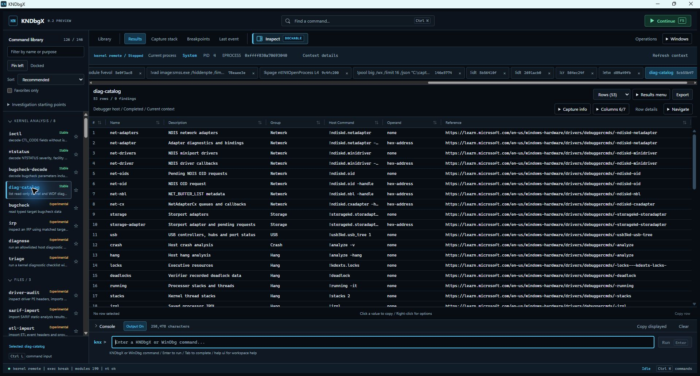

KNDbgX wraps existing WinDbg extensions with step records, saved output and context-restoration observations. Inspect **attempted**, **engineAccepted**, **contextRestored** and skipped-step reasons; native acceptance is not proof of complete data.

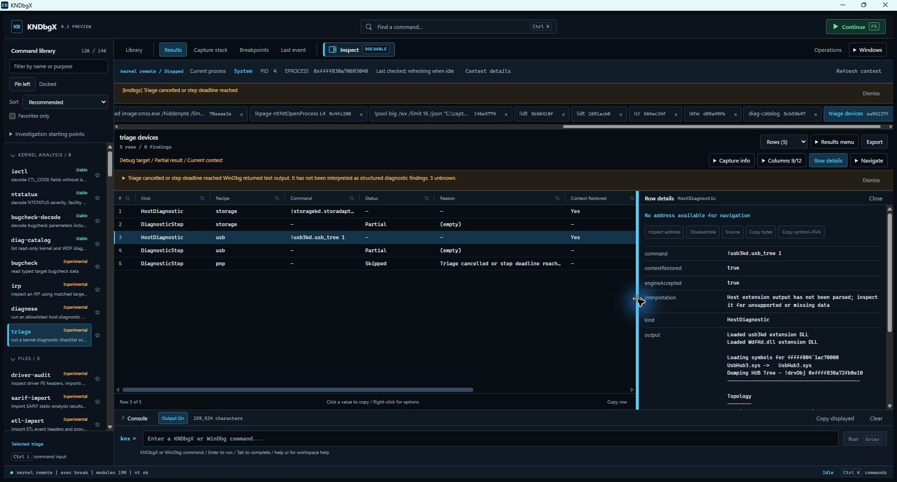

<details>
<summary>Read saved native output and inspect crash/I/O objects</summary>

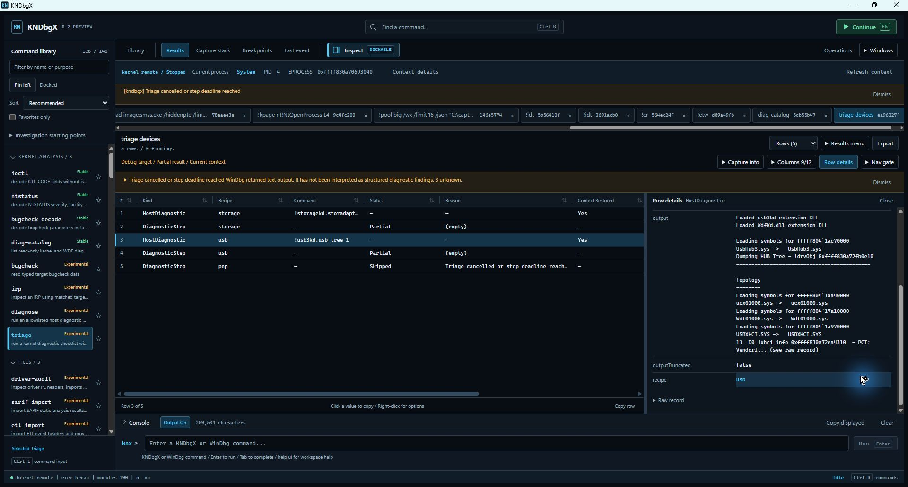

Use **View output** or **Raw record** when a cell preview is abbreviated. This captured run attempted storage/USB and skipped PnP after the deadline; an active native call can outlast that deadline.

`bugcheck` reads typed target bugcheck data; `irp <address>` reads an observed IRP with matched PDB layouts. `bugcheck-decode <hex-code> <p1> <p2> <p3> <p4>` decodes supplied parameters, including supported KASAN cases, without creating a crash. [Diagnostic workflow](docs/UX.md#run-a-diagnostic-checklist)

</details>

### Value decoders

Use `ioctl 222004` for CTL_CODE fields, `ntstatus c0000005` for status severity/facility/code, or `!wnf 41c64e6da3bc0875` for WNF state-name fields. These decode supplied numbers; `ioctl` does not send a request.

<details>
<summary>See the synthetic WNF decoding example</summary>

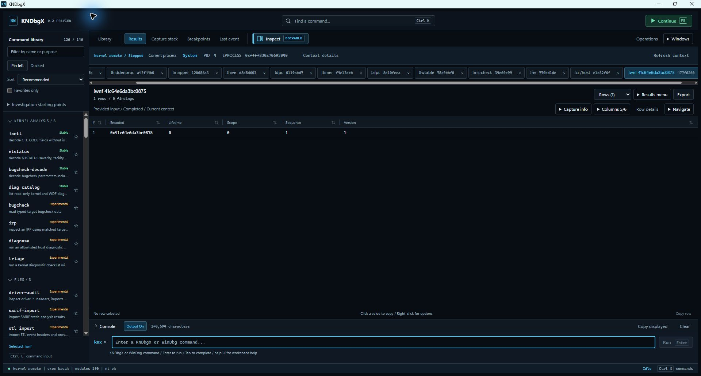

The example number was constructed for documentation. No subscription, state payload or WNF security property was collected from the guest. [Decoder workflow](docs/UX.md#decode-values-without-reading-the-target)

</details>

## Follow an address into Memory or Disassembly

Right-click a recognized result address and choose **Open Memory** or **Open Disassembly**. Callback rows let you choose Routine, Pre or Post. The action checks the source capture and process context before reading.


**Memory > Read options** chooses Virtual/Physical and byte count. Change byte/word/dword/qword display and ASCII using captured data; `??` marks unavailable bytes. **Read details** retains the context, ranges, transferred counts and native errors. `s <address> L<bytes> <byte...>` searches a bounded range.

<details>
<summary>Address actions and saved memory-read details</summary>

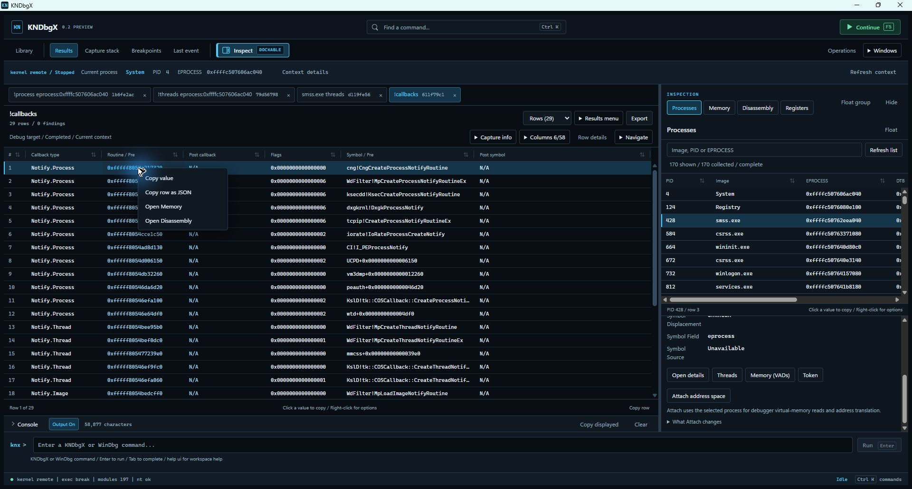

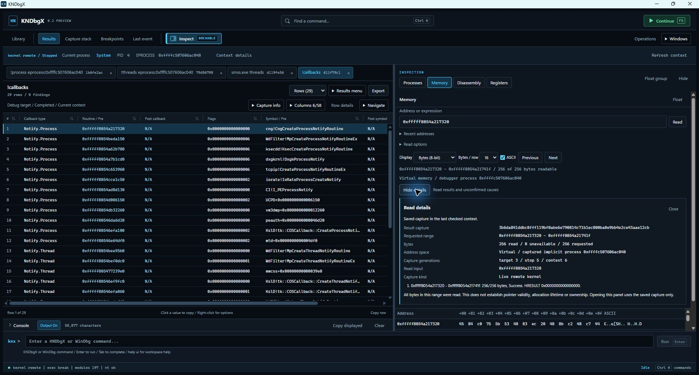

Previous/Next uses the successfully captured range. Edited addresses or changed context require a new read. Historical or mismatched results cannot authorize current target reads. [Memory workflow](docs/UX.md#memory-tab)

</details>

### Disassembly, registers and floating windows

**Disassembly** provides Current IP, Next instructions, Follow IP and breakpoint markers. Select an instruction for address actions; `u`/`uf` also retain disassembly results. **Registers** supports filtering, pinned/changed values and raw vector bytes while keeping its captured CPU/thread identity visible.

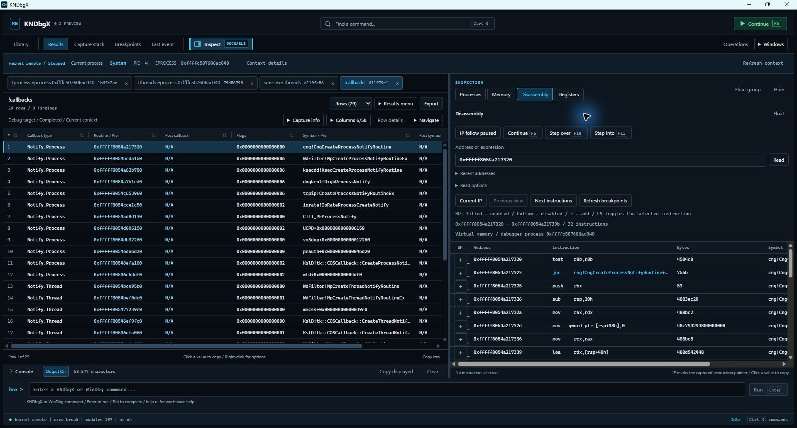

<details>
<summary>Registers and independent inspection windows</summary>

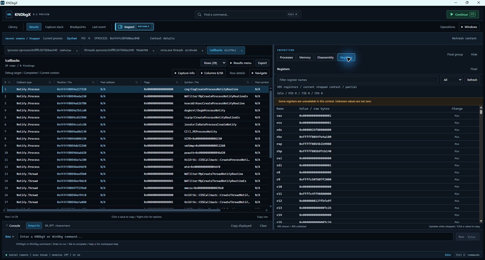

Each view can **Float** independently; **Float group** detaches Inspect. Dock via its title-bar guides or **Windows > Dock all views**. **Bring windows into view** recovers misplaced windows; views share one debugger context and execution slot.

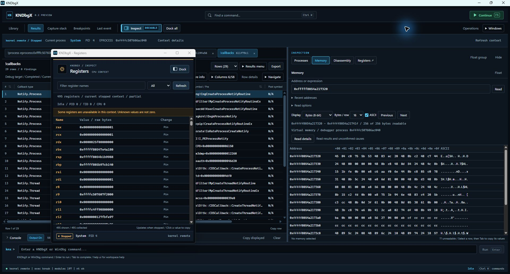

[Floating-window workflow](docs/UX.md#floating-inspection-windows)

</details>

`navigate va <address>` / `navigate pa <address>` keeps scoped address observations. `history`, `back`, `forward`, `bookmark "note"` and `bookmarks` retain/revisit saved results. They do not re-read old addresses; inspection inputs' **Recent** lists instead read the chosen expression in the current context. `source [address]` uses the host's source lookup when available.

## Start from a process

Open **Inspect > Processes**, select a process, then choose **Open details**, **Threads**, **Memory (VADs)** or **Token**. The result opens in its own tab while the process list remains available. Double-click a result tab to give it a useful name.

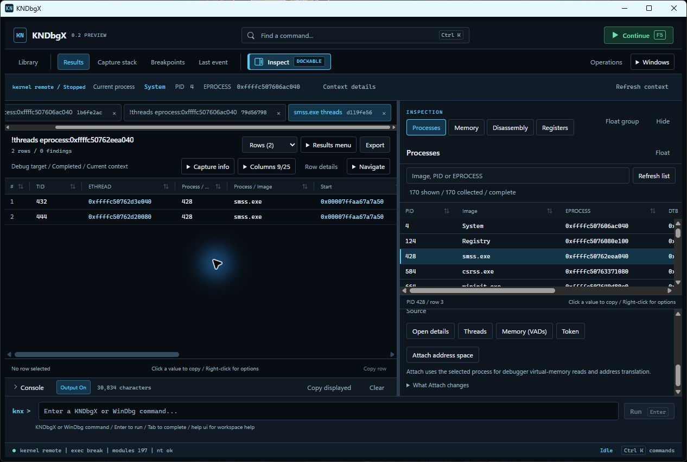

Search by image/PID and inspect EPROCESS, DTB and creation time. `!dml_proc` / `!process 0` enumerate processes; `!process pid:4`, `!threads pid:4` and `!token pid:4` select one explicitly. Without a selector, `!threads` observes the current thread and `!token` uses its impersonation token when active, otherwise the current process primary token.

Selecting a row does not switch the debugger's address space. **Attach address space** is a separate verified action; register thread/CPU context is separate too. Incomplete inventories may prevent image-name selection; use an observed PID or EPROCESS. [Process inspection](docs/UX.md#processes-tab)

## Check context and symbols

Open **Context details** to distinguish selected process, implicit address space, debugger thread/CPU, scope and last event. **Refresh context** updates observations.

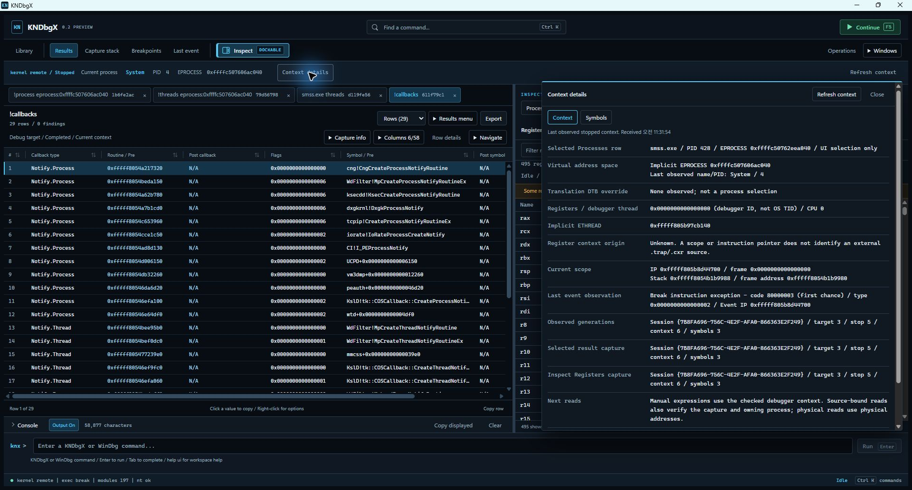

Under **Symbols**, choose **Read modules**, select a module and **Inspect selected module**. Optional Type/Field inputs such as `_EPROCESS` / `UniqueProcessId` test metadata availability. A matching image/PDB and an available private field are separate checks; **Insert reload draft** only prepares a command.

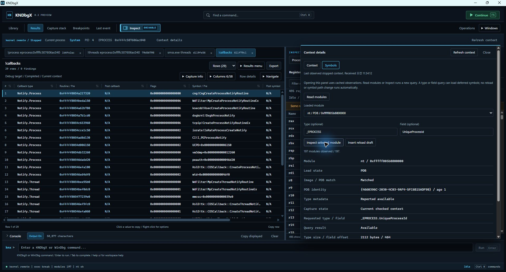

<details>
<summary>Browse typed layouts and values in Results</summary>

Run `dt nt!_EPROCESS` for field offsets, sizes, bit ranges and provenance; append an observed instance address to request field values. Sort by **Offset** or inspect individual records.

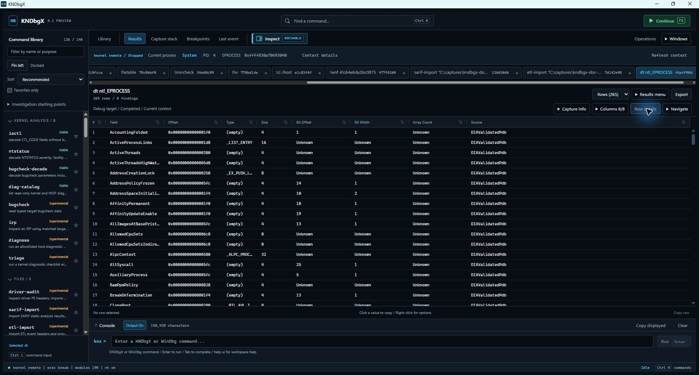

This capture requests the layout only, not an instance. Missing type names or optional metadata remain unavailable. `lm`, `x`, `ln`, `.sympath` and `.reload` provide module/symbol tools; missing private types cannot be repaired by repeatedly loading the same PDB. [Symbol workflow](docs/UX.md#context-symbols-and-waits)

</details>

## Keep results, control execution and recover work

### Retained results and export

Switch tabs without rerunning captures. Double-click/F2 to rename, drag to reorder, choose **Columns**, sort, copy full cell values or open **Row details**. Hidden columns remain in the saved result. **Capture info** explains source and coverage; **Export** saves all retained rows and output, including data outside the viewport.

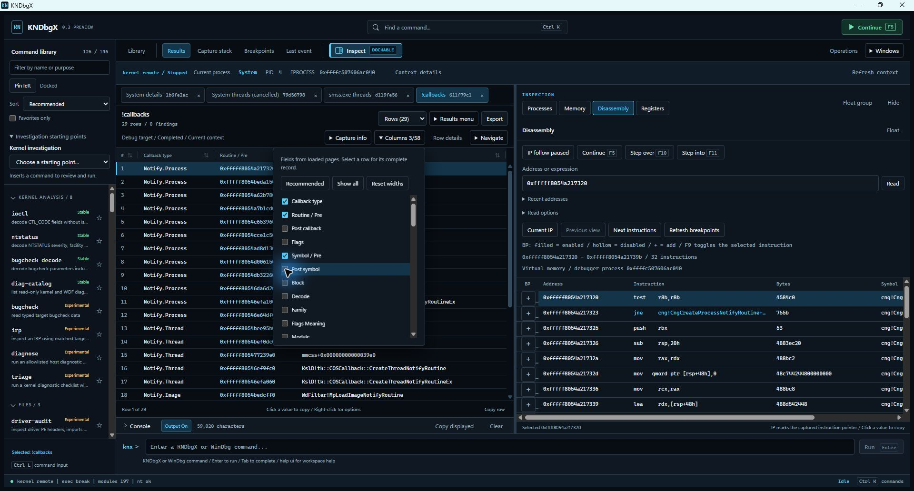

Exports go to `%LOCALAPPDATA%\kndbgx\logs`; **Copy saved path** retrieves the confirmed destination. For another destination, use `results` to find an ID, then `result-export <id> "C:\captures\result.json"`. `result-read <id> [row-offset] [finding-offset]` pages through retained data. Up to 16 unpinned and 128 protected open-tab results share 64 MiB; export before eviction or DLL unload. [Export and recovery](docs/UX.md#export-and-recovery)

### Operations, cancellation and jobs

**Operations** shows stages, elapsed time, cancellation state and retained outcomes. **Cancel operation** requests cooperative cancellation; a native symbol/memory call must return first. **Refresh outcomes** checks existing work without resubmitting it. Pause automatic inspection reads when you want manual control of refreshes.

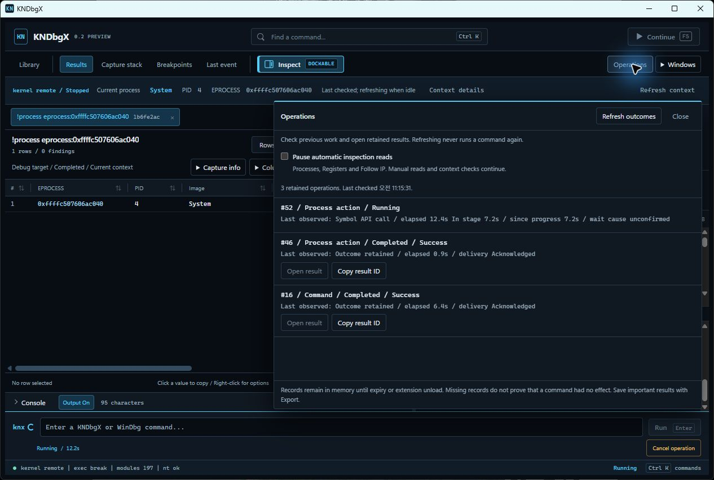

<details>
<summary>Inspect incomplete coverage after cancellation</summary>

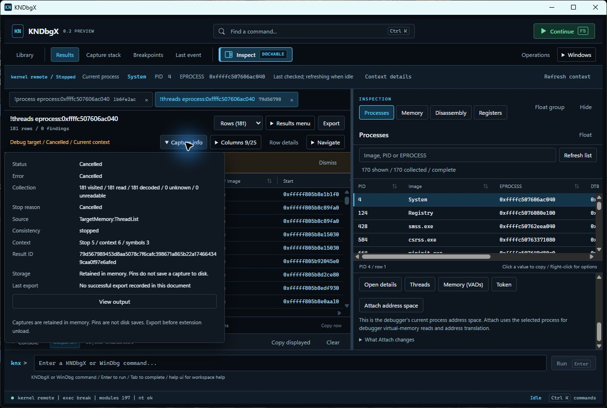

Rows already collected remain useful, but do not become a complete inventory. `submit <command>`, `jobs`, `job <id>` and `cancel <id>` offer background-job control from commands. Only one engine operation runs at a time. [Operations workflow](docs/UX.md#context-symbols-and-waits)

</details>

### Execution and approved changes

Use **Continue / Break**, F5 and Disassembly's F10/F11 on supported live targets. **Breakpoints** shows settings; **Last event** retains event information separately. With Disassembly's instruction grid focused, F9 opens an addition preview when the selected instruction has no breakpoint; **+** beside the instruction does the same. If exactly one breakpoint already exists, F9 or its filled/hollow marker directly disables/enables it without an addition preview. Multiple matches open the breakpoint list. Add/Delete needs preview approval; Enable/Disable applies its context-bound action on click.

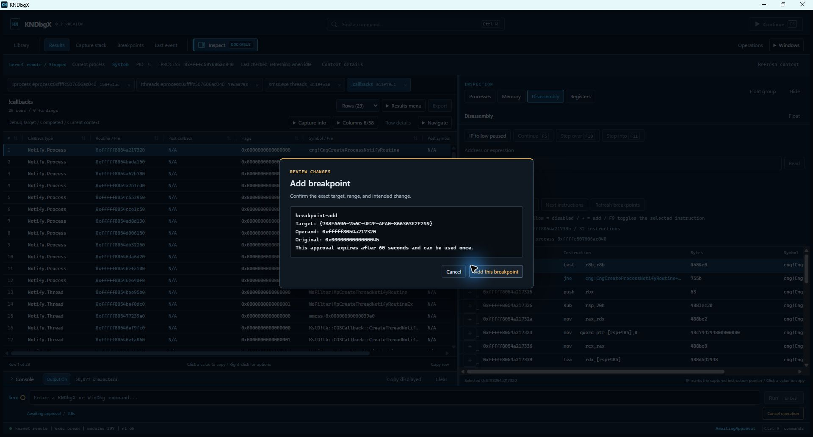

*The captured preview was canceled. It does not demonstrate breakpoint application, stepping or a target-memory write.*

Registered `eb`/`ew`/`ed`/`eq`, `f` and `setfield` changes use `plan <mutation-command>` followed by one-use approval. Review original/proposed bytes, type/field and target context before `approve <plan-id> <approval-token>`. Plans expire after 60 seconds and recheck context/original bytes; partial writes have no automatic retry or rollback. `debug-plan` / `debug-approve` provide the separate breakpoint/execution plan flow. [Change workflow](docs/UX.md#execution-and-changes)

<details>
<summary>See retained history while the target runs</summary>

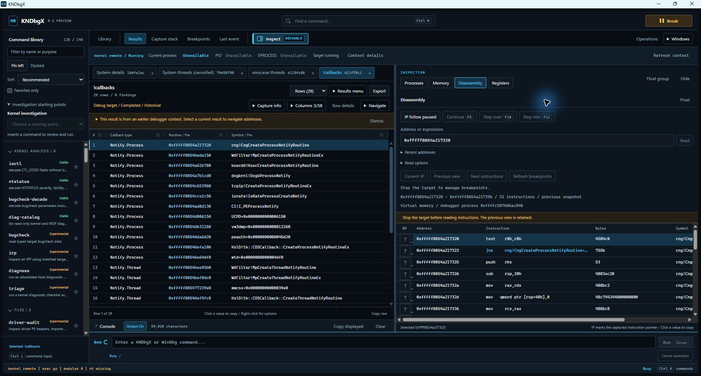

Historical captures remain readable but cannot authorize new target actions. Stop the target and refresh before another read.

</details>

### Dumps, bounded memory exports and Data Model

Use `dump-raw <address> <length> "C:\captures\range.bin"` for a bounded VA range (`/phys` for PA), or `dump-pe <module|address> "C:\captures\mapped.bin"` for a mapped image. Exports are capped at 64 MiB; unreadable requested bytes prevent publication. A mapped PE uses virtual section offsets and does not reconstruct the original disk file. `.dump <path>` delegates dump creation to the host; `dump-analyze <path>` inspects an existing dump header.

On hosts with `IHostDataModelAccess`, `model publish <result-id>` copies a bounded page into `Debugger.Models.KNDbgX` for `dx` inspection (up to 128 rows and 128 findings). These copied values remain readable after extension unload and do not read the target. Unsupported hosts retain normal CLI/UI results. [Commands and limits](docs/COMMANDS.md#limits)

The [workspace guide](docs/UX.md) adds detailed steps and [keyboard shortcuts](docs/UX.md#shortcuts). CLI remains available if the UI cannot start: prefix a workspace command with `!kndbgx` in WinDbg, for example `!kndbgx !callbacks`.

## Command index

The compiled registry contains **126 entries**, including five explicitly unsupported commands. This index groups the available workflows; exact grammar, aliases, options and target modes are in the generated [command reference](docs/COMMANDS.md). A Stable entry does not promise compatibility with every kernel build.

<details>
<summary>Browse all registered commands by group</summary>

- **Kernel Analysis:** `ioctl`, `ntstatus`, `bugcheck-decode`, `diag-catalog`, `bugcheck`, `irp`, `diagnose`, `triage`.
- **Files:** `driver-audit`, `sarif-import`, `etl-import`.
- **Session:** `help`, `status`, `cls`, `procctx`, `?`, `raw`, `plan`, `approve`, `reconnect`, `version`, `features`, `command-schema`, `policy`.
- **Debugger:** `debug-plan`, `debug-approve`, `stack`, `registers`, `breakpoints`, `event`, `navigate`, `source`, `history`, `back`, `forward`, `bookmark`, `bookmarks`.
- **Results:** `results`, `result-export`, `result-read`, `model`.
- **Symbols:** `lm`, `x`, `ln`, `.reload`, `.sympath`, `dt`, `setfield`.
- **Memory:** `db`, `dw`, `dd`, `dq`, `dc`, `dds`, `dqs`, `da`, `du`, `s`, `f`, `eb`, `ew`, `ed`, `eq`, `!db`, `!dw`, `!dd`, `!dq`.
- **Kernel:** `vtop`, `query`, `!address`, `!kpage`, `!dml_proc`, `!vad`, `!threads`, `!hiddenproc`, `!handles`, `!token`, `!callbacks`, `!ssdt`, `!idt`, `!msrcheck`, `!cr`, `!dpc`, `!timer`, `!pool`, `!nmi`, `!hal`, `!etw`, `!wnf`, `!hive`, `!alpc`, `!fwtable`, `!drvobj`, `!devstack`, `!driver`, `!module`, `!minifilter`, `!unloaded`, `!piddb`, `!cihash`, `!mapper`, `!payload`, `!byovd`, `!wfp`, `!ci`, `!hv`, `!dma`, `!snapshot`, `!diff`, `!snapshot-import`, `!process`.
- **Code:** `u`, `uf`.
- **Dumps:** `.dump`, `dump-analyze`, `dump-raw`, `dump-pe`.
- **Jobs:** `submit`, `jobs`, `job`, `cancel`.

**Unavailable in this release:** `!eb`, `!ew`, `!ed`, `!eq`, `dump-live`.

Physical/MMIO writes, callback mutation, a separate UI process, TTD and Replay SDK adapters are disabled. `features` reports optional adapter availability; `policy` is a compatibility entry and does not enable a global write mode. Use `help <command>` for aliases and operands.

</details>

## Interpretation and command routing

Missing symbols, unreadable pages and collection limits remain **Partial** or **Unavailable**. A missing row does not establish absence. Results retain their captured context; historical data cannot authorize current target actions. Export important results before eviction or DLL unload.

Unregistered commands entered manually in the UI run directly in WinDbg and may change the target or host. Registered names keep KNDbgX validation and approval rules. CLI and jobs require `raw --ack-effects <command>` for opaque execution. Dumps and local KD do not support target writes or execution controls. [Support and limits](docs/SUPPORT.md)

## Build from source

Install Visual Studio 2022 C++ tools (v143) and a Windows 10/11 SDK, then run from the repository root in PowerShell:

```powershell
.\tools\build.ps1 -Configuration Release -RunTests
```

The script finds Visual Studio with `vswhere` and writes the extension to `x64\Release`. `-RunTests` requires Node.js for frontend regressions; omit the switch for a build only. Release tooling requires Python 3.11+. WDK is needed only for `samples/snapshot-demo`. See [build verification and release packaging](docs/VALIDATION.md).

## License

KNDbgX is licensed under the [MIT License](LICENSE). Copyright (c) 2026 kernullist.
Third-party components retain their own licenses; see [THIRD_PARTY_NOTICES.md](THIRD_PARTY_NOTICES.md).
