# Workspace and workflows

Open the workspace with `!kndbgx`, then work in the KNDbgX window. This guide follows a live Windows 11 x64 VMware guest connected to WinDbg, using KNDbgX **0.2.0-preview.7**. The screenshots show actual captures, including incomplete results and unavailable values. Addresses and counts belong to that session; use your own target's values.

Start with [KNDbgX kernel and driver workflows](#kernel-and-driver-workflows), then explore [command discovery](#find-and-run-commands), [process inspection](#processes-tab) or [address navigation](#inspect-results). For setup, see the [README](../README.md). The [command reference](COMMANDS.md) supplies exact syntax; [support](SUPPORT.md) describes target and symbol limits.

## Kernel and driver workflows

These workflows add cross-view collection, structured evidence and saved-state comparison to the debugger workspace. They run from **Library** or **Ctrl+K** and keep their results in tabs. Review **Capture info**, the result status and the original fields before drawing a conclusion.

- **Callbacks and drivers:** [kernel callbacks](#inspect-kernel-callbacks), [minifilters](#follow-minifilter-registrations), [dispatch and loaded images](#inspect-driver-dispatch-and-loaded-image-metadata), [file audit](#audit-a-driver-file).
- **Processes and saved evidence:** [cross-view](#compare-two-process-inventories), [handles](#inspect-process-handle-access), [snapshots](#save-and-compare-kernel-snapshots).
- **Memory permissions:** [VAD samples](#compare-vad-protection-with-page-samples), [page translations](#inspect-page-permissions-for-a-chosen-range), [big-pool samples](#inspect-big-pool-allocations-and-wx-samples).
- **Kernel state and diagnostics:** [CPU state](#review-per-cpu-idt-and-control-state), [ETW coverage](#inspect-etw-logger-metadata), [diagnostic checklists](#run-a-diagnostic-checklist).

### Inspect kernel callbacks

Run `!callbacks` from **Library / Ctrl+K** on a stopped, supported kernel target. Compare **Callback type**, **Routine / Pre**, **Post callback** and their symbol or module fields. Use **Columns** to expose the fields needed for the investigation and **Row details** to inspect the full record. Follow a selected Routine, Pre or Post address into **Memory** or **Disassembly**.

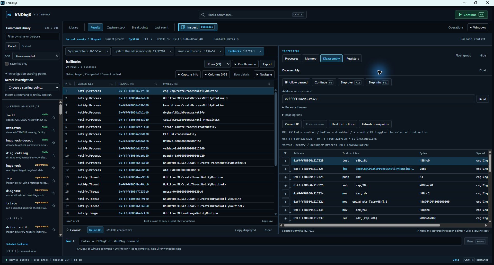

This capture retains 29 callback rows. The collector covers declared notify, object and registry families, including both Pre/Post routines for object callbacks. It does not enumerate every Windows callback mechanism. Missing layouts, unreadable pages and unresolved ownership remain coverage gaps; a registration or owning module alone does not establish a hook or malicious code.

### Follow minifilter registrations

Run `!minifilter` from **Library / Ctrl+K**. The result combines filter identity and altitude with separate PreOperation and PostOperation records. Compare **filter**, **majorName**, **family**, **routine** and ownership fields; use **Row details** when a field is hidden from the table.

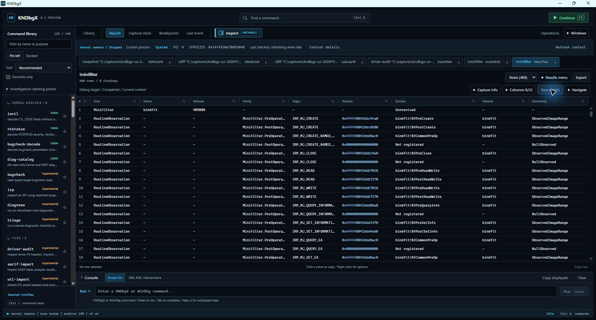

This completed capture contains 469 rows, including filter records and operation callbacks. It is not a count of 469 filters. If symbol resolution takes time, check **Operations** and wait for a confirmed completion or cancellation before starting another collection.

A null optional callback is different from an unreadable callback. Missing layouts, incomplete operation arrays and unreadable pages remain coverage gaps. A routine inside a loaded module is an ownership observation, not proof that its code is unchanged.

### Compare two process inventories

1. Stop a supported x64 kernel target and find `!hiddenproc` in the command palette.
2. Select **Run**. On remote live KD, KNDbgX compares the target's active process list with its CID table.
3. Read **Total**, **Matched**, **Mismatch candidates** and **Indeterminate** in the result header before inspecting individual rows.
4. Compare **Observation**, the two image names, EPROCESS values and creation times. Select a row and open **Row details** for its complete records; **Export** preserves the full comparison.

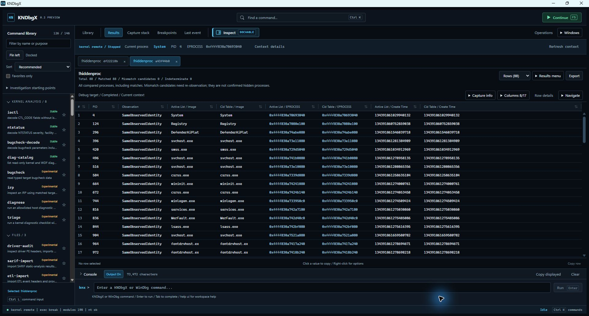

This live VMware capture completed with **Total 88 / Matched 88 / Mismatch candidates 0 / Indeterminate 0**. All 88 rows report **SameObservedIdentity**; the active-list and CID entries agree on EPROCESS and creation time. Total includes matching processes and is not a hidden-process count.

The result header separates **Total**, **Matched**, **Mismatch candidates** and **Indeterminate** for the complete retained comparison, independently of table paging or sorting. Matches have the same observed identity in both views. Candidates include one-view-only observations with known identities and differing identities for the same PID; they require re-observation and do not confirm hiding. Missing identities, incomplete opposing views and unknown observation types are indeterminate. Older captures without a count breakdown display **Unavailable**, not zero.

Counts describe collected rows. Incomplete inputs cannot establish absence, and a process missing from both views cannot be found by this comparison. Process creation, teardown or PID reuse can explain differences. Verified local KD uses a host Toolhelp comparison instead; this screenshot is from remote KD.

### Inspect process-handle access

Find `!handles`, add an owner or target filter to its draft, then select **Run**. The example uses `!handles /owner-pid 4` to inspect the System process's handles. `/target-pid` narrows the destination process; use an ID observed in your current target.

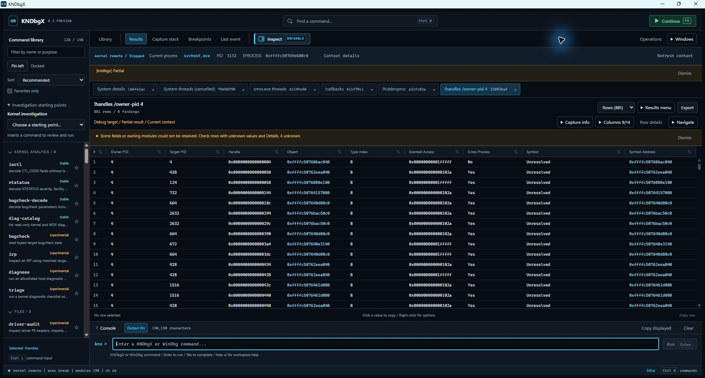

The collector selects verified Process handles with VM-access rights. **Owner PID**, **Target PID**, **Granted Access** and **Cross Process** answer different questions; access rights alone do not establish that a read, write or injection occurred. Remote KD reads the target handle tables, rather than substituting the debugger host's handles.

This capture retained 881 rows with **Partial** coverage and four unknown observations. Keep that qualification when using the result. Select a handle and open **Row details** to inspect its original access mask and object identity.

<details>
<summary>View the selected handle's fields</summary>

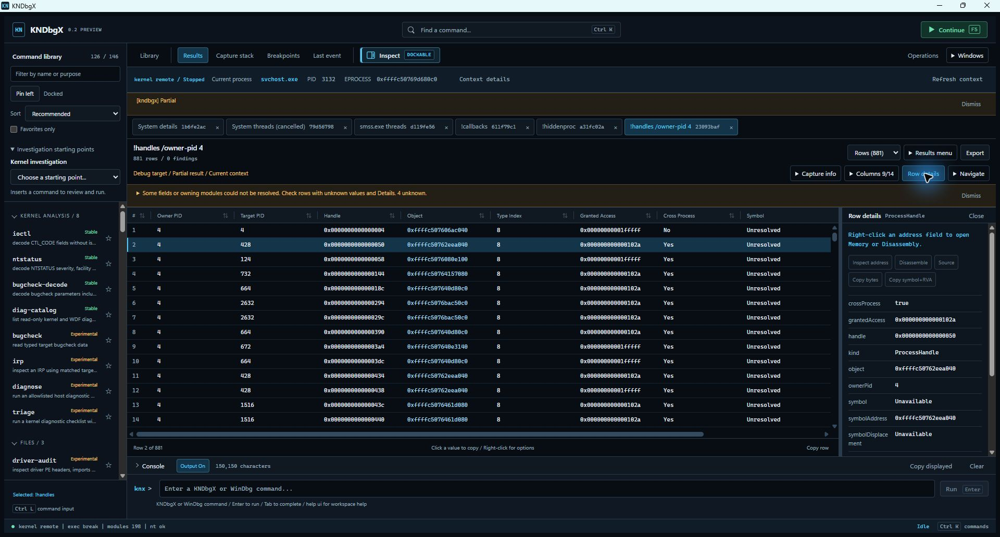

</details>

### Read a collector's coverage limits

Find `!ssdt` and select **Run** to inspect service-table entries when the target has verified layout and extent information. A result with no rows still needs interpretation. Open **View output** and read the collector's scope-specific gaps alongside its status.

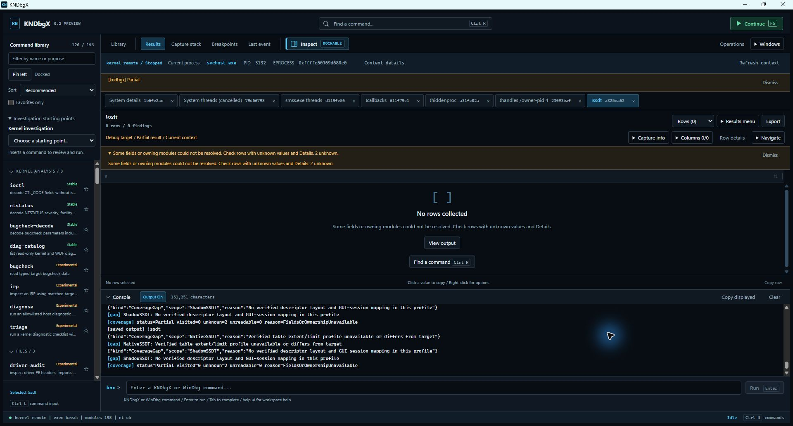

For this guest, the native table extent could not be verified, and the shadow-table descriptor/session mapping was unavailable. The result is **0 rows / Partial**, not a clean SSDT verdict. When entries can be collected, module ownership still does not prove that the service code is unchanged.

### Save and compare kernel snapshots

1. Stop the target, find `!snapshot` in **Library / Ctrl+K**, and fill in a new directory, for example `!snapshot "C:\captures\before"`.
2. Select **Run** and wait for completion. Open **Capture info** to check **Artifact Committed** and the saved path. A committed bundle can still have incomplete collections; **Collection Complete** and the result status describe that separately.
3. At the next state you want to compare, stop the target and save another snapshot to a different new directory, such as `C:\captures\after`. Existing directories are not overwritten.
4. Find `!diff`, supply the two directories and select **Run**. The comparison appears in Results, where **Columns**, **Row details** and **Export** work as they do for live collections.

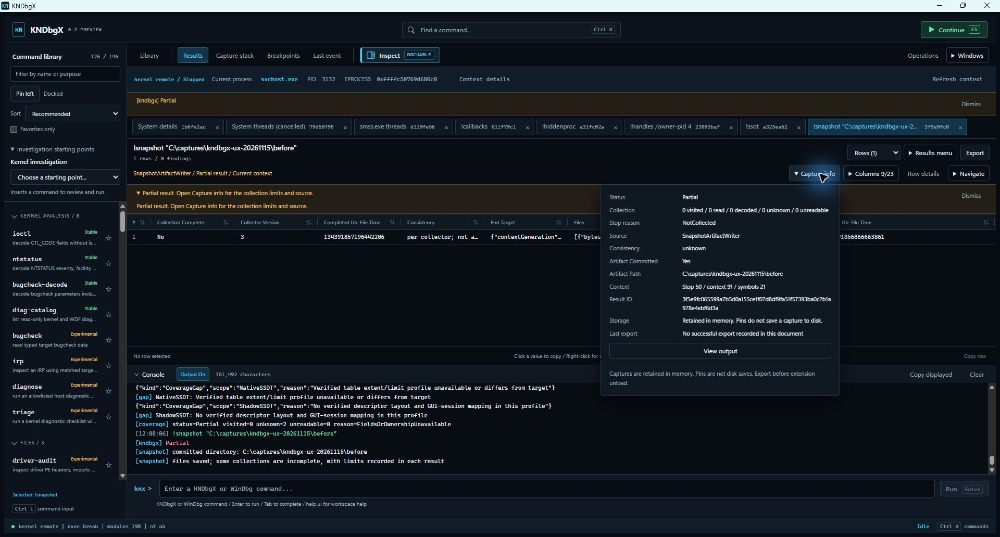

The save result is a receipt for the bundle, not a count of captured kernel objects. Snapshot v2 stores processes, modules, callbacks, SSDT, IDT, control registers, HAL and unloaded-driver events as structured collections, with a manifest and SHA-256 checksums. It does not include raw memory. Collection is sequential and not atomic across collectors.

Different session identities require the explicit `/cross-session` option:

```text
!diff "C:\captures\before" "C:\captures\after" /cross-session
```

<details>
<summary>See the default session-identity guard</summary>

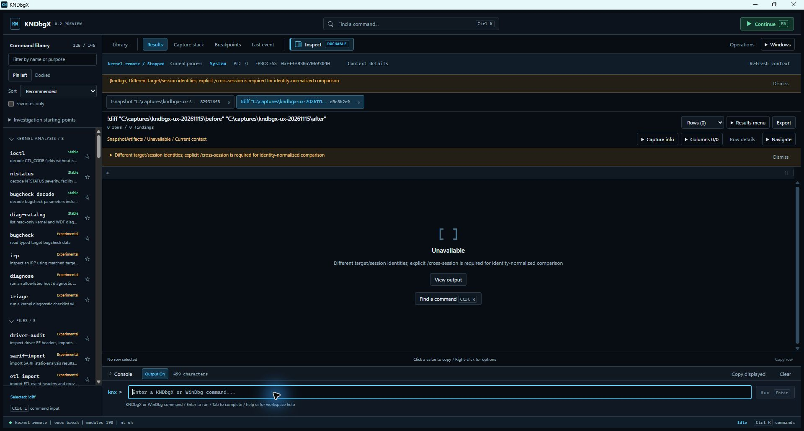

</details>

Click **State** to sort the comparison. The example retains **1,551 rows**, with **1,534 Unknown** and 17 Unchanged. A finished comparison can still be Partial because its inputs or identities are incomplete.

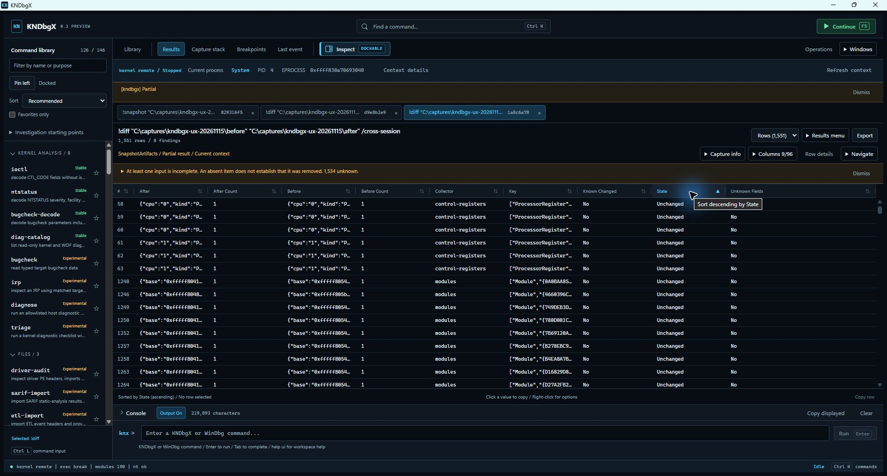

The captured example spans a debugger session reinitialization. It is a cross-session comparison, not evidence that one intervening action caused every difference. Process identities and unloaded-driver events remain incomparable across sessions. Missing identities or incomplete inputs prevent unsupported Added/Removed claims; inspect **Unknown** and coverage gaps as part of the result.

<details>
<summary>Inspect the before and after records</summary>

Select a row and open **Row details** to inspect **before**, **after**, their counts and **knownChanged**. Offline comparison rows do not bind their saved addresses to the current live target.

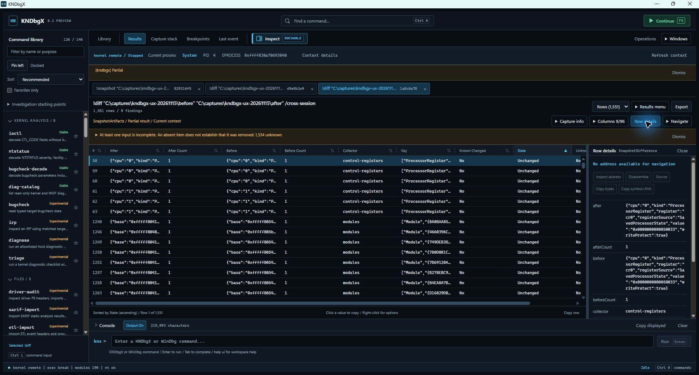

</details>

### Audit a driver file

Find `driver-audit` in **Library / Ctrl+K**, supply a file on the debugger host and select **Run**, for example `driver-audit "C:\evidence\driver.sys"`. No guest driver installation is required. The result separates file identity, PE metadata, mitigation declarations, section properties, imports and embedded-signature policy into rows.

Use **Columns** to select the fields needed for the question, then select a row and open **Row details** for fields that do not fit the table. **FileEvidence** records the supplied path and hash; match that evidence to the target before correlating it with loaded modules.

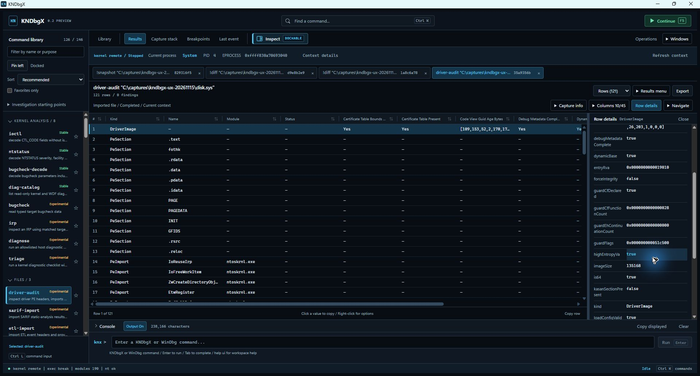

This example reads a copy of the host's `disk.sys`, producing **121 rows**. Its association with the guest's loaded driver is unverified. The selected **DriverImage** row exposes fields such as `dynamicBase`, `guardCfDeclared` and `highEntropyVa`; section and import rows remain available in the same result.

PE flags are declarations in the supplied file, not proof that a mitigation is active in the running target. Embedded-signature verification uses the host's cached policy without revocation checks. It does not verify catalog signing, target kernel signing policy or trust on another machine; **NoEmbeddedSignature** does not mean that a driver lacks a valid catalog signature.

<details>
<summary>Read the embedded-signature result and its scope</summary>

Select the **EmbeddedSignature** row and inspect **interpretation**, **scope**, **catalogChecked** and **revocationChecked**. This file reports **TrustedByHostPolicyWithoutRevocation**, while both of those additional checks are false.

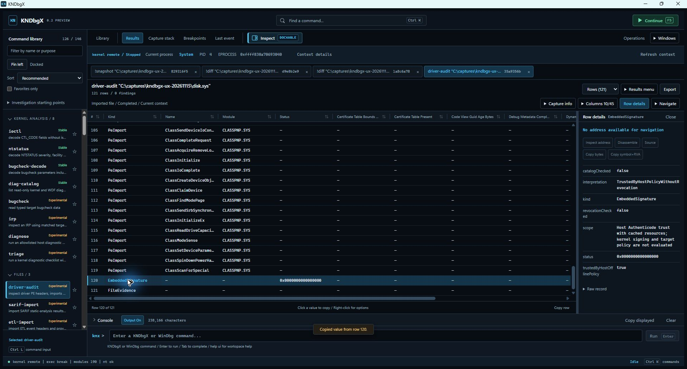

</details>

### Inspect driver dispatch and loaded-image metadata

Run `!driver` to find driver objects, then inspect an observed name or address with `!drvobj`. The example uses `!drvobj \Driver\fvevol` and completes with 34 rows covering the object, MajorFunction slots and device chain. A partial namespace walk cannot establish that an unlisted driver is absent.

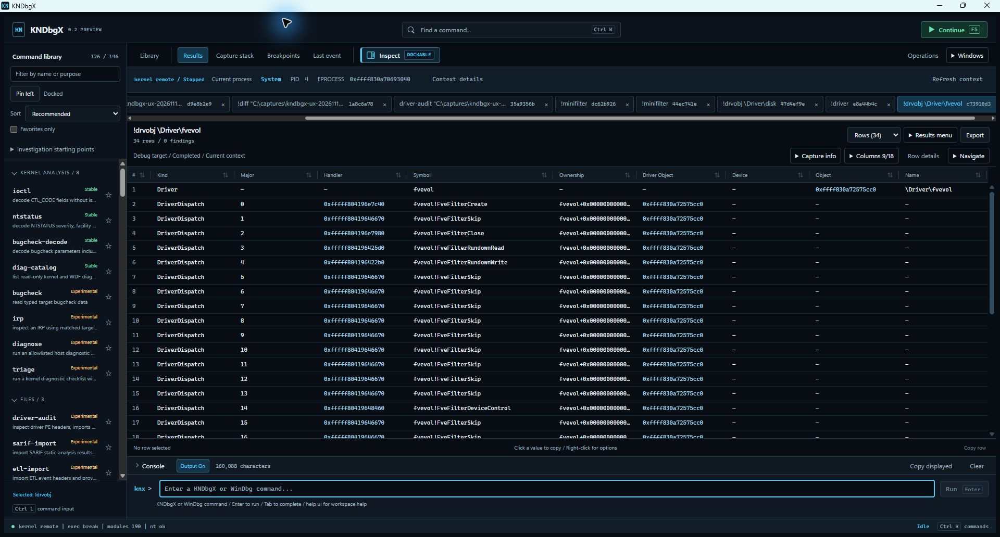

**handler** is the dispatch address, while **ownership** describes the loaded module range containing it. Shared dispatch implementations can legitimately belong to another module.

Use `!module fvevol` for the loaded image's PE identity and static section metadata. This reads target memory; `driver-audit` instead reads a supplied host file. `/disk` comparison is restricted to verified local KD and is not used for this remote guest.

<details>
<summary>Inspect the loaded image's static section flags</summary>

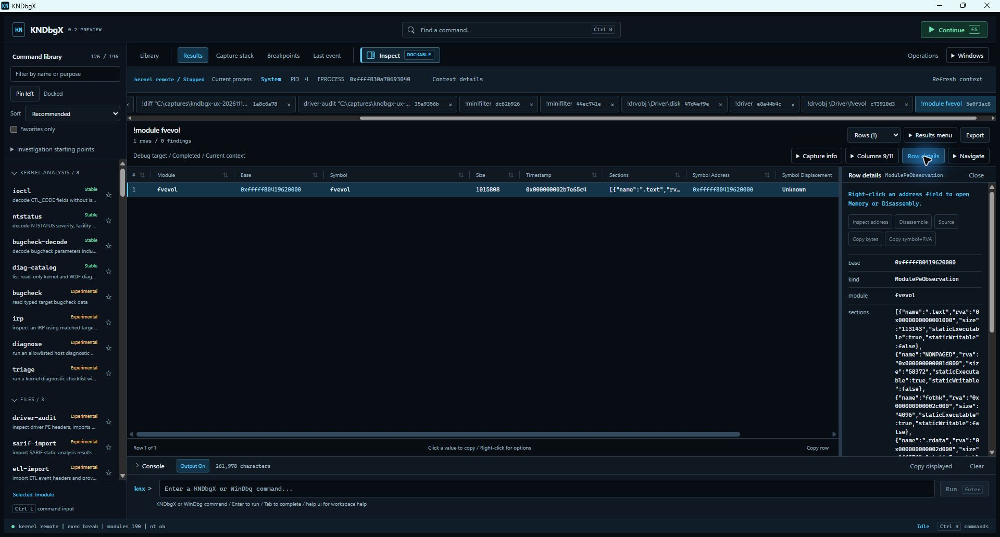

</details>

### Compare VAD protection with page samples

Select a process in **Inspect > Processes** and open **Memory (VADs)**, or find `!vad` and supply an explicit process selector. To include page-table observations, use a draft such as `!vad image:smss.exe /hiddenpte /limit 32` after confirming that image in the current inventory.

Select a VAD and open **Row details**. **pageProtection** and **executableByVad** describe the VAD; **pageSamples** records the observed writable/executable bits and **vadMismatch** for sampled pages. Unavailable samples remain Unknown. This does not switch the debugger's address space.

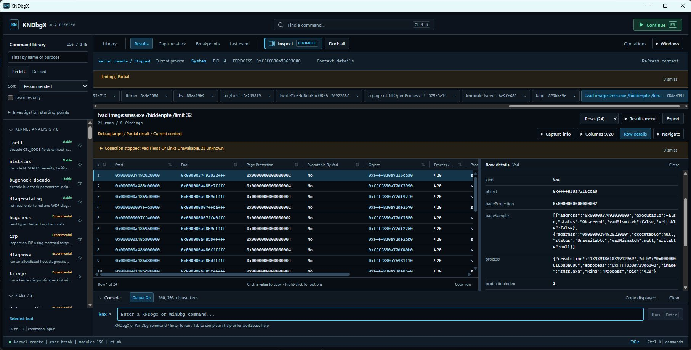

This capture retains 24 VAD rows with Partial coverage and 23 unknown observations. In the selected row, one page sample is Observed and the other is Unavailable; the latter is not converted into a non-executable or unmapped verdict.

`/hiddenpte` checks only the first and last pages of each VAD, up to 256 sampled pages. It does not search for every mapping outside the VAD tree. `/exec` and `/limit` control console display; the retained result and export still contain all collected VAD rows. With `/hiddenpte`, the console also shows non-executable regions for comparison.

### Inspect page permissions for a chosen range

Run `!kpage nt!NtOpenProcess L4` to inspect four pages starting at the page containing that symbol. The count after `L` is hexadecimal. **va**, **pa**, **dtb**, **writable** and **executable** show each translation; **error** explains a failed walk. Use the DTB from the intended process context when examining user addresses.

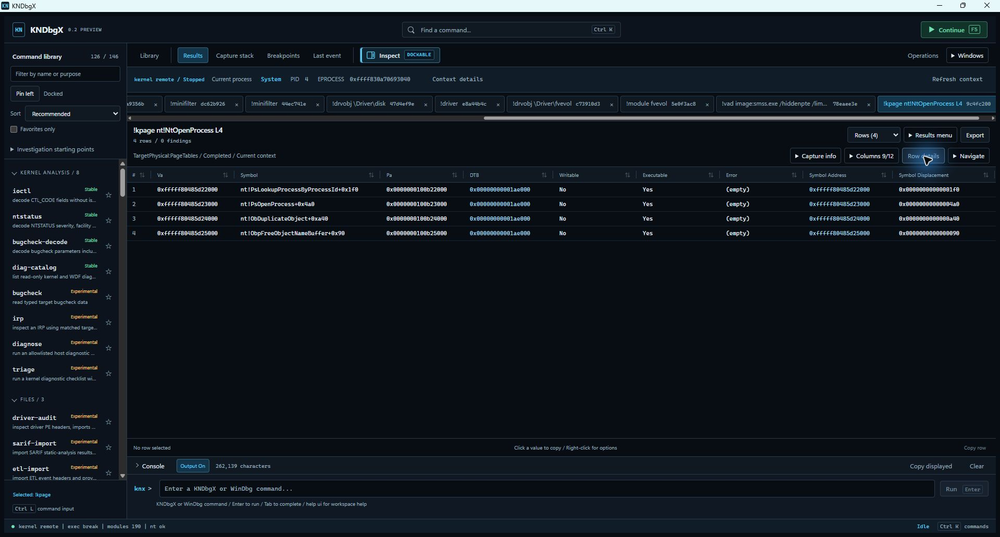

All four page translations in this capture completed and reported executable, not writable. Each row is page-aligned, so its nearest symbol can differ from the expression that selected the range.

These permissions come from page-table entries, unlike static PE section flags. An unavailable walk does not establish that memory is unmapped, and readable pages do not establish allocation ownership or lifetime.

### Inspect big-pool allocations and W+X samples

Find `!pool` and use `!pool big /wx /limit 16` to collect big-pool allocations with permission samples. Remote KD reads the target's `PoolBigPageTable` using verified layout information. Use an observed four-character, case-sensitive `/tag`, hexadecimal `/min` and `/max` byte sizes, or `/addr` to narrow matching allocations.

Select a row and compare **wxObserved**, **inspectedPages**, **unavailablePages**, **skippedPages** and **rangeClassified**. `/wx` samples the first page of each matching allocation; it does not filter the result to W+X rows. `/full` requests all pages within the global time/page budget. `/limit` caps console output, not the retained rows.

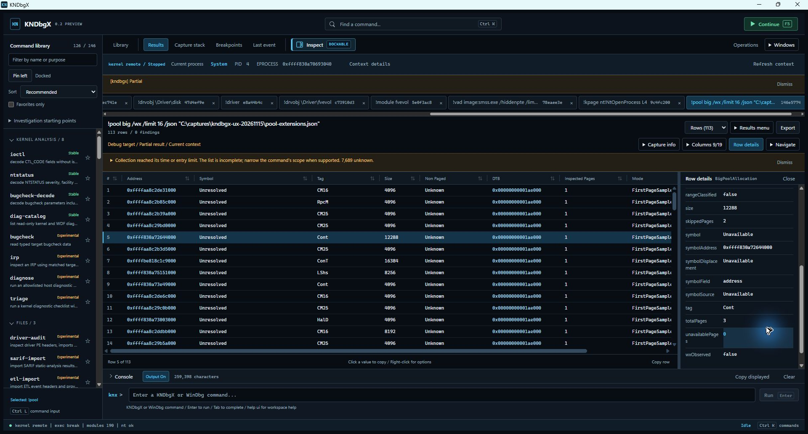

This capture retained 113 allocations before reaching its collection budget. The selected three-page allocation has one inspected page, two skipped pages and **rangeClassified: false**. Its **wxObserved: false** applies only to the inspected page. The Partial banner describes collection-wide gaps; Row details describes the selected allocation's coverage.

`!payload` uses this same big-pool collector with permission sampling. A false first-page W+X sample does not clear the remaining allocation, and a true sample does not by itself establish a malicious payload. Small-pool allocations are outside this inventory.

### Review per-CPU IDT and control state

Run `!idt` to retain the decoded IDT gates for each available CPU. Compare **cpu**, **vector**, **present**, **validGate**, **dpl**, **routine** and ownership. The descriptor comes from PDB-verified saved processor state; the collector does not switch the debugger CPU.

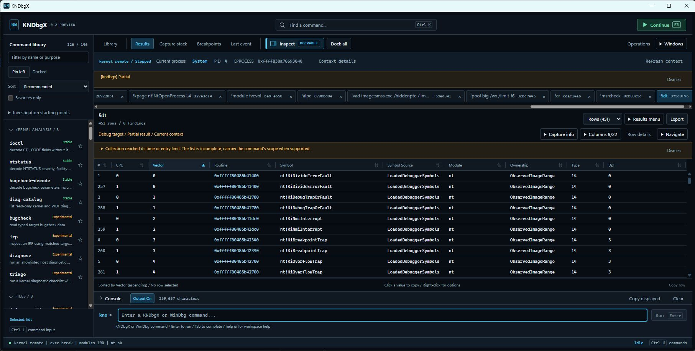

Click the **Vector** heading to bring matching vectors from different CPUs together. This capture retained 368 gates with Partial status after its collection budget was reached. Matching visible handlers do not establish that every vector was inspected; check **Capture info** before drawing a coverage conclusion.

Run `!cr` to view each CPU's saved CR0, CR4 and CR8 in a single result. **writeProtect**, **smep**, **smap** and **la57** decode relevant bits when values are available. Legitimate per-CPU differences and stale saved state must be considered before interpreting a difference.

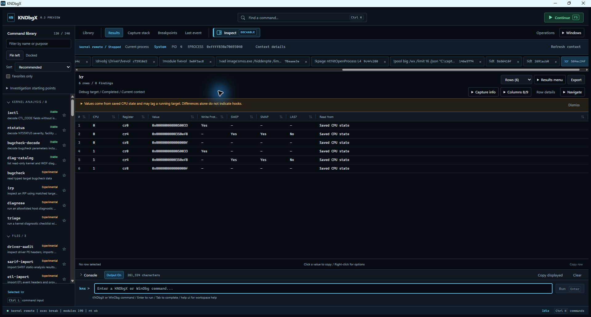

The six completed rows here cover three registers on each of two CPUs. **Read from: Saved CPU state** identifies the source; these rows are not a live read of every processor at the instant the table is viewed.

`!msrcheck` is a separate current-event-CPU observation of LSTAR, CSTAR, STAR, FMASK and EFER. Other CPUs remain Unknown; it does not silently switch CPUs or establish hook absence.

### Inspect ETW logger metadata

Run `!etw` to inspect logger contexts in the target's host silo when its layout can be verified. Compare **name**, **loggerId**, **rawClock**, **clockType** and **clockRepresentation**. Integer clock selectors are decoded only with a verified profile; other values retain their raw representation.

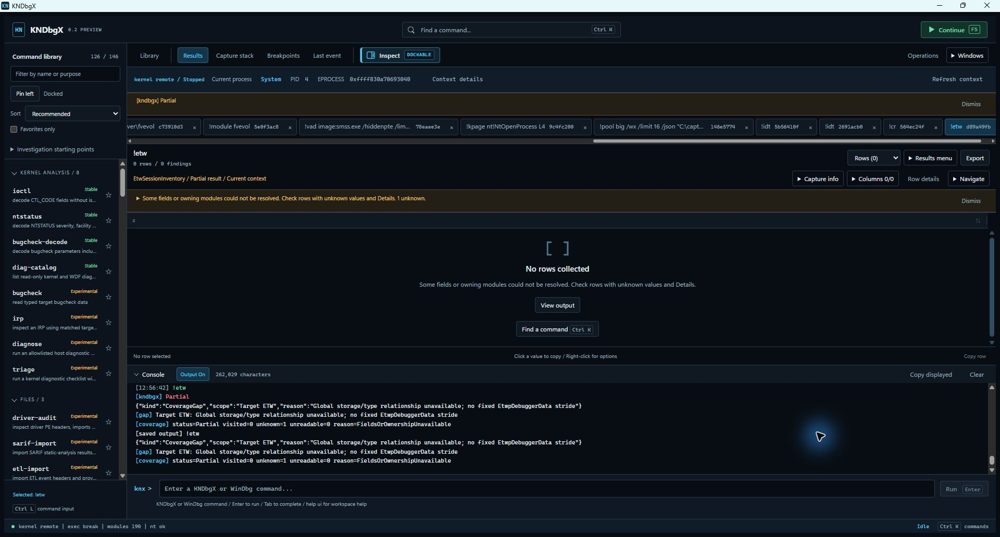

On this target the collector could not verify the global storage/type relationship, so it retained zero rows, one unknown observation and Partial status. **View output** exposes that reason. This capture does not demonstrate a successful logger inventory, and an empty table does not mean that ETW is inactive.

This is logger metadata, not an event trace or a system-wide ETW integrity verdict. It neither starts tracing nor substitutes the debugger host's logger list for a remote target. `etl-import` reads an existing host ETL file when recorded events are needed.

### Run a diagnostic checklist

Choose `diag-catalog` in **Library**, then select **Run** to browse 53 fixed diagnostic recipes, their purpose, operand and native command. Use `diagnose <recipe>` for one recipe or `triage devices` for the storage, USB and PnP checklist. Other profiles cover crash, hang, I/O, power, memory, network and WDF; WDF requires a module operand.

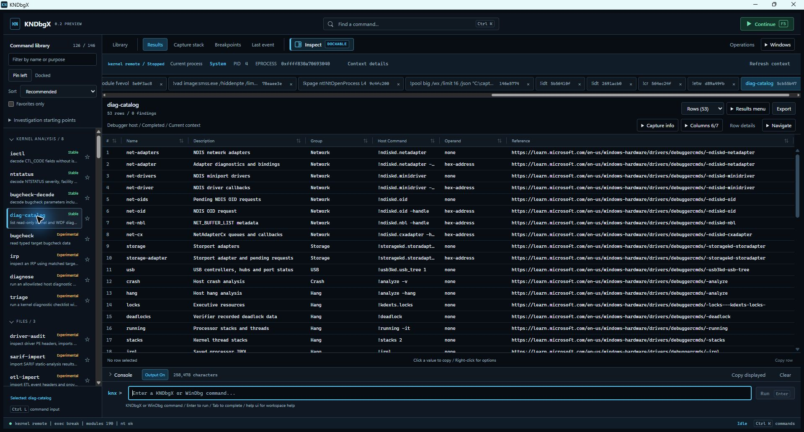

These recipes call existing WinDbg extensions. KNDbgX adds the checklist, retained step records, captured output and context-restoration status around those calls.

Select a **DiagnosticStep** to see whether it was attempted, then a **HostDiagnostic** row for **engineAccepted**, **contextRestored**, **outputTruncated** and the saved output. **View output** opens the collected native text. Partial is expected for unparsed native output; engine acceptance does not prove that a native extension found complete data. Missing extensions, symbols and skipped steps remain visible.

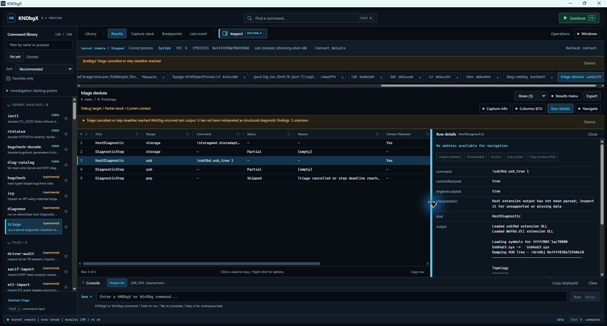

This run attempted storage and USB, retained both outputs with **contextRestored: true**, and skipped PnP after the step deadline. The 30-second deadline is checked between calls; an active native extension call can run longer. This run finished after about 77 seconds without a cancellation request.

<details>
<summary>Read the saved native output</summary>

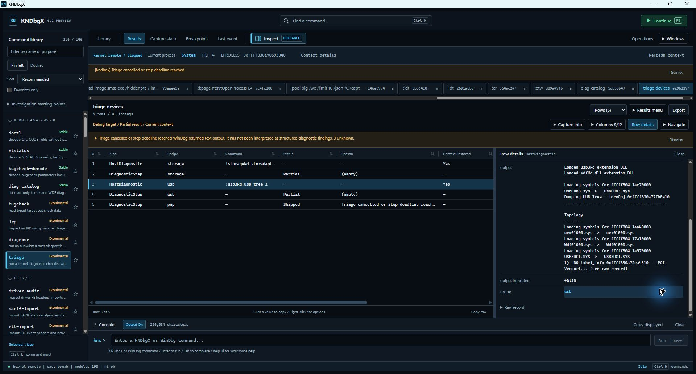

Drag the Row details divider to widen the text. Long field previews may end with **see raw record** even when **outputTruncated** is false. Expand **Raw record**, use **View output**, or export the result to inspect the retained text. The capture limit and the on-screen preview limit are separate.

</details>

### More starting points

Find these entries in **Library** or **Ctrl+K**, review the inserted draft, then select **Run**. Commands that need an object address or host file leave that operand for you to supply.

- **Process objects:** `!process 0`, `!threads` and `!token` provide object-level details alongside the cross-view, handle and VAD workflows above.
- **Device stacks:** `!devstack` follows an observed device stack. Missing layouts or pages reduce coverage; `module+RVA` is the fallback when a verified symbol name is unavailable.
- **Crash and I/O records:** `bugcheck` reads target bugcheck data, `irp <address>` inspects an observed IRP, and `ioctl <code>` / `ntstatus <code>` decode supplied values.
- **Recorded evidence:** `sarif-import` and `etl-import` read existing host files. Match artifact identity to the target before correlation. ETL import does not start tracing, and imported analyzer results are not independently confirmed defects.
- **Memory export:** `dump-raw` exports a bounded range; `dump-pe` exports a mapped PE with sections at virtual offsets, not a reconstruction of the original disk file. Unreadable requested bytes prevent publication of the output file.

Use `help <command>` for operands; `jobs`, `job <id>` and `cancel <id>` provide command-based job inspection and cancellation too.

## Find and run commands

1. Open **Library** or **Find a command / Ctrl+K**. Search by name, alias or purpose; the example below searches for `callback`.
2. Choose an entry to insert an editable draft. Fill any required operands. **Tab** completes registered syntax and loaded symbols without executing anything.
3. Press Enter or **Run** to collect a result. The new result opens in a tab, leaving earlier captures available.

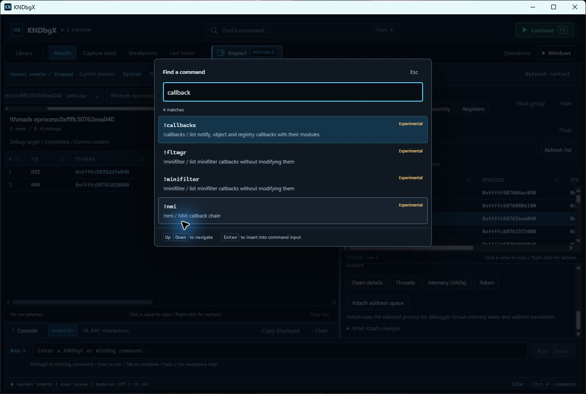

**Library > Investigation starting points > Kernel investigation** offers drafts for common kernel investigations. **Up/Down** selects suggestions or browses command history; returning past the newest entry restores the unfinished draft. Use `help <command>` or `help ui` for built-in help.

**Library > Pin left** keeps the Library beside Results and Inspect. Narrow windows temporarily use an overlay. Command selection closes an overlay and focuses the draft; a pinned Library stays open. Favorites, group folding and sort preferences persist when browser storage is available. **Windows > Restore adaptive layout** resets placement without clearing captures or drafts.

Registered names always use KNDbgX validation. Other commands entered manually in the UI, including `.reload` and external extension commands, go directly to WinDbg and can change the target or host without a KNDbgX preview. CLI and background jobs require `raw --ack-effects <command>` for opaque execution.

## Inspect results

Each retained result opens a tab. Double-click a tab or press F2 to rename it, drag to reorder, and use the tab menu to close tabs. **Rows / Findings**, **Capture info**, **Row details** and **View output** show the collected records, coverage, raw fields and saved console output. Selecting a tab or changing its columns/sort order uses saved data.

Use **Columns** to keep the fields relevant to the current question. Here, Callback type, Routine / Pre and Symbol / Pre are selected. Hidden columns remain in the retained result and its export.

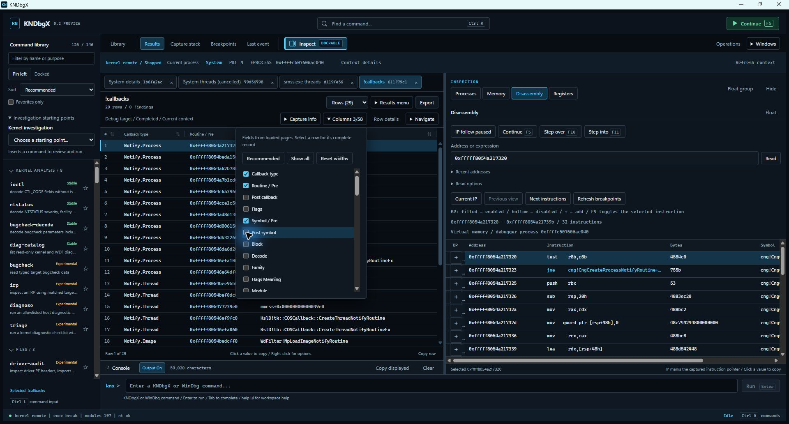

Click a cell to copy its full value, or use its context menu for row JSON. Right-click a recognized address for **Open Memory / Open Disassembly**. Callback rows offer Routine, Pre and Post addresses separately. Navigation checks the original result and process context; historical, expired or mismatched captures cannot start target reads. Offline file and diff results do not acquire current-target address bindings.

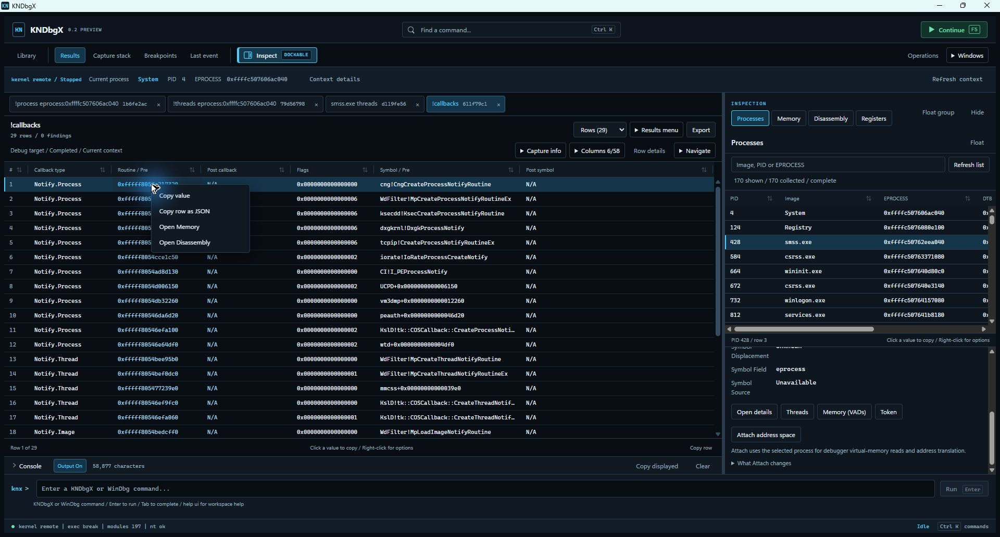

**Inspect / Ctrl+M** opens Processes, Memory, Disassembly and Registers beside Results. **Row details** is a separate result pane. Hiding a view retains its capture; failed refreshes keep the previous data with a notice.

### Floating inspection windows

Each view's **Float** opens a separate native window. **Dock** or that window's close button returns the view to Inspect. **Float group** detaches the tab group; closing the group hides it, and **Inspect** reopens it. Independent views and the group can coexist.

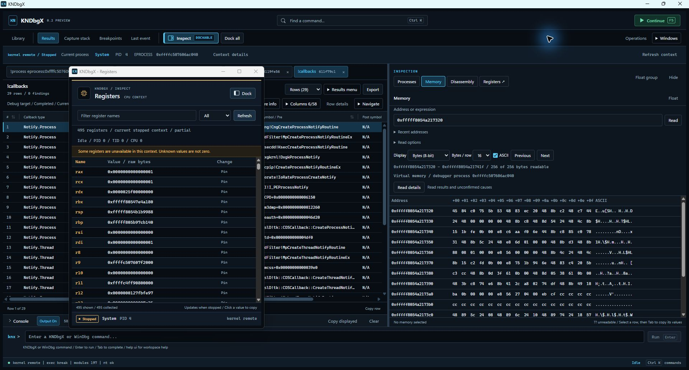

Drag a native title bar onto a workspace or group docking guide to dock. **Windows > Dock all views** restores the individual views; **Bring windows into view** recovers off-screen/minimized windows. Docking preserves drafts, selection, scroll positions and captured data. All windows share one debugger context and execution slot. Floating placement does not survive document recreation or DLL unload.

### Processes tab

Open **Inspect > Processes**, select a row, then choose **Open details**, **Threads**, **Memory (VADs)** or **Token**. The screenshot shows a completed thread result for the selected process; its tab has been renamed to keep it recognizable.

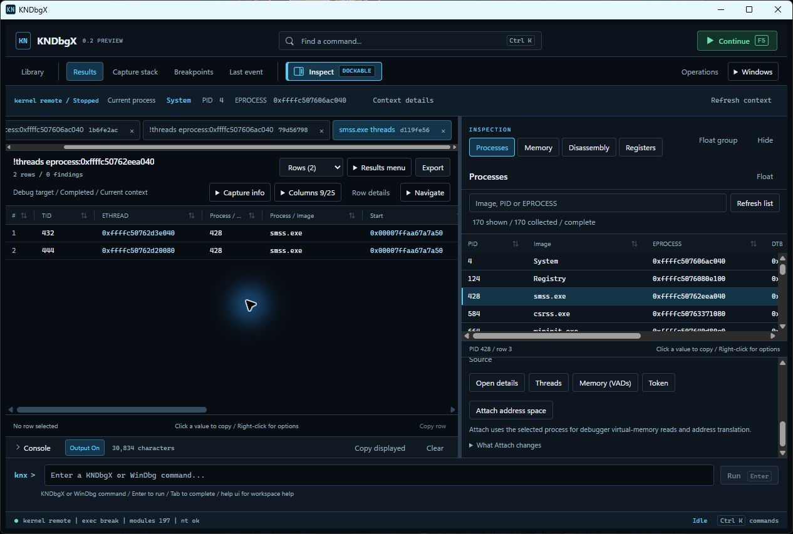

The kernel process inventory refreshes on first use and after context changes while visible. Search or sort by image, PID, EPROCESS, DTB and creation time. A name selector requires a complete inventory; use an observed `pid:PID` or `eprocess:ADDRESS` when collection is partial.

Selecting a row does not switch the debugger context. **Attach address space** requires a stopped x64 remote kernel or kernel dump and readable process identity. It changes the implicit process address space after verification; it does not select another register thread/CPU, resume execution or reload user symbols. `procctx` changes the translation DTB only.

### Memory tab

Open an address from a result, or enter an address, symbol or expression directly. Expand **Read options** for Virtual/Physical and byte count, then use **Read**. Display width, bytes per row and ASCII controls use the captured bytes. `??` denotes unavailable bytes.

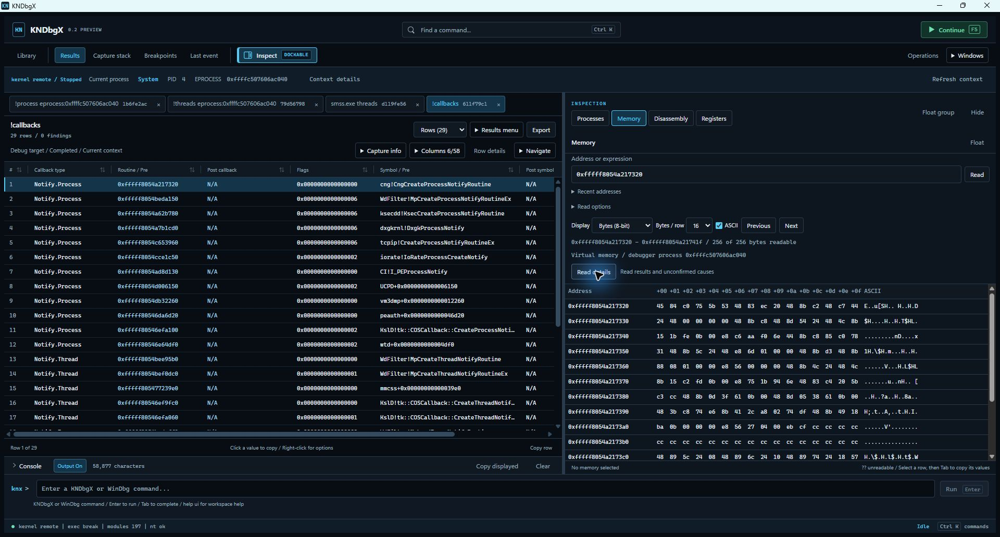

**Read details** shows saved ranges, transferred counts and native errors without another target read. This capture read all 256 requested bytes. Readability alone does not establish pointer validity, allocation lifetime or ownership; a failed read does not establish why a page is missing.

<details>
<summary>View the saved read-details panel</summary>

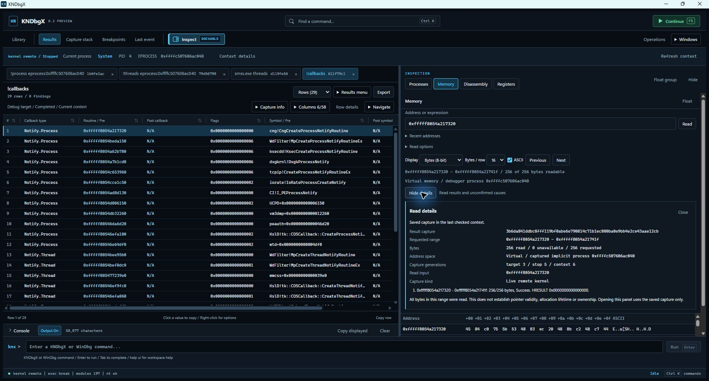

</details>

Previous/Next moves by the captured range. Editing the address, space or size requires a new successful read before range navigation. Context changes retain the previous capture as historical. Virtual reads use the debugger's selected process; a `procctx` translation override does not change that address space.

Memory and Disassembly each keep up to 20 completed manual expressions in **Recent**. Selecting an entry performs a new read in the current stopped context; restoring settings alone does not read memory.

### Disassembly tab

Enter an expression or use **Current IP**, then choose an instruction count. **Next instructions** follows the decoded boundary; **Previous view** restores a capture without rereading. Failed reads retain the previous view.

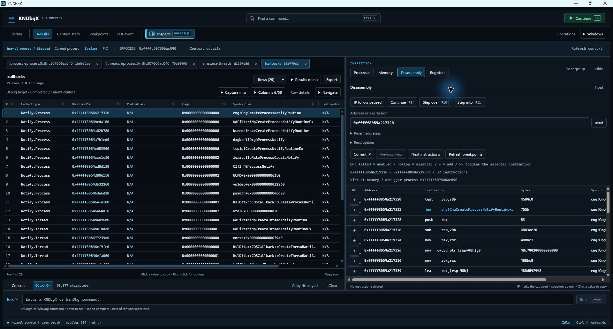

**Follow IP** refreshes at new live stops. Manual browsing pauses following; Current IP or Follow IP resumes it. F10/F11 step over/into when Disassembly is visible and a KNDbgX window has focus. Symbol loading or another DbgEng operation can delay these reads.

### Registers tab

Registers refreshes on first use and at new stopped contexts while visible. Filter by name or **All / Pinned / Changed**, pin names, copy scalar values or raw vector bytes, and use **Refresh** to retry a failed capture. Changed values compare captures from the same thread/CPU context; unavailable values are never substituted with zero.

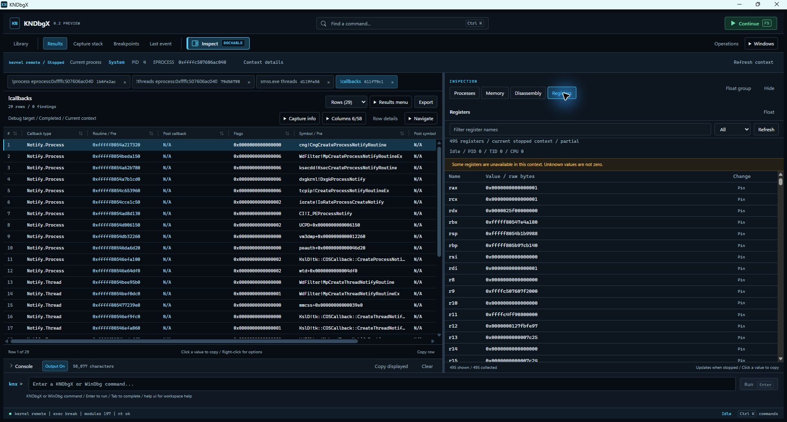

The example is Partial because some registers are unavailable in this stopped context. Its register identity is shown independently of the workspace's selected process and address space.

The summary identifies the captured process, Windows PID/TID and CPU when available. Selecting or attaching a process does not change the register thread/CPU. Running, stale or failed captures retain their own identity and notice. `registers` / `r` creates a separate command-result snapshot.

## Context, symbols and waits

**Context details** separates the selected process row, implicit address space, debugger thread/CPU, scope and last event. Opening it shows cached observations; **Refresh context** requests an update. External `.trap`/`.cxr` origins can remain Unknown.

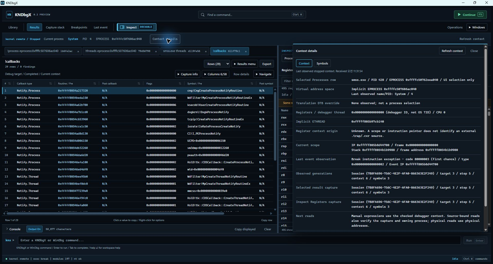

To inspect symbols, open **Context details > Symbols**, choose **Read modules**, select a module and use **Inspect selected module**. Type/Field are optional simple names, such as `_EPROCESS` and `UniqueProcessId`. Load state, image/PDB match and type availability are separate observations. A matching public PDB can still lack a private field. **Insert reload draft** only inserts `.reload /f <module>`; it does not execute it.

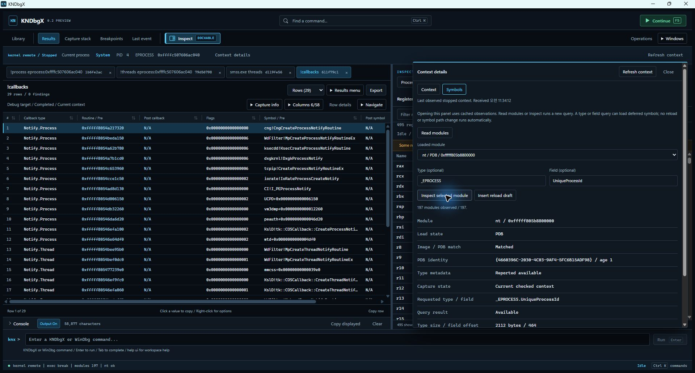

In this capture, the kernel image/PDB match is Matched and the requested field is Available. These are observations for the selected module and capture, not a guarantee for other Windows builds or types.

**Operations** shows observed stages, elapsed time, cancellation state and retained outcomes. It cannot identify DbgEng's internal wait cause. **Pause automatic inspection reads** pauses Processes, Registers and Follow IP refreshes while retaining manual reads. A pending native call must return before cooperative cancellation can take effect.

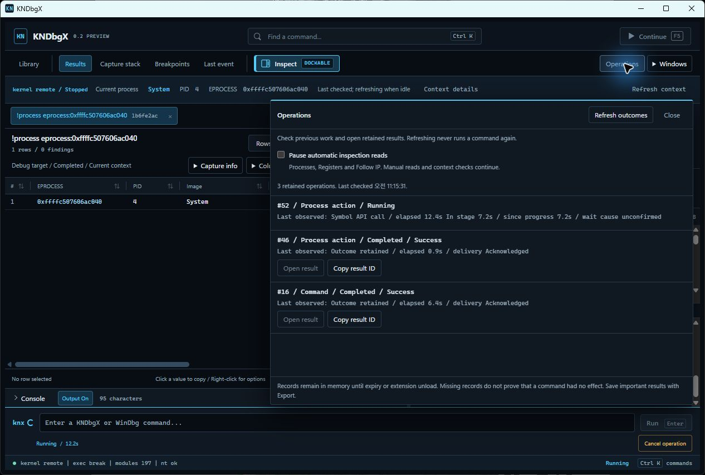

The thread collection below was cancelled after a long native call. Its retained rows remain useful for inspection, but **Capture info** records the cancellation and incomplete coverage. Do not treat those rows as a complete inventory.

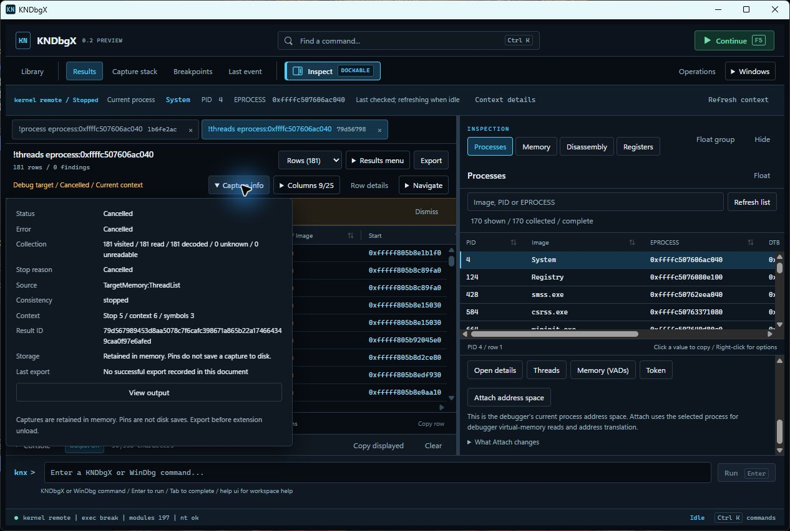

## Execution and changes

The header's **Continue / Break** controls a supported live user or remote-kernel target. F5 continues; F9 in Disassembly toggles an existing code breakpoint or opens an addition preview. **Break** interrupts target execution; **Cancel operation** requests cancellation of workspace work. An acknowledged interrupt or cancellation is not proof of completion. Dumps and local KD cannot use target writes or execution controls.

**Breakpoints** lists current settings. Add/Delete requires preview approval; Enable/Disable applies a context-bound action on click. **Last event** is separate from the current breakpoint settings; a setting address does not establish the historical hit IP.

In Disassembly, select **+** beside an instruction to open its addition preview. Check the target and operand before choosing **Add this breakpoint**. **Cancel** leaves the target unchanged. The screenshot was captured at the preview and then cancelled.

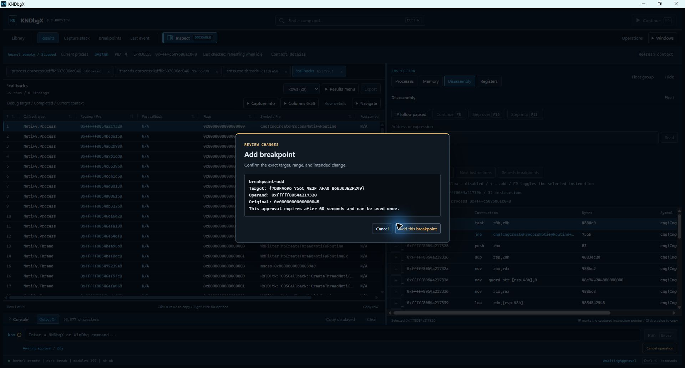

Registered memory changes also require a complete preview and one-use approval. Plans expire after 60 seconds and recheck context and original bytes. There is no global write switch. Partial writes report their ranges without automatic retry or rollback. The [command reference](COMMANDS.md) describes memory-change plans and their operands.

After **Continue**, retained results become Historical and inspection views keep their previous captures. Stop the target before making a new read; an old result does not acquire authority over the new context.

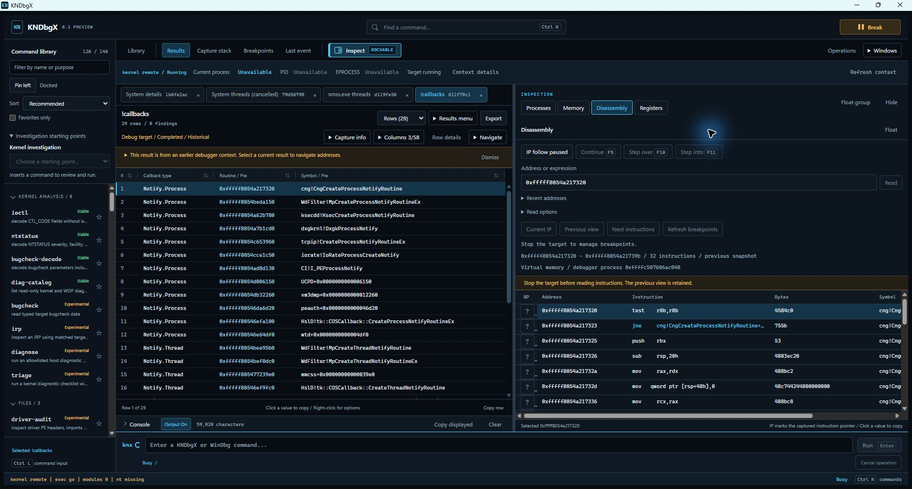

## Export and recovery

Select a result tab and choose **Export**. It saves the complete retained result, including rows outside the viewport and saved output, as a new JSON file under `%LOCALAPPDATA%\kndbgx\logs`. The success notice identifies the destination; **Capture info > Copy saved path** retrieves it later. The callback result illustrated above was exported and its 29 rows were verified in the saved file.

To choose another destination, use `result-export <result-id> "C:\captures\result.json"`; `results` lists retained IDs. A failed save reports the destination and error; retry with another writable path while the result remains retained. **Output Off** suppresses new console text without discarding retained results.

**Operations > Refresh outcomes** queries completion records without replaying commands or saves. Open result retrieves retained content, and Copy saved path uses a confirmed export path. Missing or expired outcomes remain Unknown; inspect results/files before resubmitting an operation.

Up to 16 unpinned recent results and 128 protected open-tab results share 64 MiB. Closing tabs releases protection; export important data before eviction or unload. Operation records have their own bounded lifetime and also end at DLL unload.

Closing the main window preserves the workspace in the loaded extension; bare `!kndbgx` reopens it. `!kndbgx shutdown`, DLL unload or document recreation releases captures and tabs. Layout preferences persist separately when browser storage is available. **Retry UI** creates a fresh UI after initialization failure without replaying commands.

## Shortcuts

- Ctrl+K / Ctrl+Shift+P: find a command; Ctrl+L: focus input.
- Ctrl+B / Ctrl+J / Ctrl+M: toggle Library, Console or Inspect.
- F5: continue; F9: breakpoint action; F10/F11: step with Disassembly visible.
- F2 on a result tab: rename; Ctrl+Shift+Left/Right: reorder.
- Shift+F10: context menu; Escape: dismiss a menu or cancel an edit/preview.
